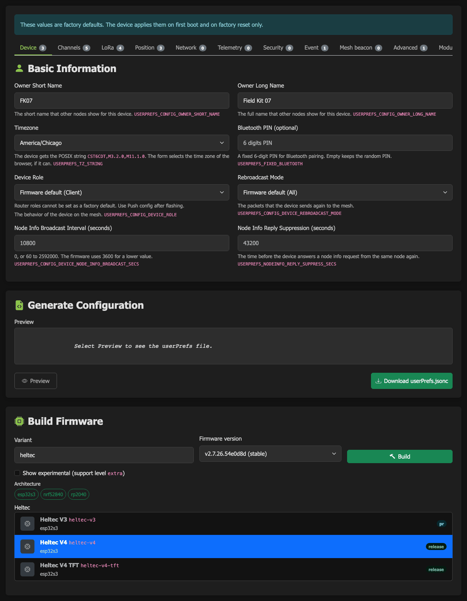
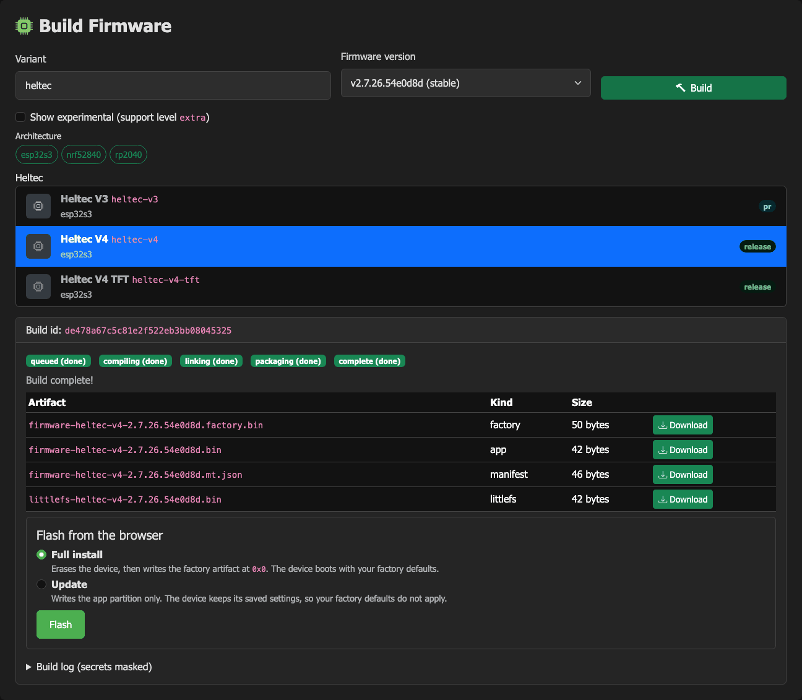

<h1 align="center">MTFWBuilder</h1>

<p align="center"><b>Meshtastic UF2/Bin firmware builder and userPrefs.jsonc configuration GUI.</b> Self-hosted, with flashing and push config in the browser.</p>

<p align="center">
  <a href="https://github.com/Crank-Git/MTFWBuilder/actions/workflows/ci.yml"></a>
  
  <a href="LICENSE"></a>
</p>

<p align="center">
  <a href="#install"><b>Install</b></a> ·
  <a href="#quick-start"><b>Quick start</b></a> ·
  <a href="#documentation"><b>Docs</b></a> ·
  <a href="docs/deploy.md"><b>Deploy</b></a>
</p>

<p align="center">
  
</p>

## Why MTFWBuilder

I made MTFWBuilder because it's easy to have a GUI to build and flash these firmwares when
you need to flash a bunch of devices quickly.

You fill in the config form, and MTFWBuilder writes `userPrefs.jsonc` and compiles the
firmware with PlatformIO. Your settings become factory defaults: the device applies them on
first boot and on factory reset. From there you flash the build from the same page, and push
anything a userPrefs key can't hold to a running device.

- **Builds.** ESP32 variants give an app `.bin` and a `.factory.bin`. nRF52840, RP2040 and
  RP2350 variants give a `.uf2`.
- **Device list per firmware version.** It comes from `pio project config --json-output` on
  the installed firmware source, so it follows upstream with no list kept in this repo.
- **Browser flashing.** ESP32-family builds flash over Web Serial with esptool-js. Full
  install erases the device and writes the factory image at `0x0`. Update writes the app
  partition only. UF2 builds get the download and the bootloader steps.
- **Push config.** Connect over Web Serial or Web Bluetooth, see a diff of the device against
  a profile, pick the sections, and push. Router roles and the module settings go this way.
- **Module settings.** The Modules tab holds serial, store and forward, range test, external
  notification, neighbor info, detection sensor and paxcounter. They're saved in profiles
  and sent by push config, never compiled in.
- **Profiles and fleets.** Save the form as a profile. A fleet run makes one build per
  device in a fleet, and Download all gives one zip with a `manifest.csv`.
- **Channel share.** Import a channel URL or a `meshtastic --export-config` YAML, and export
  the channels as a URL and a QR code.

## Requirements

- **Docker** with Compose, or **[uv](https://docs.astral.sh/uv/)**. uv installs Python 3.13
  from `.python-version`; Python 3.14 is supported too.
- **Internet access from the server** when an admin installs a firmware version. The install
  downloads the firmware source from GitHub and the PlatformIO packages and toolchains.
- **A Chromium-based browser** for flashing and push config: Chrome or Edge on a desktop for
  Web Serial, or Chrome on Android for Web Bluetooth. The page must be on `localhost` or
  HTTPS. Building and downloading don't need either API.

## Install

### Docker

```bash
git clone https://github.com/Crank-Git/MTFWBuilder.git
cd MTFWBuilder
docker compose up -d
```

This builds the image and serves the app on port 5000. State lives in two volumes: `data`
(firmware sources, artifacts, the database and `config.yaml`) and `platformio` (PlatformIO
packages and toolchains).

### Manual

```bash
git clone https://github.com/Crank-Git/MTFWBuilder.git
cd MTFWBuilder
uv sync --no-dev
uv run uvicorn mtfwbuilder.main:app --host 0.0.0.0 --port 5000
```

`--host 0.0.0.0` listens on every interface. Use `--host 127.0.0.1` to keep it on this
machine.

## Quick start

1. **Set the admin password first.** Without one, it's `meshtastic`. Copy
   `config.yaml.example`, set `admin_password`, and restart:

   ```bash
   # Manual install
   mkdir -p data && cp config.yaml.example data/config.yaml   # edit admin_password

   # Docker
   cp config.yaml.example config.yaml                          # edit admin_password
   docker compose exec -T mtfwbuilder tee /data/config.yaml < config.yaml > /dev/null
   docker compose restart mtfwbuilder
   ```

   At startup the app hashes the password with bcrypt and removes the plaintext from the
   file. It also generates `secret_key` if you leave it at the example value.
2. **Install a firmware version.** Open `http://localhost:5000/admin`, sign in, and click
   **Install stable** (or **Install alpha**, or an exact tag). The install downloads the
   firmware source, runs `pio pkg install` for its platforms and toolchains, and reads the
   device list. The first install takes a while, which is normal: the limit is one hour.
3. **Build.** Open `http://localhost:5000/`, fill in the config tabs, search for your
   variant, pick the firmware version, and click **Build**. Progress streams live, and the
   artifacts are listed when the build completes.
4. **Flash in the browser.** For an ESP32-family build, choose **Full install** or
   **Update** and click **Flash**. Update keeps the device's saved settings, so your factory
   defaults don't apply. For a UF2 build, download the `.uf2` and follow the bootloader
   steps on the page.
5. **Push config.** Open `/push-config`, choose a profile, connect via USB or Bluetooth,
   review the diff, select the sections, and click **Push**. The device restarts after the
   commit.

<p align="center">
  
</p>

## Configuration

All state lives in the data directory: firmware sources, artifacts, the database and
`config.yaml`. `MTFW_DATA_DIR` sets it. The default is `data/` in the project root, and
`/data` in Docker.

`config.yaml` takes the settings in `config.yaml.example` (`admin_password`, `secret_key`,
build settings, logging). Each setting can also come from an `MTFW_<FIELD>` environment
variable, and [docs/external.md](docs/external.md) lists them. If `secret_key` changes, the
secrets stored in profiles don't decrypt anymore and must be entered again.

## How it works

| Part | Technology |
|---|---|
| Backend | FastAPI and uvicorn, one process |
| Pages | Jinja2 templates, htmx 2.0 and Bootstrap 5.3, vendored in `static/vendor/`, no JavaScript build step |
| Build progress | Server-Sent Events through the htmx SSE extension |
| Device registry | `pio project config --json-output` per firmware version, stored in SQLite ([ADR 0006](docs/adr/0006-registry-from-pio-config.md)) |
| Database | SQLite through aiosqlite: builds, firmware sources, the registry, profiles and fleets |
| Builds | PlatformIO, one compile per build ([ADR 0005](docs/adr/0005-compile-per-build.md)) |
| Flashing | esptool-js 0.7.1 over Web Serial |
| Push config | `@meshtastic/core` 2.6.7 with the Web Serial and Web Bluetooth transports ([ADR 0008](docs/adr/0008-meshtastic-js-library.md)) |
| Auth | bcrypt password hash and signed cookie sessions, CSRF token on every admin change |

## Documentation

| Page | Covers |
|---|---|
| [docs/api.md](docs/api.md) | Every `/api/v1` route. The running app also serves OpenAPI at `/docs`. |
| [docs/deploy.md](docs/deploy.md) | Docker production with nginx and HTTPS, upgrades, volumes, troubleshooting |
| [docs/external.md](docs/external.md) | `MTFW_*` environment variables and upstream services |
| [docs/adr/](docs/adr/) | Architecture decision records |
| [docs/specs/spec.md](docs/specs/spec.md) | The project spec and its feature pages |
| [CONTRIBUTING.md](CONTRIBUTING.md) | Project structure, tests, pull requests |

## Development

```bash
uv sync                                          # with the dev group
uv run python -m playwright install chromium     # browser for the E2E tests in tests/e2e/
uv run pytest                                    # tests, with a fake pio on PATH
uv run ruff check mtfwbuilder/ tests/            # lint
uv run ruff format mtfwbuilder/ tests/           # format
uv run uvicorn mtfwbuilder.main:app --reload --port 5000
```

Branch from `dev` and open the pull request to `dev`. See [CONTRIBUTING.md](CONTRIBUTING.md).

## Security

- **Change the default admin password.** With no `admin_password` in `config.yaml`, the
  password is `meshtastic` and the log warns about it.
- **The app listens on every interface.** The manual command above uses `--host 0.0.0.0`,
  and Docker publishes port 5000 on every host interface. Put it behind the nginx overlay
  ([docs/deploy.md](docs/deploy.md)) before you expose it.
- Admin passwords are stored as bcrypt hashes. Session cookies are HttpOnly and
  SameSite=Lax, and Secure when the request scheme is `https`.
- When a build ends, the project scrubs the firmware source: it deletes `userPrefs.jsonc`,
  `.pio/build_cache` and the `.pio/build/<env>/` directory of the build. A failed or
  cancelled build also scrubs. A config that holds a secret is never cached.
- Each build gets its own build directory. The periodic cleanup deletes one older than
  `build_max_age_seconds`.
- Subprocess calls take argument lists, never `shell=True`.
- Rate limits on sign-in and builds: `10/minute` (`MTFW_LOGIN_RATE_LIMIT`) and `5/minute`
  (`MTFW_BUILD_RATE_LIMIT`). Behind a proxy, set `MTFW_TRUSTED_PROXIES` so the limiter
  reads `X-Forwarded-For` from it.
- Uploads are capped at 64 KB. The artifact download serves only the names in the build's
  artifact list.

## License

GPL-3.0-or-later. See [LICENSE](LICENSE).

Built with FastAPI, htmx, Bootstrap, PlatformIO, esptool-js and `@meshtastic/core`.

---

<sub>Part of <a href="https://github.com/Crank-Git#off-grid-and-everything-else"><b>Off-grid and everything else</b></a>.
Siblings: <a href="https://github.com/Crank-Git/ATAK-Map-Downloader">ATAK-Map-Downloader</a> ·
<a href="https://github.com/Crank-Git/issue-flow-codex">issue-flow-codex</a> ·
<a href="https://github.com/Crank-Git/simpletetris">simpletetris</a> ·
<a href="https://github.com/Crank-Git/simplebubblebobble">simplebubblebobble</a> ·
Built by <a href="https://github.com/Crank-Git">Crank</a></sub>
