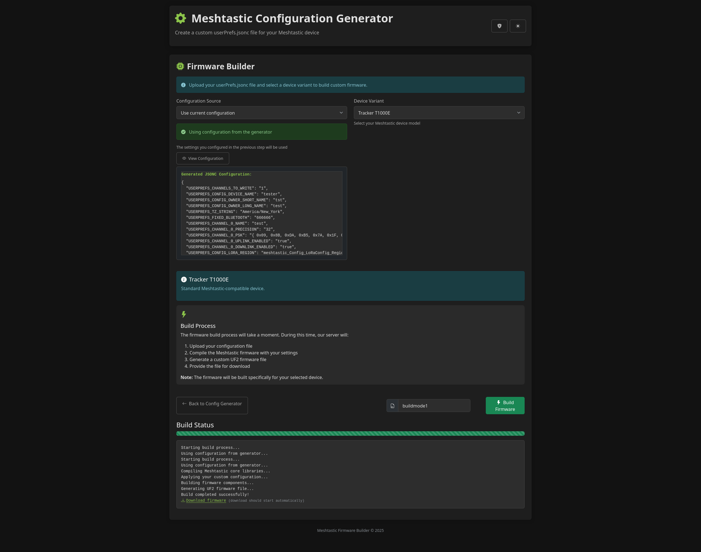

# MTFWBuilder

A self-hosted web application for generating Meshtastic device configurations and building custom firmware. Configure your device, bake settings into firmware, and download ready-to-flash binaries — all from one interface.



## Status

The v2 API under `/api/v1` exists. The pages still call v1 URLs, so the flow from the pages does not work end to end. Two planned features repair it:

- `build-pipeline-repair` (`docs/specs/features/06-build-pipeline-repair.md`)
- `frontend-htmx` (`docs/specs/features/07-frontend-htmx.md`)

In this README, "planned" marks a part that the code does not do yet. The spec in `docs/specs/` describes the planned project.

## What It Does

**MTFWBuilder is the only tool in the Meshtastic ecosystem that combines configuration generation with firmware compilation in a self-hosted package.**

- The official [Web Flasher](https://flasher.meshtastic.org/) flashes pre-built firmware
- The [Python CLI](https://github.com/meshtastic/Meshtastic-python) configures devices after flashing
- **MTFWBuilder bakes your config INTO the firmware before flashing**

### Features

- **Configuration Generator** — Web UI for building `userPrefs.jsonc` files with channel setup, LoRa settings, GPS, WiFi/MQTT, and more
- **Firmware Builder** — Compiles custom firmware via PlatformIO with your config pre-loaded
- **Device registry** — `devices/variants.yaml` lists the variants. The count of entries in that file is the variant count, and the startup log states it. ESP32 variants give `.bin` files. nRF52 and RP2040 variants give `.uf2` files.
- **Factory Binary Support** — ESP32 devices get both `firmware.bin` and `firmware.factory.bin`
- **Build progress (planned)** — The progress stream `GET /api/v1/build-progress/{id}` exists. The build page does not open it yet.
- **Admin Dashboard** — Firmware source management, system status, build cleanup. The sign-in form is planned.
- **Dark Mode** — Default dark theme with light mode toggle

## Quick Start

### Docker (recommended)

```bash
git clone https://github.com/Crank-Git/MTFWBuilder.git
cd MTFWBuilder
docker compose up -d
```

Open `http://localhost:5000`

### Manual

```bash
git clone https://github.com/Crank-Git/MTFWBuilder.git
cd MTFWBuilder
# uv installs Python 3.13 and the dependencies: https://docs.astral.sh/uv/getting-started/installation/
uv sync --no-dev
uv run uvicorn mtfwbuilder.main:app --host 0.0.0.0 --port 5000
```

### Configuration

The data directory holds all state: firmware sources, artifacts, the database and `config.yaml`. `MTFW_DATA_DIR` sets it. The default is `data/` in the project root, and `/data` in Docker.

```bash
cp config.yaml.example data/config.yaml
# Edit data/config.yaml — set admin_password and secret_key
```

At startup, the project moves a `config.yaml` in the project root to `data/config.yaml`. In Docker, `config.yaml` is `/data/config.yaml` in the `data` volume. The image does not copy a `config.yaml` from the project root.

If no `config.yaml` exists, the app auto-migrates from `config.json` (v1 format) or uses defaults. Plaintext passwords are auto-hashed to bcrypt on first startup.

`docs/external.md` lists every `MTFW_*` environment variable.

## Usage

The steps below are the flow that the planned repair gives (see [Status](#status)).

### 1. Generate Configuration

1. Fill in device name, owner info, timezone
2. Configure channels with encryption (PSK auto-generated)
3. Set LoRa region and modem preset
4. Configure GPS, WiFi, MQTT as needed
5. Preview and download `userPrefs.jsonc`

### 2. Build Firmware

1. Upload your `userPrefs.jsonc` or use the config you just generated
2. Select your device variant from the dropdown
3. Click **Build Firmware**
4. Download your custom firmware file

### 3. Flash Your Device

**ESP32 (.bin)** — Use the factory binary for best results:
```bash
esptool.py --chip esp32 --port /dev/ttyUSB0 --baud 921600 write_flash 0x0 firmware.factory.bin
```

**nRF52/RP2040 (.uf2)** — Put device in DFU mode, drag and drop the `.uf2` file.

### 4. Admin Panel

The `/admin` page shows the firmware source controls. The firmware update and the cleanup routes require an admin session, which `POST /admin/login` starts with the admin password from `config.yaml`. The page has no sign-in form yet (planned).

## Architecture

```
MTFWBuilder/
├── mtfwbuilder/                    # FastAPI application
│   ├── main.py                     # App factory, lifespan, middleware
│   ├── config.py                   # Settings (config.yaml, then MTFW_* env vars)
│   ├── auth.py                     # Bcrypt + signed cookie sessions
│   ├── database.py                 # SQLite schema. No route reads or writes it yet.
│   ├── models.py                   # Pydantic request/response validation
│   ├── rate_limit.py               # slowapi rate limiting
│   ├── routers/
│   │   ├── config_generator.py     # /api/v1/generate, preview, download
│   │   ├── firmware_builder.py     # /api/v1/build-firmware, SSE progress
│   │   ├── admin.py                # Login, firmware updates, cleanup
│   │   └── pages.py                # HTML page routes
│   └── services/
│       ├── jsonc_generator.py      # userPrefs.jsonc generation
│       ├── build_service.py        # Async PlatformIO build pipeline
│       ├── device_registry.py      # YAML device variant registry
│       ├── firmware_updater.py     # GitHub firmware source downloads
│       └── cleanup_service.py      # Build artifact and PSK cleanup
├── devices/variants.yaml           # Registry (the variant list)
├── templates/                      # Jinja2 templates (htmx planned)
├── static/                         # CSS, JS
├── tests/                          # pytest suite
├── data/                           # Data directory (MTFW_DATA_DIR). Not in git.
└── pyproject.toml                  # Modern Python packaging
```

### Tech Stack

| Component | Technology | Why |
|-----------|-----------|-----|
| Backend | FastAPI + uvicorn | Async builds, WebSocket-ready, auto OpenAPI docs |
| Frontend | Jinja2 + Bootstrap 5 (htmx planned) | Dynamic UI without a JS build pipeline |
| Build Progress | Server-Sent Events (SSE) | One-way progress, proxy-friendly. The build page does not open it yet. |
| Database | SQLite (aiosqlite) | Zero-config. Build history and profiles are planned. |
| Auth | bcrypt + itsdangerous | Hashed passwords, signed cookie sessions |
| Device Registry | YAML | Human-readable, git-diffable, easy to contribute |
| Build System | PlatformIO | Industry standard for embedded firmware |
| Python | 3.13 | `.python-version` and `requires-python` set it |
| Packaging | pyproject.toml + hatchling + uv | `uv.lock` pins every dependency |

### API

Auto-generated OpenAPI documentation at `/docs` when the app is running.

Key endpoints:
- `POST /api/v1/generate` — Generate config from JSON
- `POST /api/v1/preview` — Preview config without downloading
- `POST /api/v1/download` — Download `userPrefs.jsonc`
- `POST /api/v1/build-firmware` — Start firmware build
- `GET /api/v1/build-progress/{id}` — SSE build progress stream
- `GET /api/v1/builds/{id}/artifacts` — Artifact list of a build: `name`, `size`, `kind`
- `GET /api/v1/builds/{id}/artifacts/{name}` — Download one artifact from the artifact list
- `GET /api/v1/download-firmware/{id}` — Redirects (308) to the factory or primary artifact, for one release
- `GET /api/v1/system-info` — Firmware version and status

The three config routes validate the body with `ConfigRequest`. An invalid body returns
422 with field errors, for example `channel_0.psk`.

## Docker

### Development

```bash
docker compose up -d
docker compose logs -f
```

### Production

The production overlay puts nginx in front of the project and serves HTTPS. You need HTTPS for two reasons:

- The admin session cookie has the `Secure` flag unless `debug` is on. A browser does not send it over plain HTTP to a remote host.
- Web Serial works only on a secure page, so browser flashing (planned) needs HTTPS.

1. Copy the nginx config: `cp nginx/nginx.conf.example nginx/nginx.conf`.
2. In `nginx/nginx.conf`, set `server_name` to your domain.
3. Put the certificate in `nginx/ssl/fullchain.pem` and the key in `nginx/ssl/privkey.pem`.
4. Start the project with the overlay:

```bash
docker compose -f docker-compose.yml -f docker-compose.prod.yml up -d
```

To set the admin password, write your `config.yaml` into the `data` volume, then restart. The command runs as the container user, so the project can rewrite the file when it hashes a plaintext password.

```bash
docker compose exec -T mtfwbuilder tee /data/config.yaml < config.yaml > /dev/null
docker compose restart mtfwbuilder
```

### Volumes

| Volume | Mount | Purpose |
|--------|-------|---------|
| `data` | `/data` | The data directory: firmware sources, artifacts, the database and `config.yaml` |
| `platformio` | `/home/app/.platformio` | PlatformIO toolchains (~200MB per architecture), so a new container does not download them again |

## Security

- Admin passwords stored as **bcrypt hashes** (auto-migrated from plaintext)
- Session cookies: **httpOnly, SameSite=Lax, Secure** (unless `debug` is on)
- After a successful build, the project **scrubs** the userPrefs file and the firmware files from the firmware source. A failed build does not scrub yet, and `.elf` and object files keep the secret values (planned fix: `build-pipeline-repair`).
- Build directories **isolated** per build, cleaned after download
- All subprocess calls use **parameterized arguments** (no `shell=True`)
- **Rate limiting** on the login and build endpoints. The defaults are `10/minute` (`MTFW_LOGIN_RATE_LIMIT`) and `5/minute` (`MTFW_BUILD_RATE_LIMIT`).
- Behind a proxy, set `MTFW_TRUSTED_PROXIES` to the proxy addresses or subnets, comma-separated. The rate limiter then reads `X-Forwarded-For` from those proxies. The default is empty: the limiter counts the peer address.
- File uploads **checked** for size (64KB max) and UTF-8 encoding only
- **Path traversal protection** on firmware download endpoint

## Development

```bash
# Install with dev dependencies
uv sync

# Run tests
uv run pytest

# Run with coverage
uv run pytest --cov=mtfwbuilder

# Format
uv run ruff format mtfwbuilder/ tests/

# Lint
uv run ruff check mtfwbuilder/ tests/

# Dev server with hot reload
uv run uvicorn mtfwbuilder.main:app --reload --port 5000
```

See [CONTRIBUTING.md](CONTRIBUTING.md) for detailed contribution guidelines.

## Troubleshooting

**Build fails with "Firmware source not installed"**
- Go to `/admin` and click Update Firmware to download the source from GitHub

**Configuration not taking effect (ESP32)**
- Always use `firmware.factory.bin` — it includes bootloader and partition table
- Try a full erase first: `esptool.py --chip esp32 erase_flash`

**Build times out after 15 minutes**
- First build for each architecture downloads the toolchain (~200MB)
- Subsequent builds use cached toolchains and are much faster
- Docker: ensure the `platformio` volume is mounted

**Docker disk space issues**
- A build directory is deleted after its download.
- The project has no periodic cleanup task yet. With an admin session, `POST /api/v1/cleanup` deletes builds older than `build_max_age_seconds` (default 1 hour).

## License

GPL-3.0-or-later. See [LICENSE](LICENSE) in the repository.

## Acknowledgments

- [Meshtastic](https://meshtastic.org/) — The mesh networking platform
- [PlatformIO](https://platformio.org/) — Firmware build system
- [FastAPI](https://fastapi.tiangolo.com/) — Modern Python web framework
- [htmx](https://htmx.org/) — Dynamic HTML without JavaScript frameworks
- [Bootstrap](https://getbootstrap.com/) — UI components

## Related Projects

- [Meshtastic Firmware](https://github.com/meshtastic/firmware) — Official firmware
- [Meshtastic Web Flasher](https://flasher.meshtastic.org/) — Official web flasher
- [Meshtastic Python](https://github.com/meshtastic/Meshtastic-python) — Python API
