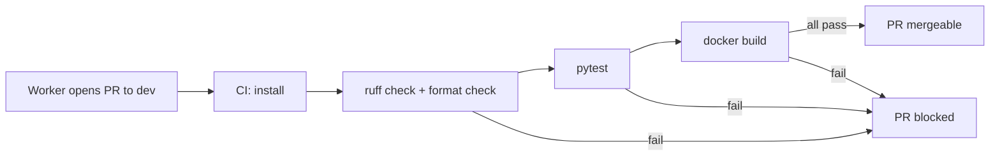

## Purpose

The foundation gives the loop the tools it needs: CI, the `dev` branch, lint rules, and
isolated tests. It also removes the v1 files and adds the license. The audit below lists
only the gaps. Items that exist already are not rebuilt.

| Epic 0 item | Found | Action |
|---|---|---|
| Repo scaffold | Present (`pyproject.toml`, `mtfwbuilder/`) | None |
| Test harness | Present: pytest, 106 tests | Isolate the tests (FR 4–5) |
| Lint / format | ruff and black configured, no complexity rules | Add rules (FR 6–7) |
| CI | Missing (no `.github/`) | Add (FR 1–3) |
| Branch model | `main` only; the interview chose dev-and-live | Create `dev` (FR 8) |
| Deploy wiring | None needed: not deployed | Docker image build check only (FR 3) |
| Seed data | None needed | Fixture firmware source (FR 9) |
| Smoke path | Missing | Add an app-start smoke test (FR 10) |
| License | Missing file; relicense chosen | Add GPL-3.0 (FR 11–12) |
| v1 leftovers | `app.py`, `utils/`, `requirements.txt`, `docker.env.example` | Delete (FR 13–14) |

## User stories

- As the owner, I want CI on each pull request, so that a broken change does not reach
  `dev`.
- As a contributor, I want tests that do not change my working tree, so that a test run
  is safe.

## Functional requirements

- FR-foundation-1 — A GitHub Actions workflow `.github/workflows/ci.yml` runs on each
  pull request to `dev` and to `main`.
- FR-foundation-2 — The workflow runs the test command, the lint command and the format
  check that `CLAUDE.md` documents.
- FR-foundation-3 — The workflow builds the Docker image without a push.
- FR-foundation-4 — No test writes to the repository root. A fixture sets
  `MTFW_BASE_DIR`, the config path and the temp directory to a pytest `tmp_path`.
- FR-foundation-5 — The login tests set their own admin password through the fixture,
  so a local `config.yaml` does not change the result.
- FR-foundation-6 — The ruff config enables the rule sets `E`, `F`, `W`, `I`, `B`,
  `UP`, `SIM`, `C90` and `PL`, with `max-complexity = 10`.
- FR-foundation-7 — The project uses `ruff format` and drops `black`.
- FR-foundation-8 — A `dev` branch exists, made from `main`. `dev` is the default
  pull-request base.
- FR-foundation-9 — `tests/fixtures/firmware/` holds a subset of the upstream firmware
  source: root `platformio.ini`, `userPrefs.jsonc`, `bin/platformio-custom.py`, and the
  variant `platformio.ini` files for 6 variants across esp32s3, nrf52840 and rp2040.
  The `.gitignore` pattern `firmware/` (line 97) changes to `/firmware/`, so git tracks
  the fixture.
- FR-foundation-10 — A smoke test starts the app with httpx and gets 200 from `/`,
  `/firmware-builder` and `/admin`.
- FR-foundation-11 — The repository has a `LICENSE` file with the GPL-3.0 text.
- FR-foundation-12 — `pyproject.toml` declares `license = "GPL-3.0-or-later"` and the
  matching classifier.
- FR-foundation-13 — The files `app.py`, `utils/`, `requirements.txt` and
  `docker.env.example` are deleted.
- FR-foundation-14 — `docker-deploy.sh` is deleted. Its useful commands move to
  `CLAUDE.md` as `docker compose` commands.

## User flows

1. A worker opens a pull request to `dev`.
2. CI installs the project.
3. CI runs lint, the format check, the tests and the Docker build.
4. If any step fails, the pull request is blocked.

## Screens & states

No screens.

## Behaviour rules

- CI caches the Python environment. CI does not install PlatformIO toolchains; tests use
  a fake `pio` (feature 06).
- Until Epic 4 lands, the commands use `pip install -e ".[dev]"`. Epic 4 changes them to
  uv.

## Data touched

None.

## Interfaces

GitHub Actions workflow syntax: https://docs.github.com/en/actions/reference/workflows-and-actions/workflow-syntax
(checked 2026-11-21). Actions: `actions/checkout@v5`, `actions/setup-python@v6`.

## Edge cases & failures

- If the fixture firmware source is stale, the contract tests pass against old keys. A
  scheduled workflow (feature 08) checks upstream `develop` weekly.

## Acceptance criteria

- A pull request with a ruff error shows a failed CI check.
- A pull request with a failed test shows a failed CI check.
- `git status` is clean after `pytest` in a fresh clone.
- The login tests pass with a `config.yaml` that sets another password.
- `ruff check` reports C901 for a function with complexity 11.
- `git branch -r` lists `origin/dev`.
- The smoke test gets status 200 from `/`, `/firmware-builder` and `/admin`.
- `LICENSE` exists and starts with "GNU GENERAL PUBLIC LICENSE Version 3".
- `app.py`, `utils/`, `requirements.txt`, `docker.env.example` and `docker-deploy.sh`
  do not exist.

## Out of scope

Release automation, image publication.

## Open questions
