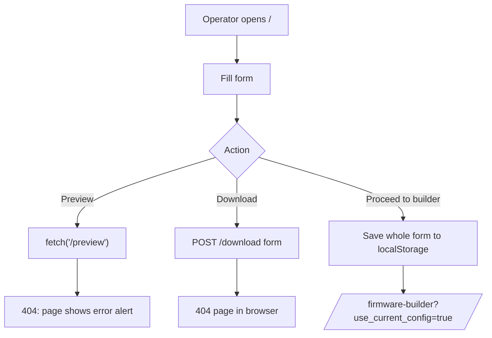

## Purpose

The config generator turns a web form into a userPrefs file. The operator previews the
userPrefs file, downloads it, or carries the config to the firmware builder page.

This file describes the code at commit `bd15bb1` (2026-11-21).

**Changed since this record.** `POST /api/v1/preview-userprefs` returns 413 for a file over 64 KB, and 422 for a file with no name or with text that is not UTF-8. It never returns 200 with `success: false`. Epic 1 (#92) changed this behaviour: the routes validate with `ConfigRequest` and return 422, the generator writes upstream key names, admin keys as `USERPREFS_USE_ADMIN_KEY_<n>`, the button pin, event mode and POSIX time zones. The current contract is `05-userprefs-correctness.md`. Defects are stated
plainly. The repair is in `05-userprefs-correctness.md` and `07-frontend-htmx.md`.

## User stories

- As an operator, I want to fill in owner names, channels, LoRa, position and network
  settings, so that I get a userPrefs file without editing JSON by hand.
- As an operator, I want to preview the userPrefs file, so that I can check it before a
  build.

## Functional requirements

The statements below describe observed behaviour.

- FR-config-generator-1 — `GET /` renders `templates/index.html` with sections Basic
  info, Channels, LoRa, GPS, Network, Advanced (`mtfwbuilder/routers/pages.py:8`).
- FR-config-generator-2 — `POST /api/v1/preview` takes a JSON object and returns
  `PreviewResponse {success, content, error}` (`routers/config_generator.py:35`).
- FR-config-generator-3 — `POST /api/v1/generate` returns the same result as preview.
  Its `preview_only` branch does the same thing as the default branch
  (`config_generator.py:19-32`).
- FR-config-generator-4 — `POST /api/v1/download` takes JSON or a form field `config`
  and returns the attachment `userPrefs.jsonc` (`config_generator.py:47`).
- FR-config-generator-5 — `POST /api/v1/preview-userprefs` takes a multipart file
  `userPrefs` of at most 64 KB and returns `FilePreviewResponse` with five key checks
  (`config_generator.py:71-99`).
- FR-config-generator-6 — The generator always writes `USERPREFS_CHANNELS_TO_WRITE`
  (`services/jsonc_generator.py:15`).
- FR-config-generator-7 — The generator writes LoRa, GPS and network keys only when the
  matching `*_enabled` field is `"true"`.
- FR-config-generator-8 — The generator converts a hex PSK to a `{ 0x.., … }` byte
  array (`jsonc_generator.py:69-76`).
- FR-config-generator-9 — The generator adds the prefix
  `meshtastic_Config_LoRaConfig_RegionCode_` to a bare region (`jsonc_generator.py:86-89`).
- FR-config-generator-10 — The output is `json.dumps(indent=2)` with no comments.

## User flows

1. The operator opens `/`.
2. The operator fills in the form.
3. If the operator selects Preview, the page calls `/preview`. The v2 app does not serve
   that URL, so the page shows an error (`templates/index.html:138`).
4. If the operator selects Download, the page posts to `/download`. The browser shows a
   404 page (`index.html:174-187`).
5. If the operator selects Proceed, the page saves the whole form to
   `localStorage.meshtastic_config` and opens the firmware builder page
   (`index.html:205-211`). The saved form holds every secret and the page never deletes
   it.

## Screens & states

The app is its own mockup. Screen: `templates/index.html` plus `templates/includes/*.html`.

| State | Handled? |
|---|---|
| Empty form | Yes. Defaults: 3 channels, region not set. |
| Preview loading | Yes ("Loading preview..."). |
| Preview error | Yes (alert). It shows every time, because of the 404. |
| Download error | No. The browser goes to a 404 page. |
| Field validation | No. No field is required. No format checks. |

## Behaviour rules

- `getFormData` sends checkboxes as `"true"`/`"false"` and drops empty values
  (`index.html:58-91`).
- Two PSK generators run on each click: `main.js:217-226` (lower-case hex) and
  `index.html:102-116` (upper-case hex). The upper-case value ends in the field.
- The time zone list holds IANA names (`static/js/timezone-data.js`). The firmware
  passes the value to `setenv("TZ", …)`, which needs a POSIX TZ string.
- The page logs the full form, secrets included, with `console.log` (`index.html:89`).

## Data touched

None on the server. Browser `localStorage.meshtastic_config` and `localStorage.theme`.

## Interfaces

| Method | Path | Request | Response |
|---|---|---|---|
| POST | `/api/v1/generate` | JSON object | 200 `PreviewResponse`; errors also 200 with `success: false` |
| POST | `/api/v1/preview` | JSON object | 200 `PreviewResponse` |
| POST | `/api/v1/download` | JSON, or form `config` | 200 attachment; 400 on error |
| POST | `/api/v1/preview-userprefs` | multipart `userPrefs` ≤ 64 KB | 200 `FilePreviewResponse` |

Emitted keys and their upstream match are listed in `05-userprefs-correctness.md`.

## Edge cases & failures

- A non-numeric `channels_to_write` raises an exception. The route returns 200 with
  the exception text.
- A value of `channels_to_write` above 8 passes. Upstream rejects it.
- A hex PSK of the wrong length passes without a check.
- Not handled: device role, channels 3–7, `IS_MUTED`. The fields `button_pin`,
  `button_pin_enabled` and `event_mode` exist in the form but the generator drops them.

## Acceptance criteria

Not applicable: this file records built behaviour. Planned fixes carry their own
criteria.

## Out of scope

Profiles, import of channel URLs, and push config.

## Open questions
