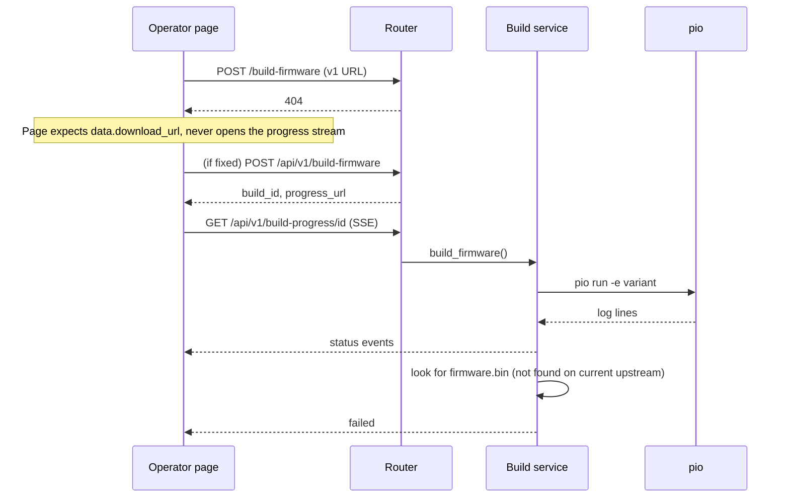

## Purpose

The firmware builder compiles one variant with one userPrefs file, and gives the
operator the artifact. This file describes the code at commit `bd15bb1`.

## User stories

- As an operator, I want to choose a variant and start a build, so that I get firmware
  with my factory defaults.
- As an operator, I want to see build progress, so that I know the build is running.

## Functional requirements

Observed behaviour:

- FR-firmware-builder-1 — `GET /firmware-builder` renders the page with variants
  grouped by manufacturer (`routers/pages.py:15-35`).
- FR-firmware-builder-2 — `POST /api/v1/build-firmware` takes form fields `variant`,
  `config_source` (`current` or `upload`), `config_json`, `stored_config`, a file
  `userPrefs` (≤ 64 KB) and `custom_filename` (`routers/firmware_builder.py:22-92`).
- FR-firmware-builder-3 — The route stores a build context in
  `app.state.active_builds` and returns `{success, build_id, message, progress_url}`.
  It does not start the build.
- FR-firmware-builder-4 — `GET /api/v1/build-progress/{build_id}` starts the build and
  streams SSE `status` events, then one `log` event with the last 100 log lines
  (`firmware_builder.py:95-130`).
- FR-firmware-builder-5 — The build runs `pio run -e <variant.id> --jobs <min(cpu,8)>
  --disable-auto-clean` in the firmware source, with no shell
  (`services/build_service.py:126-138`).
- FR-firmware-builder-6 — An `asyncio.Semaphore(1)` allows one build at a time
  (`build_service.py:29`).
- FR-firmware-builder-7 — A build times out after `build_timeout_seconds` (900)
  (`build_service.py:80-87`).
- FR-firmware-builder-8 — The build copies `.pio/build/<env>/firmware.<bin|uf2>` and, on
  ESP32, `firmware.factory.bin` to `temp_dir/<build_id>/` (`build_service.py:194-223`).
- FR-firmware-builder-9 — `GET /api/v1/download-firmware/{build_id}` sends the artifact,
  prefers the factory file on ESP32, and deletes the build directory after the send
  (`firmware_builder.py:133-206`).
- FR-firmware-builder-10 — `POST /api/v1/build-firmware` has a rate limit of 5 per
  minute per client address.

## User flows

1. The operator selects a variant and selects Build.
2. The page posts to `/build-firmware`. The v2 app does not serve that URL
   (`templates/firmware_builder.html:433`).
3. If the URL were correct, the page still waits for `download_url` and never opens the
   progress stream. No build starts.
4. If a client opens the progress stream, the build starts.
5. If the client disconnects, the build is cancelled.
6. When `pio` finishes, the build looks for `firmware.bin`. Upstream names the file
   `firmware-<env>-<version>.bin` since PR #8248 (December 2025), so the build fails.

## Screens & states

Screen: `templates/firmware_builder.html`. `templates/partials/build_progress.html`
holds a full SSE progress component, but no route or template renders it.

| State | Handled? |
|---|---|
| Queued | No (fake staged messages on 1.2 s timers, `firmware_builder.html:348-388`). |
| Progress | No real progress. |
| Failed | Shows the wrong text "The build was successful, but there was an error downloading" on network errors (`:481`). |
| Firmware source missing | Only in the stream, which the page does not open. |

## Behaviour rules

- The page appends a second `config_source=json` (`firmware_builder.html:409`). Starlette
  reads the last value, so the server would take the upload branch.
- The page guesses UF2 versus BIN from a hard-coded list, not from the registry.
- The build writes the userPrefs file to `firmware/userPrefs.jsonc` and
  `firmware/configs/userPrefs.jsonc`. Upstream reads only the root copy.
- Build ids are `build_<epoch>_<pid>_<counter>` and are predictable
  (`build_service.py:253-257`).
- `custom_filename` is read and not used.

## Data touched

- Memory: `app.state.active_builds` (30-minute expiry, swept only on the next POST).
- Disk: `temp_dir/<build_id>/`, `firmware/userPrefs.jsonc`, `firmware/.pio/build/<env>/`.
- Database: none, although a `builds` table exists.

## Interfaces

| Method | Path | Response |
|---|---|---|
| POST | `/api/v1/build-firmware` | 200 `{success, build_id, message, progress_url}`; 400 bad input; 429 rate limit |
| GET | `/api/v1/build-progress/{build_id}` | SSE `status` and `log` events; 404 unknown id |
| GET | `/api/v1/download-firmware/{build_id}?variant=&filename=` | file; 400 path traversal; 404 missing |
| GET | `/api/v1/system-info` | `{success, version, last_updated}` |

## Edge cases & failures

- On failure, `_run_pio_build` reports `failed` but the caller continues to the extract
  step and reports a second `failed` (`build_service.py:167-175`).
- Scrub runs only after a successful extract (`build_service.py:226`). After a failure,
  timeout or cancel, the userPrefs file with every secret stays in the firmware source.
- Even on success, `firmware.elf`, `.map` and object files under `.pio/build/<env>` keep
  the compiled values.
- A browser reconnect of the progress stream gets 404, because the stream removes the
  build context when it ends.
- A build abandoned before the stream opens leaves an empty directory.
- An upload that is not UTF-8 raises an unhandled decode error (500).
- The admin firmware update can delete the firmware source while a build runs.

## Acceptance criteria

Not applicable: built behaviour. See `06-build-pipeline-repair.md`.

## Out of scope

Build queue limits, build history, build cache.

## Open questions
