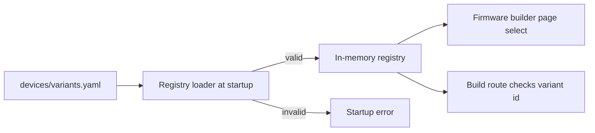

## Purpose

The registry is the list of variants the firmware builder page offers. Today it is a
hand-kept YAML file. This file describes the code at commit `bd15bb1`.

## User stories

- As an operator, I want to choose my device from a list, so that the build compiles the
  correct variant.

## Functional requirements

Observed behaviour:

- FR-device-registry-1 — The project loads `devices/variants.yaml` at startup
  (`services/device_registry.py:46-80`).
- FR-device-registry-2 — Each entry has `id`, `name`, `manufacturer`, `architecture`
  and an optional `pio_platform`. The loader stores `pio_platform` and never uses it.
- FR-device-registry-3 — The loader raises an error for an empty file, a missing
  required field, a duplicate `id`, or an unknown architecture.
- FR-device-registry-4 — The architecture maps to a format: `esp32`→`bin`,
  `nrf52`→`uf2`, `rp2040`→`uf2`, `stm32`→`bin` (`device_registry.py:9-14`).
- FR-device-registry-5 — Only `esp32` variants have a factory artifact
  (`has_factory_binary`).

## User flows

1. At startup, the loader reads the YAML file.
2. If the file is not valid, startup fails.
3. The firmware builder page lists the variants by manufacturer.
4. The build route rejects a variant id that is not in the registry.

## Screens & states

A `<select>` on `templates/firmware_builder.html`, grouped by manufacturer. No search,
no filter, no empty state. A device info box has descriptions for 5 variants only
(`firmware_builder.html:508-554`).

## Behaviour rules

- The file holds 150 entries: esp32 87 (includes s3, c3, c6 and s2 chips), nrf52 46,
  rp2040 12 (includes 2 rp2350), stm32 5. 33 manufacturers.
- 71 of the 150 ids are variant directory names, not PlatformIO environment names. For
  example, `heltec_v3` is the directory, and the environment is `heltec-v3`. A build of
  any of these 71 fails at `pio run -e`.
- The loader does not check ids against the firmware source.
- Upstream at `develop@fe89ac1` has 281 environments. 202 are not in the registry.

The full diff is in the research notes and is summarized in
`pages/inherit-reconciliation.md`.

## Data touched

`devices/variants.yaml` (read-only).

## Interfaces

Module contract: `DeviceRegistry.get(id) -> DeviceVariant | None`,
`DeviceRegistry.all()`, `DeviceRegistry.by_manufacturer()`.

## Edge cases & failures

- Not handled: the architectures `rp2350` and `nrf54l15`; a variant that exists in one
  firmware version and not in another.

## Acceptance criteria

Not applicable: built behaviour. See `10-generated-registry.md`.

## Out of scope

Device images, support levels.

## Open questions
