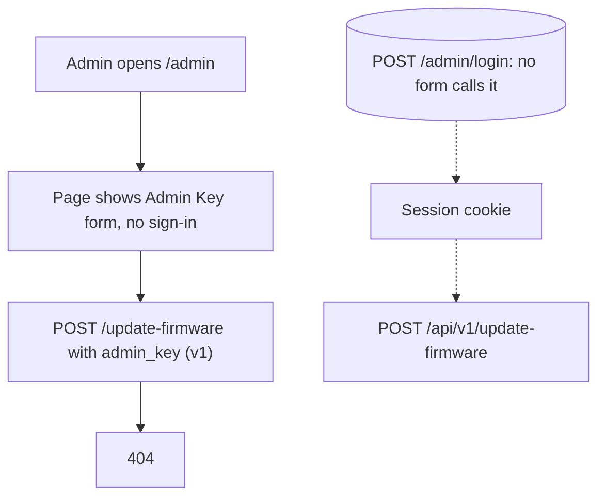

## Purpose

The admin area lets an admin download the firmware source from GitHub and remove old
builds. This file describes the code at commit `bd15bb1`.

**Changed since this record.** Epic 5 (#132) changed `/api/v1/update-firmware`: it installs the newest non-revoked stable firmware version into `<firmware_dir>/<tag>/` through the firmware catalog. Epic 2 (#102) added the periodic cleanup task and a lock between the firmware update and builds. Epic 3 (#22) added the sign-in form and the dashboard. Every admin POST now needs the form field `csrf_token`, or it returns 403. The session cookie sets `Secure` on `https`, and on `X-Forwarded-Proto: https` from a trusted proxy (FR-platform-modernization-16). FR-admin-6 is replaced: a start with no password generates a random password (FR-platform-modernization-17).

## User stories

- As an admin, I want to download the latest firmware source, so that builds use
  current firmware.
- As an admin, I want to remove old builds, so that the disk does not fill.

## Functional requirements

Observed behaviour:

- FR-admin-1 — `GET /admin` renders `templates/admin.html` with no session check
  (`routers/admin.py:23-27`).
- FR-admin-2 — `POST /admin/login` takes form field `admin_key`, checks it with bcrypt,
  and sets the cookie `mtfw_session` (`admin.py:30-53`). Rate limit: 10 per minute.
- FR-admin-3 — `POST /admin/logout` deletes the cookie.
- FR-admin-4 — `POST /api/v1/update-firmware` needs a session. It calls
  `api.github.com/repos/meshtastic/firmware/releases/latest`, downloads the zipball,
  checks every entry for zip-slip, replaces `firmware_dir`, and runs `pio pkg install`
  (`services/firmware_updater.py:26-108`).
- FR-admin-5 — `POST /api/v1/cleanup` needs a session and removes `build_*`
  directories older than `build_max_age_seconds` (3600) (`services/cleanup_service.py:24-59`).
- FR-admin-6 — At first start with no password, the password is `meshtastic`. The
  project logs a warning and writes the hash to `config.yaml` (`config.py:97-114`).

## User flows

1. The admin opens `/admin`.
2. The page shows a firmware update form with an "Admin Key" field.
3. The form posts to `/update-firmware`, which the v2 app does not serve.
4. No page calls `/admin/login`. The admin functions cannot be reached from the pages.

## Screens & states

Screen: `templates/admin.html`.
- No sign-in form, no sign-out button.
- Update progress is fake (`simulateUpdateProgress`, `admin.html:146-167`).
- System info reads `data.firmware_version`. The API returns `version`, so the page
  shows "undefined".
- No cleanup control. "Build Status: Ready" is static text.

## Behaviour rules

- The firmware updater writes `firmware_version.txt` before the download. A failed
  update still records the new version (`firmware_updater.py:63-66`).
- `pio pkg install` has no timeout.
- The update has no lock against a running build.
- `cleanup_interval_seconds` (1800) is defined and not used. No periodic cleanup exists.

## Data touched

`firmware_dir`, `base_dir/firmware_version.txt`, `config.yaml`, `temp_dir/build_*`.

## Interfaces

| Method | Path | Auth | Response |
|---|---|---|---|
| GET | `/admin` | none | HTML |
| POST | `/admin/login` | none, 10/min | 303 + cookie; 401 JSON |
| POST | `/admin/logout` | none | 303 |
| POST | `/api/v1/update-firmware` | session | `{success, message}` or `{success: false, error}`; 401 |
| POST | `/api/v1/cleanup` | session | `{success, message}`; 401 |

External: GitHub REST `GET /repos/{owner}/{repo}/releases/latest`
(https://docs.github.com/en/rest/releases/releases, API version 2022-11-28).

## Edge cases & failures

- A cookie with `Secure` set is not stored on plain HTTP. On a default Docker install,
  sign-in cannot work.
- In Docker, `config.yaml` is inside the container. A new container gets a new secret
  key, and every session ends.
- `docker-deploy.sh cleanup` posts to the v1 route `/cleanup` and fails.

## Acceptance criteria

Not applicable: built behaviour. See `07-frontend-htmx.md` and `09-firmware-versions.md`.

## Out of scope

Build history, several firmware versions.

## Open questions
