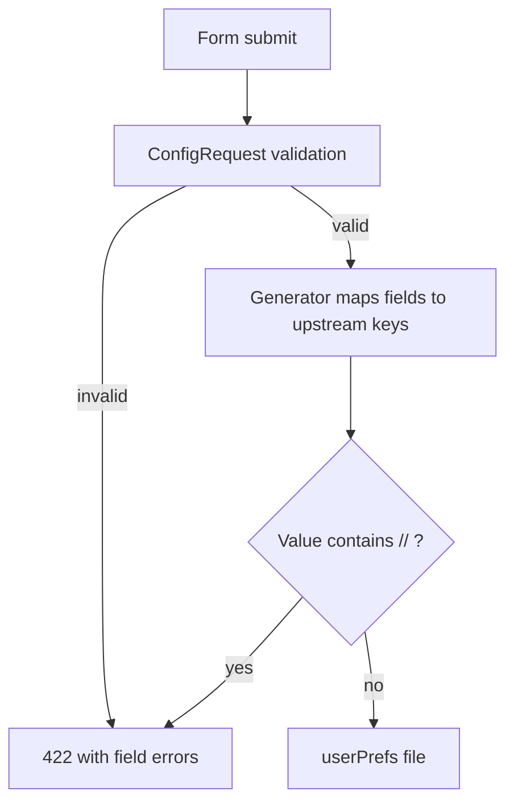

## Purpose

The generator must write only userPrefs keys that the firmware reads, in the value
format the firmware accepts. Today many keys have wrong names, so the firmware ignores
those settings without an error. This feature fixes the existing fields. New fields are
in `11-config-coverage.md`.

## User stories

- As an operator, I want every field I fill in to reach the device, so that the device
  boots with my factory defaults.

## Functional requirements

- FR-userprefs-correctness-1 — The generator writes `USERPREFS_FIXED_GPS`,
  `USERPREFS_FIXED_GPS_LAT`, `USERPREFS_FIXED_GPS_LON` and `USERPREFS_FIXED_GPS_ALT` for
  a fixed position.
- FR-userprefs-correctness-2 — The generator writes
  `USERPREFS_CONFIG_SMART_POSITION_ENABLED` for smart position.
- FR-userprefs-correctness-3 — The generator writes each admin key as
  `USERPREFS_USE_ADMIN_KEY_<n>` with a 32-byte `{ 0x.. }` array value. It never writes
  `USERPREFS_ADMIN_KEY_<n>`, which upstream names only in comments
  (`src/mesh/NodeDB.cpp:98-99,1248-1255`).
- FR-userprefs-correctness-4 — The generator writes `USERPREFS_NETWORK_WIFI_ENABLED`,
  `USERPREFS_NETWORK_WIFI_SSID` and `USERPREFS_NETWORK_WIFI_PSK` for WiFi.
- FR-userprefs-correctness-5 — The generator writes
  `USERPREFS_NETWORK_ENABLED_PROTOCOLS` for network protocols.
- FR-userprefs-correctness-6 — The generator writes `USERPREFS_MQTT_ENABLED`,
  `USERPREFS_MQTT_ADDRESS`, `USERPREFS_MQTT_ROOT_TOPIC`, `USERPREFS_MQTT_USERNAME`,
  `USERPREFS_MQTT_PASSWORD`, `USERPREFS_MQTT_ENCRYPTION_ENABLED` and
  `USERPREFS_MQTT_TLS_ENABLED` for MQTT.
- FR-userprefs-correctness-7 — The generator writes `USERPREFS_OEM_TEXT`,
  `USERPREFS_OEM_FONT_SIZE`, `USERPREFS_OEM_IMAGE_WIDTH`, `USERPREFS_OEM_IMAGE_HEIGHT`
  and `USERPREFS_OEM_IMAGE_DATA` for OEM branding.
- FR-userprefs-correctness-8 — The generator does not write
  `USERPREFS_CONFIG_DEVICE_NAME`. The form removes the device name field.
- FR-userprefs-correctness-9 — The generator writes `USERPREFS_BUTTON_PIN` and
  `USERPREFS_EVENT_MODE` from the existing advanced fields.
- FR-userprefs-correctness-10 — The generator writes a POSIX TZ string for
  `USERPREFS_TZ_STRING`. The form maps each IANA zone to its POSIX string.
- FR-userprefs-correctness-11 — The generator rejects a PSK that is not 0, 1, 16 or 32
  bytes.
- FR-userprefs-correctness-12 — The generator rejects a `channels_to_write` value
  outside 0–8.
- FR-userprefs-correctness-13 — The GPS mode list is `DISABLED`, `ENABLED`,
  `NOT_PRESENT`, which matches the `GpsMode` enum.
- FR-userprefs-correctness-14 — The generator never writes a value that contains `//`.
  It rejects such a value with a field error.
- FR-userprefs-correctness-15 — A contract test parses the fixture firmware source and
  fails when the generator writes a key that the source does not read.
- FR-userprefs-correctness-16 — The routes validate the request body with the pydantic
  model `ConfigRequest` and return 422 with field errors.

## User flows

1. The operator submits the form.
2. The route validates the body with `ConfigRequest`.
3. If a field is invalid, the route returns 422 with the field name and the reason.
4. The generator maps each field to its upstream userPrefs key.
5. The route returns the userPrefs file.

## Screens & states

No new screens. The form shows field errors next to each field (feature 07).

## Behaviour rules

- The source of truth for key names is the firmware source: the keys that `src/`
  references and that `bin/platformio-custom.py` turns into `-D` flags.
- The upstream parser removes all text after `//` on a line. A URL value breaks there.
  Source: `bin/platformio-custom.py` at `develop@fe89ac1`.
- The IANA→POSIX map is a static table in the project, generated from the tz database
  once, and committed. Example: `America/New_York` → `EST5EDT,M3.2.0,M11.1.0`.

## Data touched

None.

## Interfaces

Upstream key reference: `meshtastic/firmware` `userPrefs.jsonc` and `src/` at
`v2.7.26.54e0d8d` (stable) and `develop@fe89ac1`.

## Edge cases & failures

- Admin keys are base64 in the Meshtastic apps. The generator accepts base64 and
  converts it to the `{ 0x.. }` byte form. A key that is not 32 bytes is a field error.
- If a test fixture holds a key that the stable firmware version does not read, the
  contract test reports the key and the firmware version.

## Acceptance criteria

- A config with a fixed position gives a userPrefs file with `USERPREFS_FIXED_GPS` set to `"true"`.
- A config with MQTT gives `USERPREFS_MQTT_ENABLED` set to `"true"`, and no key starts with `USERPREFS_CONFIG_MQTT`.
- A config with WiFi gives `USERPREFS_NETWORK_WIFI_SSID`.
- A config with an admin key gives `USERPREFS_USE_ADMIN_KEY_0` with a 32-byte array, and no key named `USERPREFS_ADMIN_KEY_0`.
- `America/New_York` gives `USERPREFS_TZ_STRING` = `EST5EDT,M3.2.0,M11.1.0`.
- A 15-byte PSK returns 422 with field `channel_0.psk`.
- `channels_to_write` = 9 returns 422.
- An MQTT address `mqtt://x` returns 422 for field `mqtt_address`.
- The contract test fails when a test adds the key `USERPREFS_CONFIG_DEVICE_NAME`.
- The existing generator tests are updated to the upstream key names and pass.

## Out of scope

New settings (feature 11). The firmware version picker (feature 09).

## Open questions
