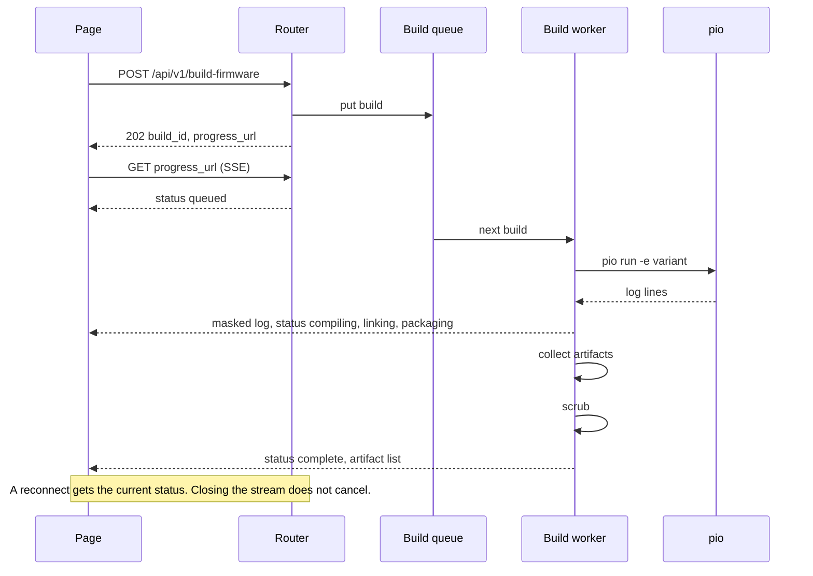
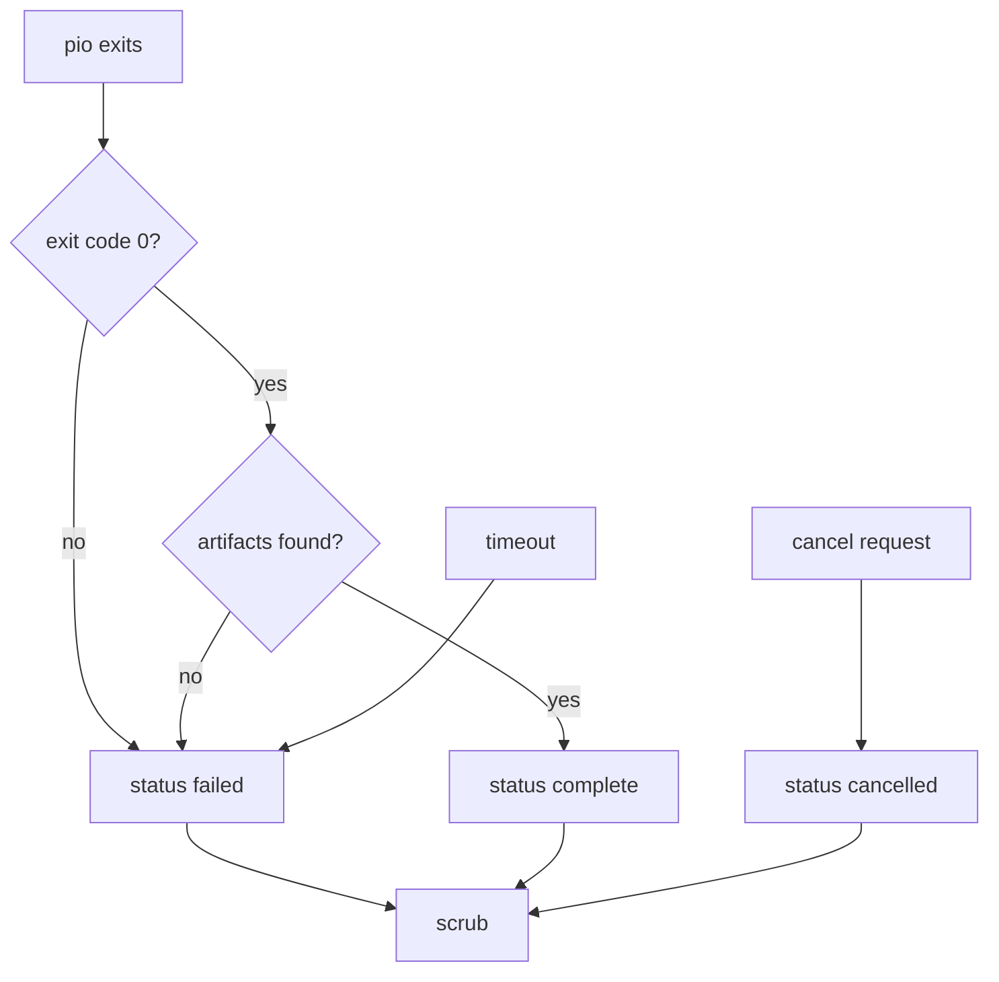

## Purpose

A build must run to an artifact without a page attached. A build must scrub every secret
on every exit path. It must also find the artifacts that current upstream firmware
produces.

## User stories

- As an operator, I want my build to continue when I reload the page, so that a dropped
  connection does not waste a 10-minute compile.
- As an operator, I want my secrets removed from the server after the build, so that
  another person on the host cannot read them.

## Functional requirements

- FR-build-pipeline-repair-1 — `POST /api/v1/build-firmware` puts the build in the build
  queue and returns 202 with `build_id` and `progress_url`.
- FR-build-pipeline-repair-2 — A build worker takes builds from the build queue in
  order. The number of build workers is `MTFW_BUILD_WORKERS` (default 1).
- FR-build-pipeline-repair-3 — The build queue holds at most `MTFW_MAX_QUEUE_SIZE`
  builds (default 5). A request when the build queue is full returns 503.
- FR-build-pipeline-repair-4 — The progress stream sends the current build status on
  connect, then each change, then each new masked log line.
- FR-build-pipeline-repair-5 — A client that reconnects to the progress stream gets the
  current build status. A closed progress stream does not cancel the build.
- FR-build-pipeline-repair-6 — `POST /api/v1/builds/{build_id}/cancel` cancels a
  queued or running build.
- FR-build-pipeline-repair-7 — A build id is 32 hex characters from `secrets.token_hex(16)`.
- FR-build-pipeline-repair-8 — The build collects every artifact that matches
  `.pio/build/<env>/firmware-<env>-*.{bin,factory.bin,uf2,hex,zip}`, the matching
  `littlefs-<env>-*.bin`, and `*.mt.json`.
- FR-build-pipeline-repair-9 — A build that fails stops at the failed step and reports
  one `failed` event with the error message.
- FR-build-pipeline-repair-10 — The build scrubs on every transition into `complete`,
  `failed` and `cancelled`.
- FR-build-pipeline-repair-11 — The scrub deletes `userPrefs.jsonc` in the firmware
  source and the whole `.pio/build/<env>/` directory.
- FR-build-pipeline-repair-12 — The build writes the userPrefs file only to the firmware
  source root.
- FR-build-pipeline-repair-13 — The build replaces each secret value in each log line
  with `***` before it stores or sends the line.
- FR-build-pipeline-repair-14 — The project records each build in the `builds` table,
  without the build log and without the config.
- FR-build-pipeline-repair-15 — A cleanup task runs every `cleanup_interval_seconds`
  and removes artifacts older than `build_max_age_seconds`.
- FR-build-pipeline-repair-16 — A firmware update waits until no build runs, and no
  build starts while a firmware update runs.
- FR-build-pipeline-repair-17 — `GET /api/v1/builds/{build_id}/artifacts` lists the
  artifacts with name, size and kind (`factory`, `app`, `uf2`, `ota-zip`, `hex`,
  `littlefs`, `manifest`).
- FR-build-pipeline-repair-18 — `GET /api/v1/builds/{build_id}/artifacts/{name}` sends
  one artifact. The name must be in the artifact list.
- FR-build-pipeline-repair-19 — The fake `pio` test executable writes upstream-named
  artifacts, so the tests run without PlatformIO.
- FR-build-pipeline-repair-20 — (Done; superseded by Epic 6, #145, which deleted the file.) Until Epic 6 deleted it, every `id` in
  `devices/variants.yaml` is a PlatformIO environment name of the stable firmware
  version. The 71 wrong ids change to the env names in
  `pages/inherit-reconciliation.md` § Registry id map. Where one directory holds several
  envs, each env gets its own entry.
- FR-build-pipeline-repair-21 — A test fails when a registry `id` is not an `[env:…]`
  name in the fixture firmware source.

## User flows

1. The operator starts a build. The route queues it and returns 202.
2. The page opens the progress stream and shows `queued`.
3. A build worker takes the build and runs `pio`.
4. The progress stream sends masked log lines and build status changes.
5. If `pio` fails, times out, or the operator cancels, the build stops and scrubs.
6. If `pio` succeeds, the build collects artifacts, scrubs, and sends `complete`.

## Screens & states

No new screens. Feature 07 renders the states.

## Behaviour rules

- Secret values for masking: every PSK (hex and byte-array form), WiFi PSK, MQTT
  password, admin key, and OEM image data.
- The ESP32 factory artifact is the preferred download for a full install.
- Retry: on an ESP32 build, a `git fetch` network error retries the build once, as
  upstream `bin/build-esp32.sh` does.

## Data touched

- `builds` table: written on queue, on each status change, and on end.
- Migration: none for `builds` (the table exists). Add the column `config_hash` TEXT
  and `firmware_version` TEXT.

## Interfaces

| Method | Path | Response |
|---|---|---|
| POST | `/api/v1/build-firmware` | 202 `{build_id, progress_url}`; 400; 422; 429; 503 queue full |
| GET | `/api/v1/build-progress/{build_id}?log_from=<n>` | SSE events `status` `{status, message, progress}`, `log` `{line}`, `artifacts` `[...]`; 404; 422 negative `log_from`. Without `log_from`, the `log` events start after the connect. |
| POST | `/api/v1/builds/{build_id}/cancel` | 200; 404; 409 already ended |
| GET | `/api/v1/builds/{build_id}/artifacts` | 200 list; 404 |
| GET | `/api/v1/builds/{build_id}/artifacts/{name}` | file; 404 |

The old `GET /api/v1/download-firmware/{build_id}` returns 308 to the factory or primary
artifact for one release, then is removed.

Upstream artifact names: `bin/platformio-pre.py` sets
`PROGNAME = firmware-<env>-<version>` (`meshtastic/firmware` PR #8248).

## Edge cases & failures

- Firmware source not installed: the build fails at once with "Firmware source not
  installed. An admin must install a firmware version."
- Disk full during build: the build fails with the `pio` error, then scrubs.
- Process restart during a build: on startup, every `builds` row with a running status
  changes to `failed` with "Server restarted", and the firmware source is scrubbed.
- Two builds of different variants share one firmware source. Each build writes its
  own userPrefs file, so build workers > 1 need one copy of the source per worker. With
  build workers > 1, the project copies the firmware source per worker.

## Acceptance criteria

- A build with the fake `pio` returns 202 and reaches `complete` with no progress stream open.
- A reconnect to the progress stream during a build gets the current build status.
- A cancel request during `compiling` gives `cancelled`, and `userPrefs.jsonc` does not exist afterwards.
- After a failed build, `userPrefs.jsonc` and `.pio/build/<env>/` do not exist.
- After a complete build, `userPrefs.jsonc` and `.pio/build/<env>/` do not exist.
- The artifact list for an ESP32 build has kind `factory` and kind `app`.
- The artifact list for an nRF52 build has kind `uf2` and kind `ota-zip`.
- No log line sent on the progress stream holds the PSK of the config.
- A sixth queued build returns 503 with build queue size 5.
- A build id is 32 hex characters.
- After restart, a build that was `compiling` shows `failed`.

## Out of scope

Build cache (feature 14). Firmware version choice (feature 09).

## Open questions
