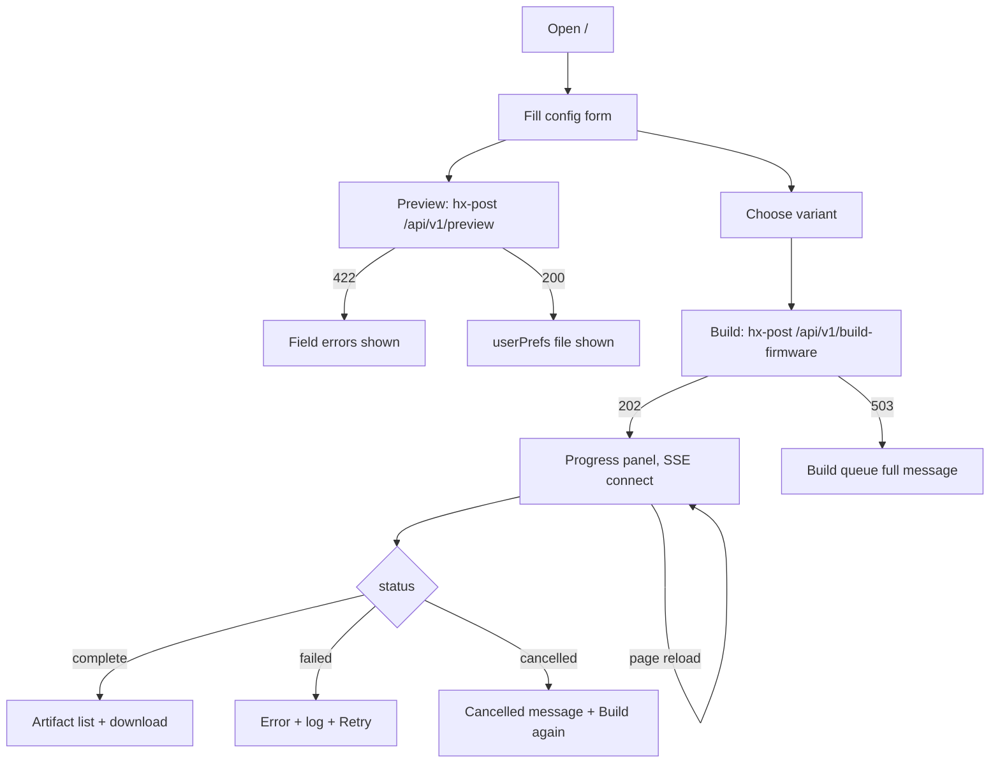
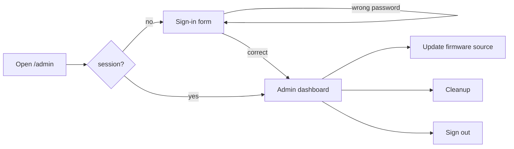

## Purpose

The pages must use the v2 API, the progress stream and admin sign-in. The interview chose
server-rendered pages with htmx and no JavaScript build step. The pages load htmx today
but do not use it.

## User stories

- As an operator, I want to preview, download and build from the pages, so that the
  documented flow works.
- As an operator, I want to watch real build progress, so that I know what the build
  does and when it ends.
- As an admin, I want to sign in on the admin page, so that I can reach the admin
  functions.

## Functional requirements

- FR-frontend-htmx-1 — The config form posts to `/api/v1/preview` with `hx-post` and
  shows the userPrefs file in a `<pre>` as text, not as HTML.
- FR-frontend-htmx-2 — The download control posts to `/api/v1/download`.
- FR-frontend-htmx-3 — A validation error shows the message next to its field.
- FR-frontend-htmx-4 — The config form and the build controls are on one page, `/`.
  `/firmware-builder` returns 308 to `/`.
- FR-frontend-htmx-5 — The page carries the config to the build in the request body. It
  never writes a config to `localStorage`.
- FR-frontend-htmx-6 — On page load, the page deletes the old key
  `localStorage.meshtastic_config`.
- FR-frontend-htmx-7 — The Build control posts to `/api/v1/build-firmware`, then
  swaps in a progress panel that connects to the progress stream with the htmx SSE
  extension.
- FR-frontend-htmx-8 — The progress panel shows each build status as a step, the masked
  log in a `
` region, and the artifact list on `complete`.
- FR-frontend-htmx-9 — The progress panel has a Cancel control while the build is
  `queued` or running.
- FR-frontend-htmx-10 — The page URL holds the build id (`/?build=<id>`), so a reload
  reconnects to the same build.
- FR-frontend-htmx-11 — `/admin` shows a sign-in form when no session exists.
- FR-frontend-htmx-12 — `/admin` shows firmware source status, an update control, a
  cleanup control, recent builds and a sign-out control when a session exists.
- FR-frontend-htmx-13 — The session cookie sets `Secure` only when the request scheme
  is `https`.
- FR-frontend-htmx-14 — Every admin form carries a CSRF token. The server rejects a
  POST without a valid token with 403.
- FR-frontend-htmx-15 — The page title names the page: "Build — MTFWBuilder",
  "Admin — MTFWBuilder".
- FR-frontend-htmx-16 — htmx, the SSE extension and Bootstrap are vendored under
  `static/vendor/` with the version in the file name. The pages load no script from a
  CDN.
- FR-frontend-htmx-17 — The theme script runs in `<head>` before first paint.
- FR-frontend-htmx-18 — One PSK generator exists. It uses `crypto.getRandomValues` and
  fills 32 bytes as base64.
- FR-frontend-htmx-19 — The pages write no `console.log` of form data.
- FR-frontend-htmx-20 — `static/js/main.js` dead handlers and
  `templates/partials/build_progress.html` are replaced by the new panel.

## User flows

1. The operator opens `/` and fills the config form.
2. The operator selects Preview. The page shows the userPrefs file or field errors.
3. The operator chooses a variant and selects Build.
4. The page shows the progress panel and connects to the progress stream.
5. If the operator reloads, the page reconnects to the same build.
6. On `complete`, the page shows the artifact list.
7. On `failed`, the page shows the error, the masked log and a Retry control.

## Screens & states

Mockup: [01-build-page](../mockups/01-build-page.html).

**Build page `/`** — regions: config form, variant picker, Build control, progress panel.

| State | What the operator sees |
|---|---|
| Empty | Form with defaults. Build disabled until a variant is chosen. |
| Validation error | Red text under each wrong field. Focus moves to the first error. |
| Queued | Step "queued" active, position in the build queue. Cancel control. |
| Running | Current step active, elapsed time, log region collapsed. |
| Complete | All steps done, artifact list with sizes, the factory artifact first. |
| Failed | Error message, log region open, Retry control. |
| Firmware source missing | "No firmware version is installed. An admin must install one." with a link to `/admin`. |
| Build queue full | "The build queue is full. Try again in a few minutes." |

**Admin page `/admin`** — signed out: password field, Sign in. Signed in: firmware
source card, cleanup card, recent builds table, Sign out. Wrong password: "Wrong
password." Rate limit: "Too many attempts. Wait one minute."

## Behaviour rules

- htmx 2.0.x and htmx-ext-sse 2.2.x (versions pinned in file names). Bootstrap 5.3.x.
  Sources: https://htmx.org/docs/ and https://htmx.org/extensions/sse/ (checked
  2026-11-21).
- Server routes return HTML fragments when the request has the header `HX-Request`,
  and JSON otherwise. The JSON API stays for automation.
- Accessibility: the progress panel has `aria-live="polite"`. Every step has text, not
  only color.

## Data touched

Browser: `localStorage.theme` only. Server: no new data.

## Interfaces

New fragment routes (HTML, `HX-Request`): the same paths as the JSON routes in features
05 and 06. CSRF: a signed token in a hidden field, the same itsdangerous secret,
per session.

## Edge cases & failures

- Progress stream drops: the htmx SSE extension reconnects. The server sends the
  current build status on connect (feature 06).
- JavaScript disabled: the config form still posts and downloads the userPrefs file.
  The build needs JavaScript; the page says so in a `<noscript>` block.
- An admin session expires: an admin POST returns 401, and the page shows the sign-in
  form.

## Acceptance criteria

- The E2E smoke test fills the form, selects Preview, and sees `USERPREFS_CHANNELS_TO_WRITE`.
- The E2E smoke test starts a build with the fake `pio`, sees `complete`, and downloads the factory artifact.
- A reload during a build shows the same build id and its current step.
- The Cancel control during `compiling` shows `cancelled`.
- `/firmware-builder` returns 308 to `/`.
- `localStorage.meshtastic_config` does not exist after the page loads.
- `/admin` without a session shows a password field.
- A correct password over plain HTTP gives a session (the cookie has no `Secure` flag).
- An admin POST without a CSRF token returns 403.
- No page requests a script from a host other than its own.
- A preview of a channel name `<b>x</b>` shows the literal text `<b>x</b>`.

## Out of scope

The new config fields (feature 11). Browser flashing (feature 13).

## Open questions
