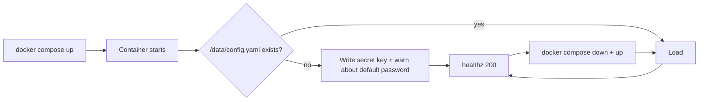

## Purpose

Move the project to a current runtime and current dependencies. Fix the Docker volumes
and the nginx config so that a self-hosted instance keeps its state and the progress
stream works through nginx.

## User stories

- As a self-hoster, I want `docker compose up` to give a working instance that keeps its
  firmware sources, sessions and history across a restart.
- As the owner, I want current dependencies, so that security fixes reach the project.

## Functional requirements

- FR-platform-modernization-1 — `pyproject.toml` sets `requires-python = ">=3.13,<3.15"`.
  The cap comes from the `meshtastic` python package, which requires Python `<3.15`.
- FR-platform-modernization-2 — The project uses uv. `uv.lock` is committed.
- FR-platform-modernization-3 — The dependency floors are at least: fastapi 0.165,
  pydantic 2.14, uvicorn 0.54, jinja2 3.1.6, platformio 6.2.0.
- FR-platform-modernization-4 — The Docker image uses `python:3.13-slim` and installs
  with `uv sync --frozen --no-dev`.
- FR-platform-modernization-5 — The Docker image is multi-stage. The runtime stage
  holds no compiler that the build does not need.
- FR-platform-modernization-6 — All state lives under one data directory,
  `MTFW_DATA_DIR` (default `/data` in Docker): firmware sources, artifacts, the
  database, and the generated `config.yaml`.
- FR-platform-modernization-7 — `docker-compose.yml` mounts one volume at `/data` and
  one volume at `/home/app/.platformio`.
- FR-platform-modernization-8 — The app serves `GET /healthz` and returns 200 with
  `{"status": "ok"}`. The Docker healthcheck uses it.
- FR-platform-modernization-9 — `nginx/nginx.conf.example` sets
  `proxy_buffering off` and `proxy_read_timeout 1h` for `/api/v1/build-progress/`.
- FR-platform-modernization-10 — `nginx/nginx.conf.example` removes the location
  `/download/` and proxies `/healthz`.
- FR-platform-modernization-11 — The rate limiter reads the client address from
  `X-Forwarded-For` when `MTFW_TRUSTED_PROXIES` lists the peer.
- FR-platform-modernization-12 — The rate limits read `build_rate_limit` and
  `login_rate_limit` from settings.
- FR-platform-modernization-13 — Settings that nothing reads (`host`, `port`) are
  removed.
- FR-platform-modernization-14 — A scheduled CI workflow runs weekly. It fetches upstream
  firmware `develop` and runs the contract tests against it.
- FR-platform-modernization-15 — README and CONTRIBUTING match the code: variant count
  source, license, commands, volumes, Python version.
- FR-platform-modernization-16 — The session cookie sets `Secure` when a peer in
  `MTFW_TRUSTED_PROXIES` sends `X-Forwarded-Proto: https`. The project ignores the header
  from any other peer.

## User flows

1. The self-hoster runs `docker compose up -d`.
2. On first start, the app writes `config.yaml` to `/data` and logs a warning about the
   default password.
3. On a later start, the app reads the same `config.yaml`. Sessions and firmware sources
   stay.

## Screens & states

No screens.

## Behaviour rules

- uv docs: https://docs.astral.sh/uv/ (checked 2026-11-21, uv 0.13.x).
- PlatformIO toolchain cache: persist `PLATFORMIO_CORE_DIR`. Source:
  https://docs.platformio.org/en/stable/projectconf/sections/platformio/options/directory/core_dir.html
- The default password warning shows on every start while the hash matches the default
  password `meshtastic`.

## Data touched

All files move under `MTFW_DATA_DIR`. A startup step moves files from the old paths
(`base_dir/mtfwbuilder.db`, `base_dir/firmware`, `base_dir/config.yaml`) when they
exist and the new paths do not.

## Interfaces

`GET /healthz` → 200 `{"status": "ok"}`.

## Edge cases & failures

- If `/data` is not writable, the app exits with a clear error at startup.
- The `meshtastic` python package requires Python `<3.15`. The CI matrix tests 3.13 and
  3.14.

## Acceptance criteria

- `uv sync && uv run pytest` passes in a fresh clone.
- `docker compose up -d`, then `docker compose down && docker compose up -d`, keeps the same admin session valid.
- The firmware version shown on `/admin` survives a container rebuild.
- `curl /healthz` returns 200.
- Through the nginx overlay, a progress stream stays open for a 20-minute fake build.
- With `MTFW_TRUSTED_PROXIES` set, two clients behind nginx have separate rate-limit counts.
- The weekly workflow file exists and runs the contract tests against upstream `develop`.
- README states no fixed variant count.

## Out of scope

Image publication to a registry. Kubernetes.

## Open questions
