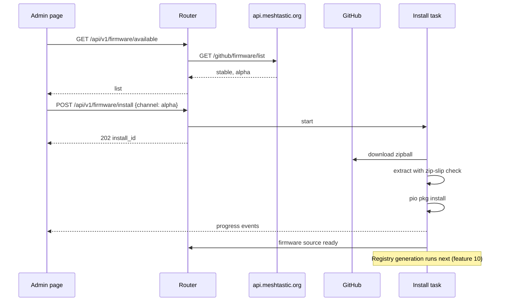

## Purpose

The project holds several firmware versions at once. An operator chooses the firmware
version for each build. Today the project holds one firmware source, always from
`releases/latest`, and replaces it in place.

## User stories

- As an admin, I want to install the stable and the alpha firmware versions, so that
  operators can choose.
- As an operator, I want to choose the firmware version of my build, so that my devices
  run the version I tested.
- As an admin, I want to remove an old firmware version, so that the disk does not fill.

## Functional requirements

- FR-firmware-versions-1 — `GET /api/v1/firmware/available` returns the upstream
  stable and alpha firmware versions from `https://api.meshtastic.org/github/firmware/list`.
- FR-firmware-versions-2 — If that API fails, the project falls back to
  `GET https://api.github.com/repos/meshtastic/firmware/releases`.
- FR-firmware-versions-3 — An admin installs a firmware version by channel (`stable`,
  `alpha`) or by an exact tag.
- FR-firmware-versions-4 — The project installs each firmware version into its own
  directory, `firmware/<tag>/`.
- FR-firmware-versions-5 — An install runs as a background task with its own progress
  stream.
- FR-firmware-versions-6 — An install writes the firmware source record only after the
  extract and `pio pkg install` succeed.
- FR-firmware-versions-7 — `pio pkg install` has a timeout of `MTFW_INSTALL_TIMEOUT_SECONDS`
  (default 3600).
- FR-firmware-versions-8 — An admin removes a firmware version. The project refuses
  removal while a build of that version is queued or running.
- FR-firmware-versions-9 — `GET /api/v1/firmware` lists installed firmware versions
  with tag, channel, install date, disk size and status.
- FR-firmware-versions-10 — The build request takes a `firmware_version`. The default
  is the newest installed stable firmware version.
- FR-firmware-versions-11 — The build page shows a firmware version selector with the
  installed versions, each labelled stable or alpha.
- FR-firmware-versions-12 — Each build record stores its firmware version. Each artifact
  name holds the firmware version (upstream already does this).
- FR-firmware-versions-13 — On first start with no firmware source, the admin page shows
  "Install stable" as the first action.

## User flows

1. The admin opens `/admin`, section Firmware sources.
2. The page lists the installed firmware versions and the available ones.
3. The admin chooses stable, alpha, or a tag, and selects Install.
4. The install task downloads, extracts and installs packages, and streams progress.
5. If any step fails, the task deletes the partial directory and shows the error.
6. When the install is ready, the firmware version appears in the build page selector.

## Screens & states

Mockup: [02-firmware-sources](../mockups/02-firmware-sources.html).

| State | What the admin sees |
|---|---|
| None installed | Empty card: "No firmware version is installed." Install stable is primary. |
| Installing | Progress bar with step: downloading, extracting, installing packages. |
| Ready | Row with tag, channel badge, date, size, Remove control. |
| Failed | Row with error text and Retry. |
| Remove blocked | "A build uses this firmware version. Try again when it ends." |
| Upstream unreachable | "Cannot reach api.meshtastic.org or GitHub." Exact tag install still offered. |

## Behaviour rules

- A tag must match `^v\d+\.\d+\.\d+\.[0-9a-f]{7}$`.
- The firmware 2.8 toolchain (pioarduino for ESP32) is installed by `pio pkg install` per
  firmware source. Toolchains are shared in the PlatformIO core directory.
- GitHub requests send `User-Agent: MTFWBuilder` and use `GITHUB_TOKEN` from the
  environment when set, to avoid the anonymous rate limit of 60 per hour.

## Data touched

New table `firmware_sources`: `version` TEXT PK, `channel` TEXT, `path` TEXT,
`installed_at` TIMESTAMP, `size_bytes` INTEGER, `status` TEXT. Migration: import an
existing `firmware/` tree and `firmware_version.txt` as one row.

## Interfaces

| Method | Path | Auth | Response |
|---|---|---|---|
| GET | `/api/v1/firmware` | none | list of installed firmware versions |
| GET | `/api/v1/firmware/available` | admin | `{stable: [...], alpha: [...]}` |
| POST | `/api/v1/firmware/install` | admin | 202 `{install_id, progress_url}`; 409 already installed |
| DELETE | `/api/v1/firmware/{version}` | admin | 204; 409 in use |

External:
- `https://api.meshtastic.org/github/firmware/list` — used by `meshtastic/web-flasher`.
  The response shape (`releases.stable`, `releases.alpha`) was observed on 2026-11-21.
  No published docs; see `Risks`.
- GitHub REST releases API, version 2022-11-28:
  https://docs.github.com/en/rest/releases/releases

## Edge cases & failures

- A revoked alpha (upstream marks some alphas revoked, for example `v2.8.0.47db0e3`):
  the list from api.meshtastic.org omits it. A pinned install of a revoked tag shows a
  warning.
- Disk full during extract: the task fails and deletes the partial directory.

## Acceptance criteria

- An admin installs stable and alpha, and `/api/v1/firmware` lists two firmware versions.
- A build request with `firmware_version` = the alpha tag gives artifacts whose names hold the alpha version.
- A build request without `firmware_version` uses the newest installed stable version.
- A failed install leaves no `firmware/<tag>/` directory and no `firmware_sources` row.
- A remove request during a build of that version returns 409.
- With api.meshtastic.org unreachable, the list comes from the GitHub releases API.
- A tag `v2.7.26` (no hash) returns 422.

## Out of scope

Builds from a branch or a pull request of the firmware repository.

## Open questions
