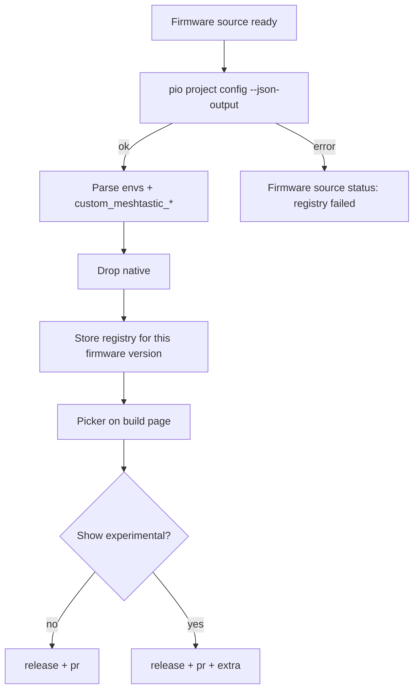

## Purpose

The registry must come from the firmware source, so it is correct for each firmware
version and needs no hand edits. Upstream variant `platformio.ini` files carry
`custom_meshtastic_*` metadata. The hand-kept `devices/variants.yaml` is deleted.

## User stories

- As an operator, I want to find my device by name in a few seconds, so that I build the
  correct variant.
- As an operator, I want to see if a variant is a release variant, so that I know if
  upstream tests it.

## Functional requirements

- FR-generated-registry-1 — When a firmware source becomes ready, the project runs
  `pio project config --json-output` in it and stores the registry for that firmware
  version.
- FR-generated-registry-2 — Each registry entry holds: `env`, `display_name`,
  `manufacturer`, `architecture`, `support_level`, `hw_model`, `hw_model_slug`,
  `image`, `requires_dfu`, `partition_scheme`, `has_mui`, `has_ink_hud`.
- FR-generated-registry-3 — `display_name` comes from `custom_meshtastic_display_name`.
  When it is missing, it is the `env` name.
- FR-generated-registry-4 — `manufacturer` comes from the first value of
  `custom_meshtastic_tags`. When it is missing, it is "Other".
- FR-generated-registry-5 — `architecture` comes from the `-I variants/<arch>` build flag.
- FR-generated-registry-6 — `support_level` comes from `board_level`.
- FR-generated-registry-7 — The registry excludes every variant with architecture
  `native`.
- FR-generated-registry-8 — The picker shows variants with support level `release` and
  `pr` by default.
- FR-generated-registry-9 — A "Show experimental" toggle adds variants with support
  level `extra`.
- FR-generated-registry-10 — The picker has a text search over display name, env and
  manufacturer.
- FR-generated-registry-11 — The picker has architecture filter chips.
- FR-generated-registry-12 — The picker groups results by manufacturer.
- FR-generated-registry-13 — The picker shows the device image when the firmware source
  holds the image file named in `custom_meshtastic_images`.
- FR-generated-registry-14 — The architecture maps to the flash method: ESP32 family →
  Web Serial; `nrf52840` and `rp2040`/`rp2350` → UF2; `nrf54l15` → DFU zip; `stm32` →
  download only.
- FR-generated-registry-15 — The build route rejects a variant that is not in the
  registry of the chosen firmware version, with 422.
- FR-generated-registry-16 — `devices/variants.yaml` and its loader are deleted.

## User flows

1. A firmware source becomes ready (feature 09).
2. The project reads the resolved PlatformIO config and builds the registry.
3. The operator chooses a firmware version on the build page.
4. The picker shows the registry of that firmware version.
5. The operator searches or filters, and chooses a variant.

## Screens & states

Mockup: [03-device-picker](../mockups/03-device-picker.html).

| State | What the operator sees |
|---|---|
| Loading | Skeleton list. |
| Populated | Manufacturer groups, each row: image, display name, env, architecture, support level badge. |
| No match | "No device matches '<text>'." with a Clear control. |
| No firmware version | "No firmware version is installed." |
| Registry failed | "The device list for <version> failed to load. An admin must reinstall it." |

## Behaviour rules

- Field examples from `variants/esp32s3/heltec_v4/platformio.ini` (`develop@fe89ac1`):
  `custom_meshtastic_hw_model = 110`, `custom_meshtastic_display_name = Heltec V4`,
  `custom_meshtastic_support_level = 1`, `custom_meshtastic_tags = Heltec`,
  `custom_meshtastic_requires_dfu = true`, `board_level = release`.
- About 124 of 281 envs carry the full metadata set. 154 carry a display name.
- An env with `custom_meshtastic_actively_supported = false` shows the badge
  "Not actively supported".
- The search matches without case and without punctuation: "heltec v4" matches
  `heltec-v4`.

## Data touched

New table `variants`: `version` + `env` PK, and the fields in FR 2. The registry for a
firmware version is deleted with its firmware source.

## Interfaces

| Method | Path | Response |
|---|---|---|
| GET | `/api/v1/variants?version=&q=&arch=&experimental=` | list of registry entries |
| GET | `/api/v1/variants/{env}/image?version=` | SVG/PNG; 404 |

PlatformIO: `pio project config --json-output`
(https://docs.platformio.org/en/stable/core/userguide/project/cmd_config.html, PlatformIO
Core 6.2).

## Edge cases & failures

- A display name that two envs share (for example `thinknode_m1` and
  `thinknode_m1-inkhud`): the picker shows the env under the name.
- An env with no tags: manufacturer "Other".
- Upstream renames an env between firmware versions: each firmware version has its own
  registry, so a profile that names the old env shows "Variant not in <version>".

## Acceptance criteria

- After a fixture firmware source becomes ready, the registry holds every non-native env in it.
- The entry for `heltec-v4` has display name "Heltec V4", architecture `esp32s3`, support level `release`.
- The picker without the toggle shows no `extra` variant.
- The picker with the toggle shows `extra` variants.
- A search for "heltec v4" lists `heltec-v4`.
- A build request for an env that is not in the chosen firmware version returns 422.
- `devices/variants.yaml` does not exist.
- No native env appears in `/api/v1/variants`.

## Out of scope

Images from api.meshtastic.org. Device descriptions written by the project.

## Open questions
