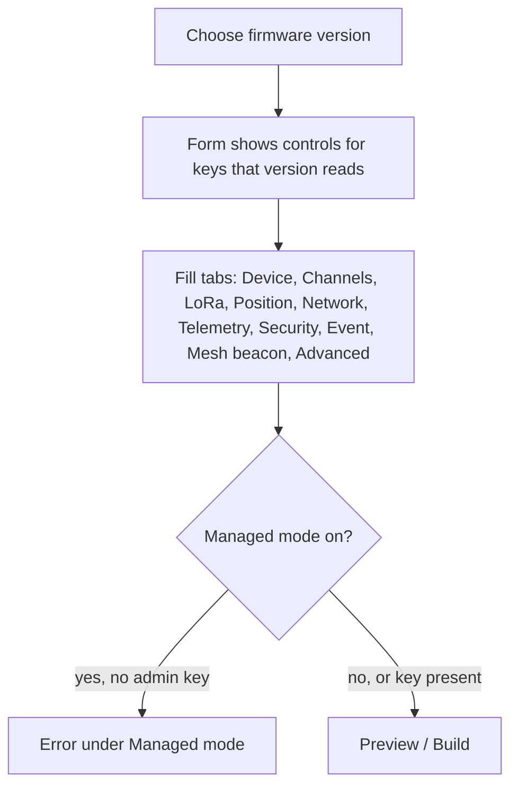

## Purpose

The config form must cover the userPrefs keys that upstream lists. Today the form covers
about 40 of 105 keys, with 13 of 37 regions, 7 of 17 modem presets, and no role.

## User stories

- As an organizer, I want to set the role, TX power and telemetry, so that event devices
  behave the same from first boot.
- As an organizer, I want to lock settings with managed mode, so that attendees cannot
  change the event channels.
- As an operator, I want each control to say what it does, so that I choose correct
  values.

## Functional requirements

- FR-config-coverage-1 — One module, `mtfwbuilder/meshtastic_enums.py`, holds the region,
  modem preset, role, rebroadcast mode, GPS mode and packet signature policy enums. A
  test checks them against the protobufs of the newest installed firmware version.
- FR-config-coverage-2 — The region control lists all 37 regions of protobufs v2.8.3.
- FR-config-coverage-3 — The modem preset control lists all 17 modem presets of
  protobufs v2.8.3.
- FR-config-coverage-4 — The role control lists the roles of protobufs v2.8.3, without
  the deprecated `ROUTER_CLIENT` and `REPEATER`, and without `ROUTER`, `ROUTER_LATE` and
  `LOST_AND_FOUND`. Upstream replaces those three with `CLIENT` when they come from a
  userPrefs key (`src/mesh/NodeDB.cpp:1180-1188`, "ROUTER roles restricted, fall back
  to CLIENT").
- FR-config-coverage-4a — Under the role control, the form says: "Router roles cannot
  be set as a factory default. Use Push config after flashing."
- FR-config-coverage-5 — The form writes channels 0–7: name, PSK, precision, uplink,
  downlink, muted, where upstream reads the key for that index.
- FR-config-coverage-6 — The form writes the device keys
  `USERPREFS_CONFIG_DEVICE_ROLE`, `USERPREFS_CONFIG_DEVICE_REBROADCAST_MODE`,
  `USERPREFS_CONFIG_DEVICE_NODE_INFO_BROADCAST_SECS`,
  `USERPREFS_NODEINFO_REPLY_SUPPRESS_SECS`.
- FR-config-coverage-7 — The form writes the LoRa keys `USERPREFS_LORACONFIG_TX_POWER`,
  `USERPREFS_LORA_TX_DISABLED`, `USERPREFS_CONFIG_LORA_CONFIG_OK_TO_MQTT`.
- FR-config-coverage-8 — The form writes the telemetry keys
  `USERPREFS_CONFIG_DEVICE_TELEM_UPDATE_INTERVAL`,
  `USERPREFS_CONFIG_ENVIRONMENT_MEASUREMENT_ENABLED`,
  `USERPREFS_CONFIG_ENV_TELEM_UPDATE_INTERVAL`, `USERPREFS_CONFIG_ENV_SCREEN_SCREEN_ENABLED`,
  `USERPREFS_CONFIG_AQ_MEASUREMENT_ENABLED`, `USERPREFS_CONFIG_AQ_SCREEN_ENABLED`,
  `USERPREFS_CONFIG_AQ_TELEM_UPDATE_INTERVAL`.
- FR-config-coverage-9 — The form writes the security keys
  `USERPREFS_CONFIG_SECURITY_IS_MANAGED` and
  `USERPREFS_CONFIG_SECURITY_PACKET_SIGNATURE_POLICY`.
- FR-config-coverage-10 — The form writes `USERPREFS_NETWORK_IPV6_ENABLED`.
- FR-config-coverage-11 — The form writes the event keys `USERPREFS_EVENT_MODE`,
  `USERPREFS_EVENT_MODE_HOP_LIMIT`, `USERPREFS_BLOCK_POSITION_ON_EVENT_CHANNEL`.
- FR-config-coverage-12 — The form writes `USERPREFS_CANNED_MESSAGES`,
  `USERPREFS_RINGTONE_RTTTL` and `USERPREFS_RINGTONE_NAG_SECS`.
- FR-config-coverage-13 — The form writes the mesh beacon keys: broadcast and listen
  enable, interval, message, the offer fields, and targets 0–3.
- FR-config-coverage-14 — The form refuses managed mode without at least one admin key,
  with the error "Managed mode needs an admin key, or the device cannot be changed
  again."
- FR-config-coverage-15 — The form shows a banner: "These values are factory defaults.
  The device applies them on first boot and on factory reset only."
- FR-config-coverage-16 — The form hides each control whose userPrefs key the chosen
  firmware version does not read.
- FR-config-coverage-17 — The time zone control shows the IANA name and the POSIX
  string it writes.
- FR-config-coverage-18 — A coverage test fails when the fixture firmware source lists a
  userPrefs key that the form does not write, except the keys in spec `Non-goals`.

## User flows

1. The operator chooses a firmware version.
2. The form shows only the controls whose keys that firmware version reads.
3. The operator fills in the tabs.
4. If the operator turns on managed mode without an admin key, the form shows an error.
5. The operator previews or builds.

## Screens & states

Mockup: [04-config-form](../mockups/04-config-form.html).

Tabs: Device, Channels, LoRa, Position, Network, Telemetry, Security, Event, Mesh beacon,
Advanced. Each tab shows a count of the fields with a value. Each control has help text
and the userPrefs key in small monospace text.

| State | What the operator sees |
|---|---|
| Default | Banner about factory defaults. All fields empty: the firmware keeps its own defaults. |
| Version without a key | The control is absent. A note at the tab bottom: "3 settings are not available in v2.7.26." |
| Managed mode warning | Amber notice under the toggle, always visible when on. |
| Error | Red text under the field. Tab label shows a red dot. |

## Behaviour rules

- An empty field writes no key. The firmware then uses its own default.
- TX power: 0–30 dBm. 0 means the region maximum.
- Interval fields are seconds, 0 or 60–2,592,000.
- Enum values are written with their C prefix, for example
  `meshtastic_Config_DeviceConfig_Role_ROUTER`, as upstream `userPrefs.jsonc` examples do.
- Protobufs reference: https://github.com/meshtastic/protobufs tag `v2.8.3`
  (2026-11-17), files `meshtastic/config.proto` and `meshtastic/module_config.proto`.

## Data touched

None.

## Interfaces

`GET /api/v1/userprefs/keys?version=` returns the userPrefs keys that the firmware
version reads, from a scan of its firmware source.

## Edge cases & failures

- A firmware version older than the protobufs the project knows: the form hides the
  enum values that the firmware version lacks.
- `USERPREFS_CANNED_MESSAGES` separates messages with `|`. A message that contains `|`
  is a field error.

## Acceptance criteria

- The region control has 37 options.
- The modem preset control has 17 options.
- The role control lists `CLIENT_BASE` and does not list `REPEATER` or `ROUTER`.
- A config with role `TRACKER` gives `USERPREFS_CONFIG_DEVICE_ROLE` = `meshtastic_Config_DeviceConfig_Role_TRACKER`.
- A config with role `ROUTER` returns 422 with the router-role message.
- A config with channel 5 set gives `USERPREFS_CHANNEL_5_PSK`.
- Managed mode without an admin key returns 422 with the managed-mode error text.
- With firmware version v2.7.20 chosen, no mesh beacon control shows.
- The coverage test passes against the fixture firmware source.
- The time zone control shows `EST5EDT,M3.2.0,M11.1.0` for `America/New_York`.

## Out of scope

Module config that upstream does not expose as userPrefs keys (for example serial,
store-and-forward, range test, TAK). Push config (feature 15) covers those.

## Open questions

## Changes at the batch gate (#142)

- Enum checks read the fixture `config.proto` (protobufs `v2.8.3`); per-version enum values come from each firmware source's `config.pb.h`.
- The router-role fallback is at `src/mesh/NodeDB.cpp:604-611` in firmware `v2.7.26.54e0d8d` (the line numbers above were from `develop`).
- Limits accepted at the gates: mesh beacon interval 0 or 3600–2,592,000 s; event hop limit 0–7; canned messages 200 bytes or fewer (the joined value); with `USERPREFS_BLOCK_POSITION_ON_EVENT_CHANNEL` on and a channel 0 PSK set, that PSK is 16 or 32 bytes; frequency slot 1 or more.
- A key that the chosen firmware version does not read returns 422; `channels_to_write` above the version's channel slots returns 422.
- Toggles with a firmware default are "Firmware default / On / Off" selects; an untouched toggle writes no key.
- Preview, generate and download send `X-Userprefs-Note` (and preview shows it) when no firmware version or no key scan is available.
- `GET /api/v1/userprefs/keys?version=` returns `keys` and `enum_values`; 404 for an unknown version.
- A 422 body holds only `loc`, `msg` and `type` for each error, never the rejected input.
