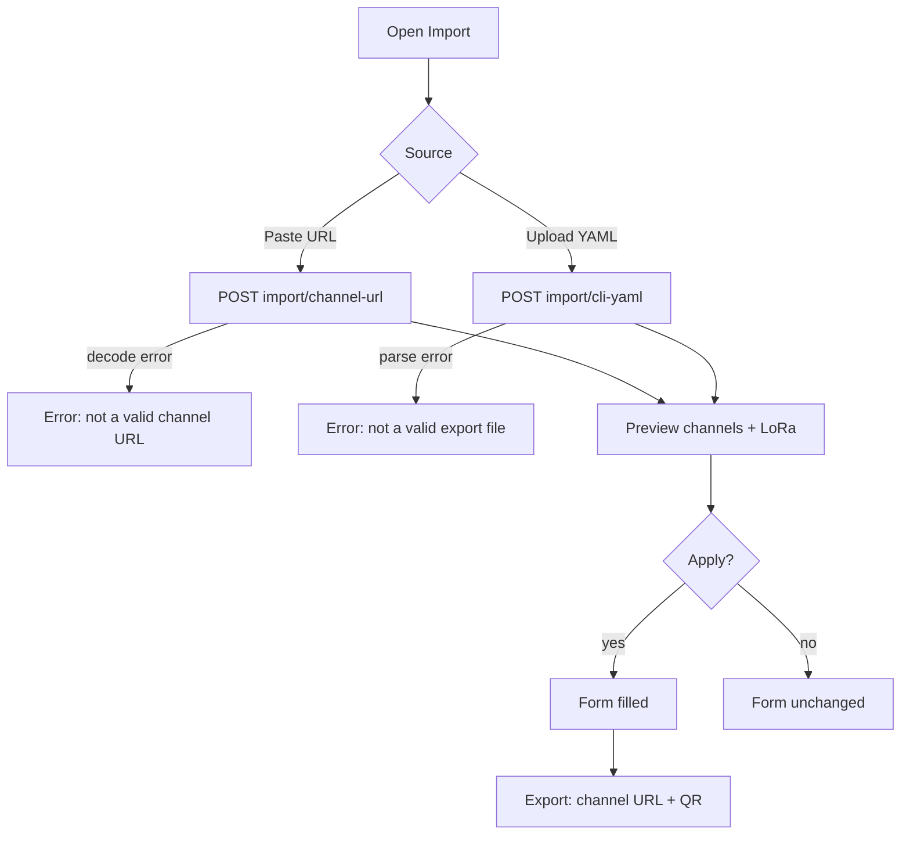

## Purpose

An operator often has channels already: from a Meshtastic app, a QR code, or a
`meshtastic --export-config` file. The project imports them into the config form. It
also exports the config's channels as a channel URL and a QR code, so phones join the
same mesh.

## User stories

- As an operator, I want to paste a channel URL, so that I do not type PSKs by hand.
- As an organizer, I want a QR code of the event channels, so that attendees with phones
  join.
- As an operator, I want to upload my CLI export YAML, so that I build firmware from my
  current device config.

## Functional requirements

- FR-channel-share-1 — `POST /api/v1/import/channel-url` takes a `meshtastic.org/e/#`
  URL and returns the channels and the LoRa settings in it.
- FR-channel-share-2 — The import accepts the forms `https://meshtastic.org/e/#…` and
  `https://meshtastic.org/e/?add=true#…`.
- FR-channel-share-3 — The import decodes the base64url fragment as a `ChannelSet`
  protobuf with the `meshtastic` python package.
- FR-channel-share-4 — `POST /api/v1/import/cli-yaml` takes a YAML file of at most
  64 KB from `meshtastic --export-config`.
- FR-channel-share-5 — The YAML import maps `owner`, `owner_short`, `channel_url` and
  every `config` and `module_config` field that has a userPrefs key.
- FR-channel-share-6 — The YAML import lists every field that has no userPrefs key, as
  "Not applied".
- FR-channel-share-7 — The import shows a preview of the decoded channels before it
  changes the form.
- FR-channel-share-8 — An "Apply" control fills the form from the preview. With an
  `add=true` URL, the channels go into the first free indices.
- FR-channel-share-9 — `POST /api/v1/export/channel-url` returns the channel URL for the
  channels and LoRa settings in the config.
- FR-channel-share-10 — The export returns an SVG QR code of the channel URL.
- FR-channel-share-11 — The project parses YAML with `yaml.safe_load` only.
- FR-channel-share-12 — The server keeps no copy of an imported URL or YAML file.

## User flows

1. The operator opens Import on the build page.
2. The operator pastes a channel URL or uploads a YAML file.
3. If the input is not valid, the page shows the error and keeps the form unchanged.
4. The page shows a preview of the channels, the LoRa settings and the "Not applied"
   list.
5. The operator selects Apply. The page fills the form.
6. The operator opens Export to get the channel URL and the QR code.

## Screens & states

Mockup: [05-channel-share](../mockups/05-channel-share.html).

| State | What the operator sees |
|---|---|
| Empty | URL field, file field, help text with an example URL shape. |
| Preview | Table of channels: index, name, PSK (masked, Show control), role (primary/secondary). LoRa: region, modem preset. |
| Not applied | Amber list of fields with no userPrefs key. |
| Error | Red text: "This is not a valid Meshtastic channel URL." |
| Export | Channel URL in a read-only field with Copy, QR code SVG. |

## Behaviour rules

- Channel URL format: python `meshtastic/node.py` `getURL` and `setURL` (lines 384–463 at
  https://github.com/meshtastic/python, package 2.7.11). The fragment is URL-safe
  base64 without padding.
- The `meshtastic` package is GPL-3.0. The project is GPL-3.0 after Epic 0, so the
  import is allowed (ADR 0004).
- A PSK of 1 byte is a default-key index. The preview shows it as "Default key <n>".

## Data touched

None stored.

## Interfaces

| Method | Path | Request | Response |
|---|---|---|---|
| POST | `/api/v1/import/channel-url` | `{url}` | `{channels: [...], lora: {...}}`; 422 |
| POST | `/api/v1/import/cli-yaml` | multipart `file` | `{config: {...}, not_applied: [...]}`; 413; 422 |
| POST | `/api/v1/export/channel-url` | config | `{url, qr_svg}` |

CLI export format: https://meshtastic.org/docs/software/python/cli/ (checked 2026-11-21).

## Edge cases & failures

- A URL with more than 8 channels: the import takes the first 8 and warns.
- An `add=true` URL when all 8 indices are used: the import shows "No free channel index."
- A YAML file with Python object tags: `safe_load` rejects it, and the import returns 422.

## Acceptance criteria

- The URL of the default `LongFast` channel imports as channel 0, name empty, PSK default key 1, modem preset `LONG_FAST`.
- An export of an imported URL gives the same URL.
- A URL with a broken fragment returns 422 with "This is not a valid Meshtastic channel URL."
- A YAML export with `owner: Alice` fills the long name "Alice".
- A YAML export with `module_config.serial` lists `serial` under "Not applied".
- A YAML file with `!!python/object` returns 422.
- The export response holds an SVG with a QR code that decodes to the channel URL.

## Out of scope

Contact URLs (`meshtastic.org/v/#`). Camera QR scan.

## Open questions
