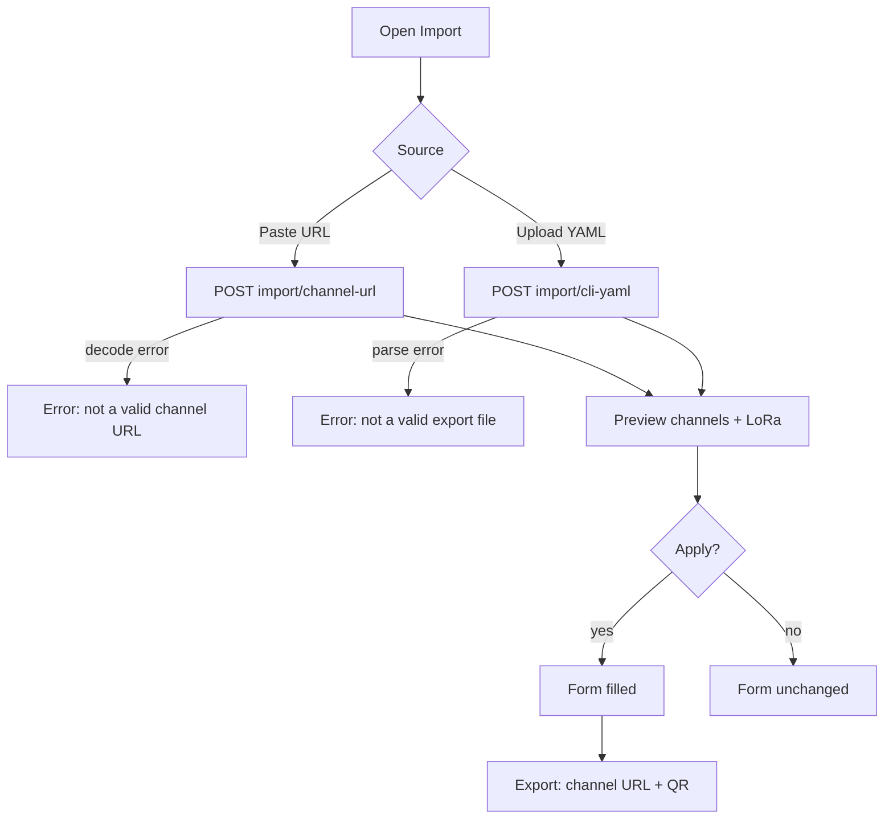

## Purpose

An operator often has channels already: from a Meshtastic app, a QR code, or a
`meshtastic --export-config` file. The project imports them into the config form. It
also exports the config's channels as a channel URL and a QR code, so phones join the
same mesh.

## User stories

- As an operator, I want to paste a channel URL, so that I do not type PSKs by hand.
- As an organizer, I want a QR code of the event channels, so that attendees with phones
  join.
- As an operator, I want to upload my CLI export YAML, so that I build firmware from my
  current device config.

## Functional requirements

- FR-channel-share-1 — `POST /api/v1/import/channel-url` takes a `meshtastic.org/e/#`
  URL and returns the channels and the LoRa settings in it.
- FR-channel-share-2 — The import accepts the forms `https://meshtastic.org/e/#…` and
  `https://meshtastic.org/e/?add=true#…`.
- FR-channel-share-3 — The import decodes the base64url fragment as a `ChannelSet`
  protobuf with the `meshtastic` python package.
- FR-channel-share-4 — `POST /api/v1/import/cli-yaml` takes a YAML file of at most
  64 KB from `meshtastic --export-config`.
- FR-channel-share-5 — The YAML import maps each field in the list below that has a
  userPrefs key. A mapped field that an imported section leaves out gets its proto default.
  - Top level: `owner`, `owner_short` (`ownerShort`), `channel_url` (`channelUrl`),
    `canned_messages`, `ringtone`, `location`.
  - `config.device`: `role`, `rebroadcastMode`, `nodeInfoBroadcastSecs`, `tzdef`,
    `buttonGpio`.
  - `config.position`: `gpsMode`, `gpsUpdateInterval`, `positionBroadcastSecs`,
    `positionBroadcastSmartEnabled`, `fixedPosition`.
  - `config.lora`: `region`, `modemPreset`, `channelNum`, `ignoreMqtt`, `txPower`,
    `txEnabled`, `configOkToMqtt`.
  - `config.network`: `wifiEnabled`, `wifiSsid`, `wifiPsk`, `enabledProtocols`,
    `ipv6Enabled`.
  - `config.security`: `adminKey`, `isManaged`, `packetSignaturePolicy`.
  - `config.bluetooth`: `fixedPin`, in the `FIXED_PIN` mode only.
  - `module_config.mqtt`: `enabled`, `address`, `username`, `password`, `root`,
    `encryptionEnabled`, `tlsEnabled`.
  - `module_config.telemetry`: `deviceUpdateInterval`, `environmentMeasurementEnabled`,
    `environmentUpdateInterval`, `environmentScreenEnabled`, `airQualityEnabled`,
    `airQualityInterval`, `airQualityScreenEnabled`.
  - `module_config.externalNotification`: `nagTimeout`.
- FR-channel-share-6 — The YAML import lists as "Not applied" each field that has no
  userPrefs key, and each value that the config rejects.
- FR-channel-share-7 — The import shows a preview of the decoded channels before it
  changes the form.
- FR-channel-share-8 — An "Apply" control fills the form from the preview. An `add=true`
  URL follows upstream `Node.setURL`:
  - The import skips a channel with an empty name or with a name that the config uses.
  - Each added channel goes into the next free index, from index 1. Index 0 stays.
  - Each added channel has the role SECONDARY.
  - A free index is an index that the firmware version reads.
- FR-channel-share-9 — `POST /api/v1/export/channel-url` returns the channel URL for the
  channels and LoRa settings in the config.
- FR-channel-share-10 — The export returns an SVG QR code of the channel URL.
- FR-channel-share-11 — The project parses YAML with `yaml.safe_load` only.
- FR-channel-share-12 — The server keeps no copy of an imported URL or YAML file.

## User flows

1. The operator opens Import on the build page.
2. The operator pastes a channel URL or uploads a YAML file.
3. If the input is not valid, the page shows the error and keeps the form unchanged.
4. The page shows a preview of the channels, the LoRa settings and the "Not applied"
   list.
5. The operator selects Apply. The page fills the form.
6. The operator opens Export to get the channel URL and the QR code.

## Screens & states

Mockup: [05-channel-share](../mockups/05-channel-share.html).

| State | What the operator sees |
|---|---|
| Empty | URL field, file field, help text with an example URL shape. |
| Preview | Table of channels: index, name, PSK (masked, Show control), role (primary/secondary). LoRa: region, modem preset. |
| Not applied | Amber list of the values that Apply leaves out: a field with no userPrefs key, a rejected value, or a value that the firmware version does not read. |
| Error | Red text: "This is not a valid Meshtastic channel URL." |
| Export | Channel URL in a read-only field with Copy, QR code SVG. An amber list shows the export warnings. |

## Behaviour rules

- Channel URL format: python `meshtastic/node.py` `getURL` and `setURL` (lines 384–463 at
  https://github.com/meshtastic/python, package 2.7.11). The fragment is URL-safe
  base64 without padding.
- The `meshtastic` package is GPL-3.0. The project is GPL-3.0 after Epic 0, so the
  import is allowed (ADR 0004).
- A PSK of 1 byte is a default-key index. The preview shows it as "Default key <n>".
- Apply puts no value into a control or an option that the firmware version does not
  read. The preview lists each such value as "Not applied", with the reason "this
  firmware version does not read it".
- The PSK `{ }` is a PSK of 0 bytes. Upstream `Channels::getKey` gives the primary channel
  no encryption, and a secondary channel the primary key. The import fills `{ }` for an
  empty PSK, and the export writes an empty PSK.
- The preview shows an empty PSK by the channel role, as upstream `Channels::getKey` reads it
  (`src/mesh/Channels.cpp:221-226` at `v2.7.26.54e0d8d`):
  - A primary channel shows "No encryption".
  - A secondary channel shows "Uses the primary channel key".
- A channel name is at most 11 bytes in UTF-8. Upstream `channel.options` gives
  `ChannelSettings.name` a `max_size` of 12, and the C string ends with a 0 byte.

## Data touched

None stored.

## Interfaces

| Method | Path | Request | Response |
|---|---|---|---|
| POST | `/api/v1/import/channel-url` | `{url}`, at most 4096 characters | `{channels: [...], lora: {...}, add, warnings: [...]}`; 422 |
| POST | `/api/v1/import/cli-yaml` | multipart `file` | `{config: {...}, not_applied: [...], warnings: [...]}`; 413; 422 |
| POST | `/api/v1/export/channel-url` | config | `{url, qr_svg, warnings: [...]}`; 422 |

- `add` is true for an `add=true` URL.
- Each channel has `uses_primary_key`: true for a secondary channel with an empty PSK.
- `qr_svg` is an SVG document of a QR code that holds `url`.
- The import `warnings` give the reason for each rejected value, and the 8-channel limit.
- The export `warnings` hold a line when the config sets no LoRa region.
- The cli-yaml route returns 413 when the `Content-Length` is over 64 KB plus 2 KB,
  before it reads the form.
- The export returns 422 for a config that is not valid, for `channels_to_write` 0, for
  a precision or a LoRa channel number that is not a `uint32` number, and for a URL
  that does not fit a QR code.

CLI export format: https://meshtastic.org/docs/software/python/cli/ (checked 2026-11-21).

## Edge cases & failures

- A URL with more than 8 channels: the import takes the first 8 and warns.
- An `add=true` URL when all 8 indices are used: the import shows "No free channel index."
- A YAML file with Python object tags: `safe_load` rejects it, and the import returns 422.
- A YAML value that Python cannot build, such as an int over 4300 digits or an impossible
  date: the import returns 422.
- A URL that is not ASCII, or that `urlsplit` rejects: the import returns 422.
- A config without a LoRa region: the export gives the URL with the region UNSET and a
  warning.

## Acceptance criteria

- The URL of the default `LongFast` channel imports as channel 0, name empty, PSK default key 1, modem preset `LONG_FAST`.
- An export of an imported URL gives the same URL.
- A URL with a broken fragment returns 422 with "This is not a valid Meshtastic channel URL."
- A YAML export with `owner: Alice` fills the long name "Alice".
- A YAML export with `module_config.serial` lists `serial` under "Not applied".
- A YAML file with `!!python/object` returns 422.
- The export response holds an SVG with a QR code that decodes to the channel URL.

## Out of scope

Contact URLs (`meshtastic.org/v/#`). Camera QR scan.

## Open questions
