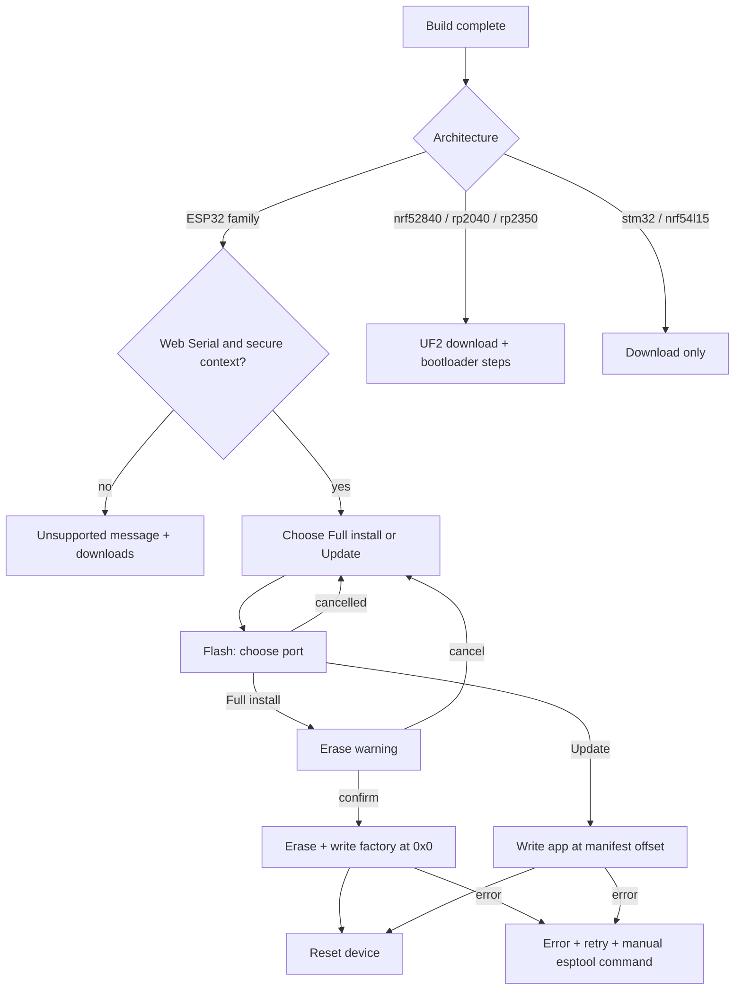

## Purpose

After a build completes, the operator flashes an ESP32-family artifact from the page. No
`esptool.py` install is needed. For UF2 variants, the page gives step-by-step
drag-and-drop instructions.

## User stories

- As an operator, I want to flash my build from the page, so that I do not install
  command-line tools.
- As an operator with an nRF52 device, I want clear UF2 steps, so that I flash it
  without a search.

## Functional requirements

- FR-browser-flashing-1 — The project vendors esptool-js 0.7.x (Apache-2.0) under
  `static/vendor/`.
- FR-browser-flashing-2 — On `complete` for an ESP32-family variant, the progress panel
  shows a "Flash" control.
- FR-browser-flashing-3 — "Flash" opens the Web Serial port picker.
- FR-browser-flashing-4 — The operator chooses "Full install" or "Update".
- FR-browser-flashing-5 — "Full install" erases the flash, then writes the factory
  artifact at offset `0x0`.
- FR-browser-flashing-6 — "Update" writes the app artifact at the app partition offset
  from the build's `.mt.json` manifest.
- FR-browser-flashing-7 — "Full install" shows the warning "This erases the device.
  Saved settings, messages and keys are lost." before the operator confirms.
- FR-browser-flashing-8 — The flash panel shows progress in percent and the current
  step: connecting, erasing, writing, verifying, resetting.
- FR-browser-flashing-9 — After the write, esptool-js resets the device.
- FR-browser-flashing-10 — For `nrf52840`, `rp2040` and `rp2350` variants, the panel
  shows the UF2 download and the steps to enter the bootloader for that architecture.
- FR-browser-flashing-11 — When `navigator.serial` is absent, the panel shows "This
  browser cannot flash. Use Chrome or Edge on a desktop." and the download links.
- FR-browser-flashing-12 — When the page is not a secure context, the panel shows "Web
  Serial needs HTTPS. Open this page through the TLS proxy or on localhost." and the
  download links.
- FR-browser-flashing-13 — The page fetches artifacts for flashing from the artifact
  route of feature 06. No artifact goes to a third party.

## User flows

1. A build reaches `complete`.
2. For an ESP32-family variant in Chrome or Edge over HTTPS, the panel shows Flash.
3. The operator chooses Full install or Update.
4. The operator selects Flash and chooses the serial port.
5. For a full install, the panel warns about the erase. The operator confirms.
6. The page writes the artifact and shows progress.
7. The page resets the device and shows the done text of the mode.
8. If an error occurs, the panel shows the error, a Retry control, and the equivalent
   `esptool.py` command.

## Screens & states

Mockup: [06-flash](../mockups/06-flash.html).

| State | What the operator sees |
|---|---|
| Ready | Flash control, Full install / Update choice. |
| Port picker | The browser's own dialog. |
| Connecting | "Connecting. If this takes more than 10 seconds, hold BOOT and press RESET." |
| Writing | Progress bar with percent. |
| Done | Full install: "Done. The device restarts with your factory defaults." Update: "Done. The device restarts and keeps its saved settings." |
| Error | Error text, Retry, manual command. |
| Unsupported browser / not secure | Message and download links. |
| UF2 | Numbered steps, UF2 download control. |

## Behaviour rules

- The page connects at 921600 baud first. On a connect error, the page tries 115200 baud.
  When no ROM bootloader answers the sync, the page does not try 115200, because each
  attempt syncs at the ROM rate of 115200. The manual command uses 921600.
- esptool-js: https://github.com/espressif/esptool-js (0.7.1, 2026-11-02).
- Web Serial availability: https://developer.mozilla.org/en-US/docs/Web/API/Web_Serial_API
  (checked 2026-11-21). Chrome and Edge on desktop. Not Safari, not Firefox.
- The project does not copy code from `meshtastic/web-flasher` (GPL-3.0 is compatible,
  but the project keeps its own small panel).

## Data touched

None on the server.

## Interfaces

Uses `GET /api/v1/builds/{build_id}/artifacts` and `/artifacts/{name}` (feature 06).

## Edge cases & failures

- The operator unplugs the device during a write: the panel shows the error. A full
  install is safe to repeat.
- A port that is not an ESP32: esptool-js fails to sync. The panel shows "No ESP32 found
  on this port."
- Update on a device with another partition table: the panel advises Full install.

## Acceptance criteria

- In Chrome over HTTPS, an ESP32 build shows a Flash control.
- In a browser without `navigator.serial`, the panel shows the unsupported message and the download links.
- Over plain HTTP on a LAN address, the panel shows the HTTPS message.
- Full install shows the erase warning before any write.
- A manual test flashes `heltec-v4` with a full install, and the device boots with the config's owner name.
- An nRF52 build shows the UF2 steps and no Flash control.
- The page loads esptool-js from the project's own host.

## Out of scope

Serial DFU for nRF52. OTA. Flash of stm32 variants.

## Open questions
