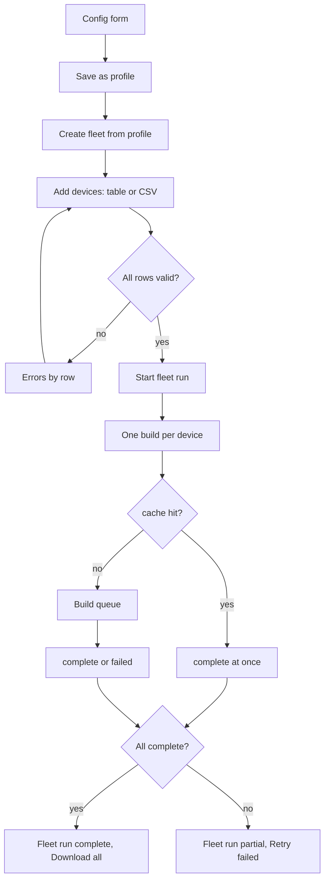

## Purpose

An organizer saves a config as a profile, defines a fleet of devices, and makes one
build per device in one fleet run. Each device can differ in names, variant, role,
fixed position and admin key. The build cache returns a repeated build at once.

Epic 10 covers FR 1–9 (profiles and build cache). Epic 11 covers FR 10–20 (fleets and
fleet runs).

## User stories

- As an organizer, I want to save the event config as a profile, so that I reuse it next
  year.
- As an organizer, I want to list 20 devices with their names and variants, so that I
  build all of them in one step.
- As an organizer, I want a repeated build to be instant, so that a second download
  does not take 10 minutes.

## Functional requirements

- FR-fleet-builds-1 — An operator saves the current config as a profile with a unique
  name.
- FR-fleet-builds-2 — A profile stores no secret, unless the profile stores secrets
  (FR 3). On save, the project removes PSKs, WiFi PSK, MQTT password and admin keys, and
  marks each removed field "must re-enter".
- FR-fleet-builds-3 — An operator opts in per profile to store secrets. The project then
  encrypts the secrets with a key derived from `secret_key`, and shows "This profile
  stores secrets on the server." Only an admin stores, loads or removes the stored
  secrets of a profile (ADR 0007).
- FR-fleet-builds-4 — An operator loads, renames, exports as JSON and deletes a profile.
- FR-fleet-builds-5 — The project computes a config hash: HMAC-SHA-256 keyed with
  `secret_key`, over the app version, the firmware version, the variant and the userPrefs
  file with its keys sorted.
- FR-fleet-builds-6 — Before it queues a build, the project looks up the config hash in
  the build cache.
- FR-fleet-builds-7 — On a hit, the build gets status `complete` at once with the cached
  artifacts.
- FR-fleet-builds-8 — The build cache stores only artifacts. It removes an entry
  `MTFW_CACHE_TTL_SECONDS` (default 86400) after its last use. Exception: the build cache
  never stores or serves the artifacts of a config with a secret. A 1-byte channel PSK
  selects a published default key, so it is not a secret here.
- FR-fleet-builds-9 — An admin turns the build cache off with `MTFW_CACHE_ENABLED=false`.
- FR-fleet-builds-10 — An operator creates a fleet from a profile.
- FR-fleet-builds-11 — A fleet device has: label, variant, long name, short name, role,
  fixed latitude, fixed longitude, fixed altitude, admin key. Each field except label is
  optional and overrides the profile.
- FR-fleet-builds-12 — An operator adds fleet devices by a table form or by pasting CSV
  with the header `label,variant,long_name,short_name,role,lat,lon,alt,admin_key`.
- FR-fleet-builds-13 — The project validates each fleet device. It shows every error
  with the row number before a fleet run starts.
- FR-fleet-builds-14 — A fleet holds at most `MTFW_MAX_FLEET_SIZE` devices (default 50).
- FR-fleet-builds-15 — A fleet run makes one build per fleet device. The fleet run
  feeds the builds to the build queue one at a time. Each build counts toward the build
  queue limit of feature 06.
- FR-fleet-builds-16 — The fleet run page shows one row per fleet device with its build
  status.
- FR-fleet-builds-17 — A failed fleet device build does not stop the fleet run. The
  fleet run ends `partial` when a fleet device has a complete build. The fleet run ends
  `failed` when no fleet device has a complete build.
- FR-fleet-builds-18 — "Retry failed" queues the failed fleet devices again.
- FR-fleet-builds-19 — "Download all" returns one zip with a folder per fleet device
  label.
- FR-fleet-builds-20 — The zip holds a `manifest.csv` with label, variant, firmware
  version, artifact names and config hash. It holds no secret.

## User flows

1. The organizer fills the config form and saves it as a profile.
2. The organizer creates a fleet from the profile.
3. The organizer adds fleet devices by table or by CSV.
4. If a row is not valid, the page shows the error with the row number.
5. The organizer starts the fleet run.
6. The page shows each fleet device's build status.
7. When the fleet run ends, the organizer downloads all artifacts as one zip.

## Screens & states

Mockup: [07-fleet](../mockups/07-fleet.html).

| Screen | States |
|---|---|
| Profiles list | Empty ("No profiles yet. Save one from the build page."), populated, delete confirm. |
| Fleet editor | Empty table, populated, CSV paste dialog, row errors, "Clear admin key" on a row with a saved admin key, CSV file that is not UTF-8. |
| Fleet run | Queued, running (rows update live), complete, partial, failed. |

The fleet editor does not list the past fleet runs of a fleet. The fleet run URL holds
the fleet run id, and no page links to it after the fleet run page closes. The operator
keeps the fleet run URL, the same as the URL of a single build.

## Behaviour rules

- Per-device overrides write these userPrefs keys: `USERPREFS_CONFIG_OWNER_LONG_NAME`,
  `USERPREFS_CONFIG_OWNER_SHORT_NAME`, `USERPREFS_CONFIG_DEVICE_ROLE`,
  `USERPREFS_FIXED_GPS*`, `USERPREFS_USE_ADMIN_KEY_0`.
- A fleet run with a profile that has "must re-enter" secrets asks for them once, for
  the whole fleet run. The project holds them in memory for that fleet run only.
- The project drops the held secrets of a fleet run in these cases:
  - the fleet run ends `complete`.
  - the fleet run stops because of an internal error.
  - `build_max_age_seconds` passes after the fleet run ends.
  - the operator deletes the fleet.
- Retry failed uses the held secrets. A secret that the operator enters again replaces
  the held secret.
- Retry failed uses the profile of the fleet run, also after the fleet gets another
  profile.
- A fleet run of an admin session uses the stored secrets of the profile, so it needs the
  CSRF token.
- A fleet device id stays the same after a save. The fleet editor sends the id of each
  saved row, so a renamed label keeps its fleet device. A row without the id of a saved
  fleet device of the fleet gets the saved fleet device with the same label.
- A label is unique in a fleet and holds at most 64 characters.
- A fleet device position needs both `lat` and `lon`. One coordinate alone is a row
  error.
- When the profile has GPS off, a fleet device position writes only the
  `USERPREFS_FIXED_GPS*` keys. The other GPS keys of the profile stay out.
- A `manifest.csv` cell that starts with `=`, `+`, `-`, `@`, a tab or a carriage return
  gets a `'` before it, so a spreadsheet does not run it as a formula.
- A zip folder name is unique without regard to case. It has no trailing dot. A Windows
  reserved name, for example `CON`, gets a `_` before it.
- The per-device role accepts only the roles of FR-config-coverage-4. A row with
  `ROUTER`, `ROUTER_LATE` or `LOST_AND_FOUND` is a row error: "Router roles cannot be set
  as a factory default. Use Push config after flashing." The firmware would replace them
  with `CLIENT`.
- Short name: at most 4 characters. Long name: at most 25 bytes (firmware 2.8 limit).
- Lat −90 to 90, lon −180 to 180, alt −1000 to 10000 m.

## Data touched

New tables (see spec `Data model`): `profiles` (replaces the unused `config_profiles`),
`fleets`, `fleet_devices`, `fleet_runs`, `cache_entries`. `builds` gains
`fleet_run_id`. Migration: drop `config_profiles` (it holds no rows).

## Interfaces

| Method | Path | Response |
|---|---|---|
| GET/POST | `/api/v1/profiles` | list / 201 |
| GET/PUT/DELETE | `/api/v1/profiles/{id}` | profile / 200 / 204 |
| GET/POST | `/api/v1/fleets` | list / 201 |
| GET/PUT/DELETE | `/api/v1/fleets/{id}` | fleet / 200 / 204; 422 above `MTFW_MAX_FLEET_SIZE` devices |
| PUT | `/api/v1/fleets/{id}/devices` | 200 with no admin key; 422 with row errors |
| POST | `/api/v1/fleets/{id}/devices/csv` | 200 with no admin key; 422 with row errors, or one error above `MTFW_MAX_FLEET_SIZE` rows or 65536 characters |
| DELETE | `/api/v1/fleets/{id}` | 204; 409 while a fleet run of the fleet runs |
| POST | `/api/v1/fleets/{id}/runs` | 202 `{run_id, progress_url}` with the fleet run id; 403 for an admin session without the CSRF token; 409 while a fleet run of the fleet runs; 429 above the build rate limit; 503 when the build queue is full |
| GET | `/api/v1/fleet-runs/{id}` | status per fleet device; 404 for a row id |
| POST | `/api/v1/fleet-runs/{id}/retry` | 202; 409 while a fleet run of the fleet runs or with no failed fleet device; 403, 429 and 503 as for a start |
| GET | `/api/v1/fleet-runs/{id}/download` | zip; 409 while the fleet run runs |
| GET | `/fleets` | Fleets page |
| GET | `/fleets/{id}` | Fleet editor page |
| GET | `/fleet-runs/{id}` | Fleet run page; an htmx request gets the state only |

In each `/fleet-runs/{id}` path, `{id}` is the fleet run id.

## Edge cases & failures

- Two fleet devices with the same label: a row error.
- A variant that is not in the chosen firmware version: a row error.
- The server restarts during a fleet run: the fleet run shows `partial`, and Retry
  failed continues it. If every fleet device has a complete build, the fleet run shows
  `complete`.
- Single builds fill the build queue during a fleet run: the next build of the fleet run
  waits until the build queue has space.

## Acceptance criteria

- A saved profile holds no PSK in the database.
- A profile with "store secrets" on holds the PSK encrypted, not as plain text.
- A second build with the same config completes in under 1 second.
- A CSV of 3 rows with one bad role shows one error that names row 2.
- A fleet run of 3 devices gives 3 builds and a zip with 3 folders and `manifest.csv`.
- `manifest.csv` holds no PSK.
- A fleet run where one build fails ends `partial`, and Retry failed builds only that device.
- A fleet of 51 devices returns 422.

## Out of scope

Printing labels. Sharing a profile between instances other than by JSON export.

## Open questions
