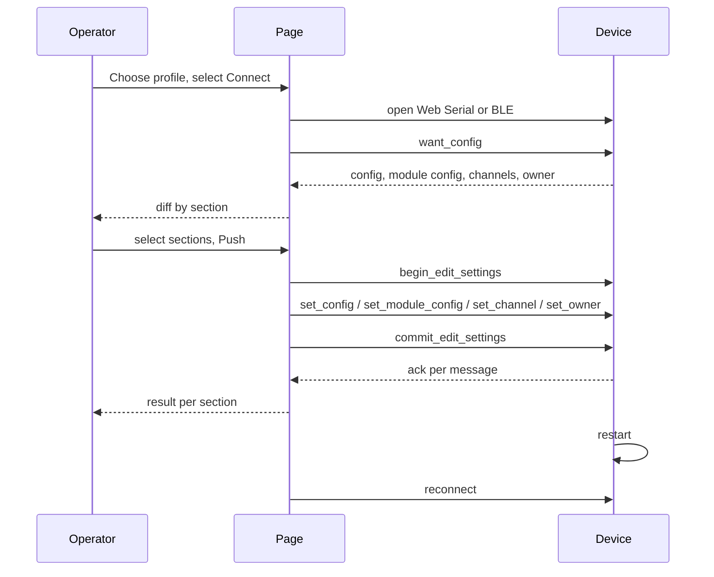

## Purpose

An operator pushes a config to a device that already runs Meshtastic, over Web Serial
or Web Bluetooth, with no build. This covers settings that have no userPrefs key, and
devices that already run stock firmware. The JavaScript client libraries are changing,
so the epic starts with a spike.

## User stories

- As an operator, I want to apply my profile to a device that runs stock firmware, so
  that I do not compile.
- As an organizer, I want to see what will change before I push, so that I do not break
  a working device.

## Functional requirements

- FR-push-config-1 — A spike compares `@meshtastic/core` with
  `@meshtastic/transport-web-serial` and `@meshtastic/transport-web-bluetooth` (JSR)
  against `meshtastic-sdk` JS. It records the choice in an ADR.
- FR-push-config-2 — The project vendors the chosen library under `static/vendor/` as
  one prebuilt ES module per package, joined by an import map. The project has no
  JavaScript build step.
- FR-push-config-3 — "Connect" opens the Web Serial port picker or the Web Bluetooth
  device picker.
- FR-push-config-4 — After connect, the page reads the device's config, module config,
  channels and owner.
- FR-push-config-5 — The page shows a diff: each field where the device value differs
  from the profile value.
- FR-push-config-6 — The operator selects the sections to push.
- FR-push-config-7 — The page sends the selected sections in one admin transaction:
  `begin_edit_settings`, the `set_config`, `set_module_config`, `set_channel` and
  `set_owner` messages, then `commit_edit_settings`.
- FR-push-config-8 — The page shows a result per section: applied or failed with the
  device's error.
- FR-push-config-9 — The page tells the operator that the device restarts after a
  commit, and reconnects when the port returns.
- FR-push-config-10 — Push config covers the `module_config` sections that have no
  userPrefs key: serial, store_forward, range_test, external_notification, neighbor_info,
  detection_sensor, paxcounter. The protobufs in `@meshtastic/core` 2.6.7 are 2.7.8.
  They have no `statusmessage` or `traffic_management` field, so push config does not
  cover those two sections (owner ruling on #70). A newer library can add them again.
  **Deferred** (PM decision at the #73 gate): a profile has no field for these
  sections, so Epic 12 pushes only profile fields.
  [#182](https://github.com/Crank-Git/MTFWBuilder/issues/182) carries the work. The planned feature [module-settings](16-module-settings.md) restores it.
- FR-push-config-11 — When the device has managed mode on, the page shows "This device
  is managed. Only an admin key holder can change it remotely." and pushes nothing.
- FR-push-config-12 — Secrets go only from the page to the device. The server receives
  no device data.

## User flows

1. The operator chooses a profile and selects Connect.
2. The page reads the device's current values.
3. If the device is managed, the page stops with the managed message.
4. The page shows the diff by section.
5. The operator selects the sections and selects Push.
6. The page sends the changes in one admin transaction.
7. The page shows the result per section, and reconnects after the restart.

## Screens & states

Mockup: [08-push-config](../mockups/08-push-config.html).

| State | What the operator sees |
|---|---|
| Not connected | Connect via USB, Connect via Bluetooth, browser support note. |
| Profile warning | The `warning` text of the profile, for example "Sign in as admin to load the stored secrets." |
| Reading | "Reading device config…". The page shows no step count. |
| Read failed | The error. The page closes the port when the device sends no config in 10 seconds, or when the connection drops. |
| Re-enter | A password field for each secret that the profile does not store. Push stays disabled until each one holds a valid value. |
| Diff | Sections with changed fields: device value → profile value. Checkboxes per section. |
| Not pushed | Each profile value that push config does not send, with the reason. |
| No changes | "The device already matches this profile." |
| Pushing | Progress per section. Connect via USB and Connect via Bluetooth are disabled until the reconnect ends. |
| Result | Applied / failed per section. Restart notice. |
| Result unknown | "The result is unknown. Read the device again." The connection over USB dropped during the commit. |
| Managed device | Managed message. Push disabled. |
| Unsupported | "This browser cannot connect. Use Chrome or Edge on a desktop." |
| Not secure | "Web Serial and Web Bluetooth need HTTPS. Open this page through the TLS proxy or on localhost." |

## Behaviour rules

- AdminMessage reference: protobufs `meshtastic/admin.proto` at tag `v2.8.3`.
- Library: `@meshtastic/core` 2.6.7, `@meshtastic/transport-web-serial` 0.2.5 and
  `@meshtastic/transport-web-bluetooth` 0.1.5 from npm, GPL-3.0-only (ADR 0008).
  The page loads them from `static/vendor/` as three esm.sh builds with an import map.
- The core build carries protobufs 2.7.8. It has no `ModuleConfig` fields
  `statusmessage` and `traffic_management` (ADR 0008).
- `meshtastic-sdk` (https://github.com/meshtastic/meshtastic-sdk) has no JS release, so
  the project does not use it (ADR 0008).
- Web Bluetooth: Chrome and Edge on desktop and Android.
- Managed mode: push config never sends `security.is_managed = true`. A managed device
  ignores each local admin message (`AdminModule::handleReceivedProtobuf`,
  `tests/fixtures/firmware/src/modules/AdminModule.cpp:86-89`), so a push cannot change
  that device again. Managed mode stays a factory default that a build sets. The page
  shows the field under "Not pushed" with "Set managed mode with a build. Push config
  does not set it."
- The page checks managed mode after each read: at connect and at the reconnect after a
  restart.
- Admin keys: when the profile sets an admin key, the push sends only the non-empty
  profile slots, in slot order. The device keeps no old key, and the list has no gap.
- Bluetooth: a profile PIN also sets the `FIXED_PIN` pairing mode, as
  `USERPREFS_FIXED_BLUETOOTH` does (`NodeDB.cpp:736-737`). The diff compares the pairing
  mode (#184).
- Fixed position: the page sends the profile `fixed_lat` and `fixed_lon` with
  `setFixedPosition` of core 2.6.7, inside the transaction and after the position config.
  The firmware delays the save of `set_fixed_position` until the commit while a
  transaction is open (`AdminModule::saveChanges`, `AdminModule.cpp:1364-1374`). The
  firmware also sets `fixed_position` (`AdminModule.cpp:419-433`), so a later position
  config would replace it. `setFixedPosition` takes no altitude, so `fixed_alt` is under
  "Not pushed".
- Not pushed: the page lists each profile value that push config does not send, with one
  of these reasons:
  - Core 2.6.7 has no field for this value.
  - The firmware reads this value only from a build.
  - Push config does not send this value.
  - The managed mode text and the altitude text above.
- Test hook: the page uses `window.__pushConfigTestDevice` only when the template renders
  the test flag. The template renders it only when the `push_test_hooks` setting
  (`MTFW_PUSH_TEST_HOOKS`) is on. Only the E2E test config turns it on.

## Data touched

None on the server.

## Interfaces

Device protocol only, through the chosen library. No server routes.

## Edge cases & failures

- The device has older firmware that lacks a field: the device drops each field that its
  protobufs do not have, and applies the rest of the message. The page shows that section
  as applied.
- The device rejects a set message: the page shows that section as failed with the device
  error, and the other sections still apply.
- The connection drops mid-transaction: no commit is sent, so the device keeps its old
  config. The page says so.
- The connection drops during the commit over USB: the page cannot tell if the device
  saved the config. It shows "The result is unknown. Read the device again." and closes
  the port.
- The connection drops during the commit over Bluetooth: the device turns its radio off
  at the commit, so the page counts the drop as the restart and connects again.
- The device rejects the commit: the page shows the device error and closes the port.
- A profile with "must re-enter" secrets: the page asks for them before Push.
- A profile with a `warning`: the page shows the warning text above the connect controls.

## Acceptance criteria

- An ADR records the library choice and its version.
- A manual test pushes two channels to a device over Web Serial, and the Meshtastic app then shows the two channels.
- The diff lists only fields that differ.
- A drop before commit leaves the device's channels unchanged.
- A managed device shows the managed message, and no set message is sent.
- No request from the page to the server holds device data.

## Out of scope

Pushes to many devices at once. Push over TCP/HTTP.

## Open questions

- Which library: decided by the spike in FR-push-config-1 (ADR 0008).
- Vendor layout: three ES modules and an import map, by the owner ruling on #70
  (ADR 0008).
