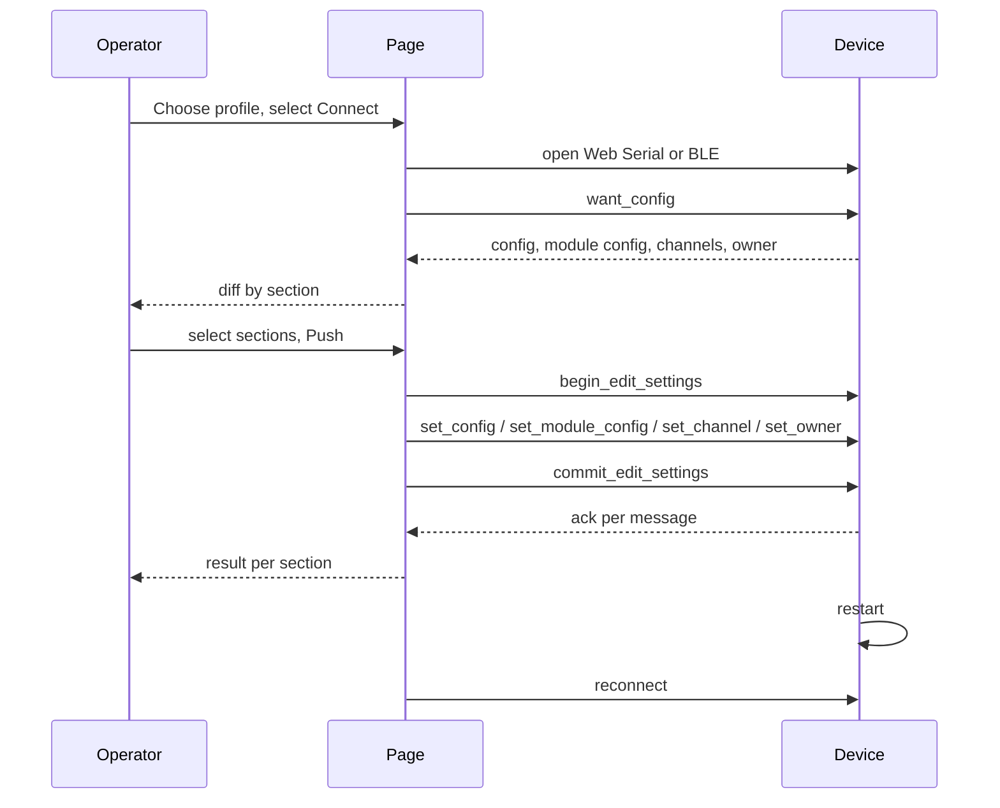

## Purpose

An operator pushes a config to a device that already runs Meshtastic, over Web Serial
or Web Bluetooth, with no build. This covers settings that have no userPrefs key, and
devices that already run stock firmware. The JavaScript client libraries are changing,
so the epic starts with a spike.

## User stories

- As an operator, I want to apply my profile to a device that runs stock firmware, so
  that I do not compile.
- As an organizer, I want to see what will change before I push, so that I do not break
  a working device.

## Functional requirements

- FR-push-config-1 — A spike compares `@meshtastic/core` with
  `@meshtastic/transport-web-serial` and `@meshtastic/transport-web-bluetooth` (JSR)
  against `meshtastic-sdk` JS. It records the choice in an ADR.
- FR-push-config-2 — The project vendors the chosen library as one prebuilt ES module
  under `static/vendor/`. The project has no JavaScript build step.
- FR-push-config-3 — "Connect" opens the Web Serial port picker or the Web Bluetooth
  device picker.
- FR-push-config-4 — After connect, the page reads the device's config, module config,
  channels and owner.
- FR-push-config-5 — The page shows a diff: each field where the device value differs
  from the profile value.
- FR-push-config-6 — The operator selects the sections to push.
- FR-push-config-7 — The page sends the selected sections in one admin transaction:
  `begin_edit_settings`, the `set_config`, `set_module_config`, `set_channel` and
  `set_owner` messages, then `commit_edit_settings`.
- FR-push-config-8 — The page shows a result per section: applied or failed with the
  device's error.
- FR-push-config-9 — The page tells the operator that the device restarts after a
  commit, and reconnects when the port returns.
- FR-push-config-10 — Push config covers the `module_config` sections that have no
  userPrefs key: serial, store_forward, range_test, external_notification, neighbor_info,
  detection_sensor, paxcounter, status_message, traffic_management.
- FR-push-config-11 — When the device has managed mode on, the page shows "This device
  is managed. Only an admin key holder can change it remotely." and pushes nothing.
- FR-push-config-12 — Secrets go only from the page to the device. The server receives
  no device data.

## User flows

1. The operator chooses a profile and selects Connect.
2. The page reads the device's current values.
3. If the device is managed, the page stops with the managed message.
4. The page shows the diff by section.
5. The operator selects the sections and selects Push.
6. The page sends the changes in one admin transaction.
7. The page shows the result per section, and reconnects after the restart.

## Screens & states

Mockup: [08-push-config](../mockups/08-push-config.html).

| State | What the operator sees |
|---|---|
| Not connected | Connect via USB, Connect via Bluetooth, browser support note. |
| Reading | "Reading device config…" with a step count. |
| Diff | Sections with changed fields: device value → profile value. Checkboxes per section. |
| No changes | "The device already matches this profile." |
| Pushing | Progress per section. |
| Result | Applied / failed per section. Restart notice. |
| Managed device | Managed message. Push disabled. |
| Unsupported | "This browser cannot connect. Use Chrome or Edge on a desktop." |

## Behaviour rules

- AdminMessage reference: protobufs `meshtastic/admin.proto` at tag `v2.8.3`.
- Library candidates (checked 2026-11-21):
  - `@meshtastic/core` 2.6.6, `@meshtastic/transport-web-serial` 0.2.5,
    `@meshtastic/transport-web-bluetooth` 0.1.2 on https://jsr.io/@meshtastic. GPL-3.0.
    The source repo `meshtastic/js` is archived.
  - `meshtastic-sdk` (https://github.com/meshtastic/meshtastic-sdk), Kotlin Multiplatform,
    GPL-3.0. Its JS build is "snapshot only until 0.3.0".
- Web Bluetooth: Chrome and Edge on desktop and Android.

## Data touched

None on the server.

## Interfaces

Device protocol only, through the chosen library. No server routes.

## Edge cases & failures

- The device has older firmware that lacks a field: the device rejects that message.
  The page shows that section as failed, and the other sections still apply.
- The connection drops mid-transaction: no commit is sent, so the device keeps its old
  config. The page says so.
- A profile with "must re-enter" secrets: the page asks for them before Push.

## Acceptance criteria

- An ADR records the library choice and its version.
- A manual test pushes two channels to a device over Web Serial, and the Meshtastic app then shows the two channels.
- The diff lists only fields that differ.
- A drop before commit leaves the device's channels unchanged.
- A managed device shows the managed message, and no set message is sent.
- No request from the page to the server holds device data.

## Out of scope

Pushes to many devices at once. Push over TCP/HTTP.

## Open questions

- Which library: decided by the spike in FR-push-config-1. Not blocking: the epic is
  last.
