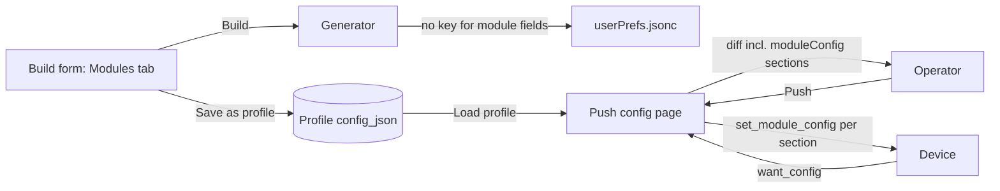

## Purpose

This feature adds the 7 `module_config` sections that have no userPrefs key to the build
form and to profiles: serial, store_forward, range_test, external_notification,
neighbor_info, detection_sensor and paxcounter. A build writes no userPrefs key for
these fields. Push config sends them to a connected device. This feature changes the
built feature [push-config](15-push-config.md) and restores FR-push-config-10, which
Epic 12 deferred ([#182](https://github.com/Crank-Git/MTFWBuilder/issues/182)). It also
changes what a profile holds ([fleet-builds](14-fleet-builds.md)).

Owner rulings on #182 (2026-11-21):

- The fields go in profiles and in the build form.
- The pin and hardware fields are in profiles, and they are optional.
- The fields go in one new tab, "Modules".
- `nag_timeout` comes from the existing build field "Ringtone nag seconds".

## User stories

- As an organizer, I want to keep the store and forward, range test and neighbor info
  settings in a profile, so that each device that I push gets the same module settings.
- As an operator, I want to set the serial module and the detection sensor of a board
  from the page, so that I do not use the Meshtastic app for each device.

## Functional requirements

- FR-module-settings-1 — The build form has an eleventh tab, "Modules", after
  "Advanced". The tab has one card for each section: Serial, Store and forward, Range
  test, External notification, Neighbor info, Detection sensor and Paxcounter.
- FR-module-settings-2 — The tab shows the note: "These settings are not compiled into
  the firmware. Push config sends them to a connected device."
- FR-module-settings-3 — Each card has the fields of its section in the table under
  Behaviour rules. Each field has the form field name of that table. Each field is
  empty by default, and an empty field means "keep the device value".
- FR-module-settings-4 — The pin and hardware fields have the label "(hardware)" and the
  help text "Leave empty to keep the pin of the device. A wrong pin can drive the wrong
  GPIO."
- FR-module-settings-5 — `ConfigRequest` validates each new field. A boolean is "true" or
  "false". An unsigned number is a whole number in the range of its proto type. A
  Paxcounter threshold is a whole number in the int32 range, and it can be negative. An enum is a name of its proto
  enum in `@meshtastic/core` 2.6.7. The detection sensor name has at most 20 bytes.
- FR-module-settings-6 — The generator writes no userPrefs key for a new field. The
  contract test lists the new fields as fields that write no userPrefs key.
- FR-module-settings-7 — A profile saves and loads the new fields as it does the other
  form fields. A profile export holds them. None of them is a secret.
- FR-module-settings-8 — Push config maps each new field to its `ModuleConfig` field
  (`moduleConfig.<section>`) and shows it in the diff. An empty field gives no diff row.
- FR-module-settings-9 — Push config sends the form field "Ringtone nag seconds"
  (`ringtone_nag_secs`) as `external_notification.nag_timeout`.
- FR-module-settings-10 — A diff row that changes a pin or hardware field shows the
  warning "This changes a pin. Check that the profile fits this board."
- FR-module-settings-11 — A neighbor info update interval below 14400 seconds shows the
  form error "The firmware uses at least 14400 seconds (4 hours)." This matches the
  firmware clamp in `AdminModule.cpp:991-994`.
- FR-module-settings-12 — A fleet device has no override for a new field. Each fleet
  device of a fleet run gets the profile value. Fleet builds write no key for these
  fields.

## User flows

1. The operator opens the Modules tab and fills the module fields that the profile must
   set.
2. The operator saves the config as a profile.
3. A build of this config writes no key for the module fields.
4. On the push config page, the operator loads the profile and connects a device.
5. The diff shows each module field that differs from the device. A pin change shows
   the pin warning.
6. Push sends each selected module section with `set_module_config` inside the admin
   transaction.

## Screens & states

Mockup: [09-module-settings](../mockups/09-module-settings.html).

| State | What the operator sees |
|---|---|
| Modules tab, empty | Seven cards, all fields empty, and the note of FR 2. |
| Field error | The field error under the field, as on the other tabs. |
| Hardware field | The "(hardware)" label and the help text of FR 4. |
| Push diff, module section | A section per module with each changed field: device value → profile value. |
| Push diff, pin change | The diff row and the pin warning of FR 10. |

## Behaviour rules

The fields below are from the `ModuleConfig` descriptor in the vendored
`@meshtastic/core` 2.6.7 (protobufs 2.7.8). HW marks a pin or hardware field.

| Section | Form field | Proto field | Type | HW |
|---|---|---|---|---|
| Serial | `serial_enabled` | `enabled` | bool | |
| Serial | `serial_echo` | `echo` | bool | |
| Serial | `serial_rxd` | `rxd` | uint32 | HW |
| Serial | `serial_txd` | `txd` | uint32 | HW |
| Serial | `serial_baud` | `baud` | enum `Serial_Baud` | |
| Serial | `serial_timeout` | `timeout` | uint32 | |
| Serial | `serial_mode` | `mode` | enum `Serial_Mode` | |
| Serial | `serial_override_console_serial_port` | `override_console_serial_port` | bool | HW |
| Store and forward | `store_forward_enabled` | `enabled` | bool | |
| Store and forward | `store_forward_heartbeat` | `heartbeat` | bool | |
| Store and forward | `store_forward_records` | `records` | uint32 | |
| Store and forward | `store_forward_history_return_max` | `history_return_max` | uint32 | |
| Store and forward | `store_forward_history_return_window` | `history_return_window` | uint32 | |
| Store and forward | `store_forward_is_server` | `is_server` | bool | |
| Range test | `range_test_enabled` | `enabled` | bool | |
| Range test | `range_test_sender` | `sender` | uint32 (seconds) | |
| Range test | `range_test_save` | `save` | bool | |
| External notification | `ext_notify_enabled` | `enabled` | bool | |
| External notification | `ext_notify_output_ms` | `output_ms` | uint32 | |
| External notification | `ext_notify_output` | `output` | uint32 | HW |
| External notification | `ext_notify_output_vibra` | `output_vibra` | uint32 | HW |
| External notification | `ext_notify_output_buzzer` | `output_buzzer` | uint32 | HW |
| External notification | `ext_notify_active` | `active` | bool | HW |
| External notification | `ext_notify_alert_message` | `alert_message` | bool | |
| External notification | `ext_notify_alert_message_vibra` | `alert_message_vibra` | bool | |
| External notification | `ext_notify_alert_message_buzzer` | `alert_message_buzzer` | bool | |
| External notification | `ext_notify_alert_bell` | `alert_bell` | bool | |
| External notification | `ext_notify_alert_bell_vibra` | `alert_bell_vibra` | bool | |
| External notification | `ext_notify_alert_bell_buzzer` | `alert_bell_buzzer` | bool | |
| External notification | `ext_notify_use_pwm` | `use_pwm` | bool | HW |
| External notification | `ext_notify_use_i2s_as_buzzer` | `use_i2s_as_buzzer` | bool | HW |
| External notification | (`ringtone_nag_secs`, FR 9) | `nag_timeout` | uint32 | |
| Neighbor info | `neighbor_info_enabled` | `enabled` | bool | |
| Neighbor info | `neighbor_info_update_interval` | `update_interval` | uint32 (seconds) | |
| Neighbor info | `neighbor_info_transmit_over_lora` | `transmit_over_lora` | bool | |
| Detection sensor | `detection_sensor_enabled` | `enabled` | bool | |
| Detection sensor | `detection_sensor_minimum_broadcast_secs` | `minimum_broadcast_secs` | uint32 | |
| Detection sensor | `detection_sensor_state_broadcast_secs` | `state_broadcast_secs` | uint32 | |
| Detection sensor | `detection_sensor_send_bell` | `send_bell` | bool | |
| Detection sensor | `detection_sensor_name` | `name` | string, ≤ 20 bytes | |
| Detection sensor | `detection_sensor_monitor_pin` | `monitor_pin` | uint32 | HW |
| Detection sensor | `detection_sensor_trigger_type` | `detection_trigger_type` | enum `TriggerType` | |
| Detection sensor | `detection_sensor_use_pullup` | `use_pullup` | bool | HW |
| Paxcounter | `paxcounter_enabled` | `enabled` | bool | |
| Paxcounter | `paxcounter_update_interval` | `paxcounter_update_interval` | uint32 (seconds) | |
| Paxcounter | `paxcounter_wifi_threshold` | `wifi_threshold` | int32 | |
| Paxcounter | `paxcounter_ble_threshold` | `ble_threshold` | int32 | |

Rules:

- Enum values are the names in core 2.6.7. `Serial_Mode` has DEFAULT, SIMPLE, PROTO,
  TEXTMSG, NMEA, CALTOPO, WS85 and VE_DIRECT. The newer MS_CONFIG, LOG, LOGTEXT and
  MODBUS are not in core 2.6.7, so the form does not offer them.
  `RangeTestConfig.clear_on_reboot` is not in core 2.6.7, so it has no form field.
- A push merges the profile values over the section that the device sent. A field that
  the profile leaves empty keeps the device value. This rule keeps the pins of a board
  when the profile has no pin.
- The fields are on the Modules tab for each firmware version. They have no
  `data-userprefs-key`, so the key scan does not hide them.

## Data touched

- `ConfigRequest` gets the new fields (`mtfwbuilder/models.py`).
- A profile `config_json` holds them. The table has no new column.
- `static/js/push-config.js` `FIELD_MAP` gets a row for each field.
- No database change.

## Interfaces

No new route. `POST /api/v1/generate`, the build routes and the profile routes accept
the new fields, and the generator ignores them. The device protocol is `set_module_config`
through `@meshtastic/core` 2.6.7 (ADR 0008).

## Edge cases & failures

- A profile saved before this feature has no module field. Push config gives no module
  diff row for it, and the Modules tab stays empty after a load.
- A board without the pin that the profile names: the device takes the pin value. The
  pin warning of FR 10 is the only guard. The device checks a serial section with
  `SerialModule::isValidConfig` and can reject it. The push then shows the section as
  failed.
- A neighbor info interval below 14400: the form shows the error of FR 11. A push from
  an older profile with such a value sends it, and the device stores 21600.
- A Paxcounter threshold that is not a whole number in the int32 range: a form error.

## Acceptance criteria

- [ ] The build form has the Modules tab with the 7 cards, the note and every field of
  the Behaviour rules table.
- [ ] A build with every module field set writes no new key. The contract test passes.
- [ ] A profile with module fields saves and loads them unchanged.
- [ ] Push config with that profile and a fake device that differs shows a diff row for
  each changed module field, and sends `set_module_config` for each selected section.
- [ ] A profile with `serial_rxd` set shows the pin warning in the diff.
- [ ] An empty module field gives no diff row, and the push keeps the device value.
- [ ] `ringtone_nag_secs` reaches the device as `external_notification.nag_timeout`.
- [ ] `pytest`, `ruff check` and `ruff format --check` pass.

## Out of scope

- The other `module_config` sections (mqtt, telemetry, canned_message, audio,
  remote_hardware, ambient_lighting). They have userPrefs keys or are out of the product.
- `status_message` and `traffic_management` (not in core 2.6.7).
- Per-device module overrides in a fleet run.

## Open questions

None.
