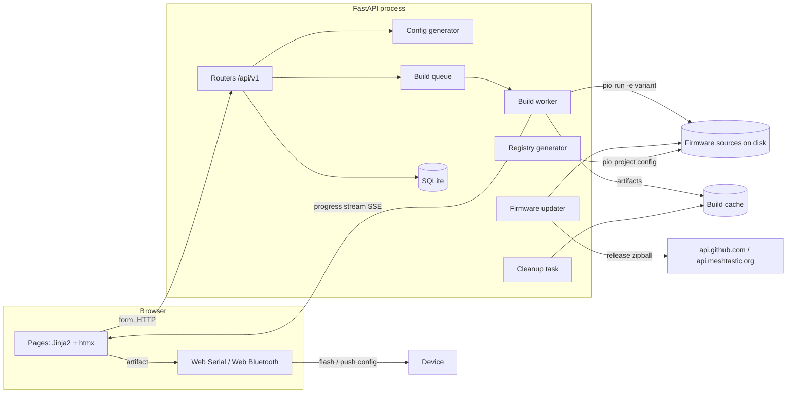
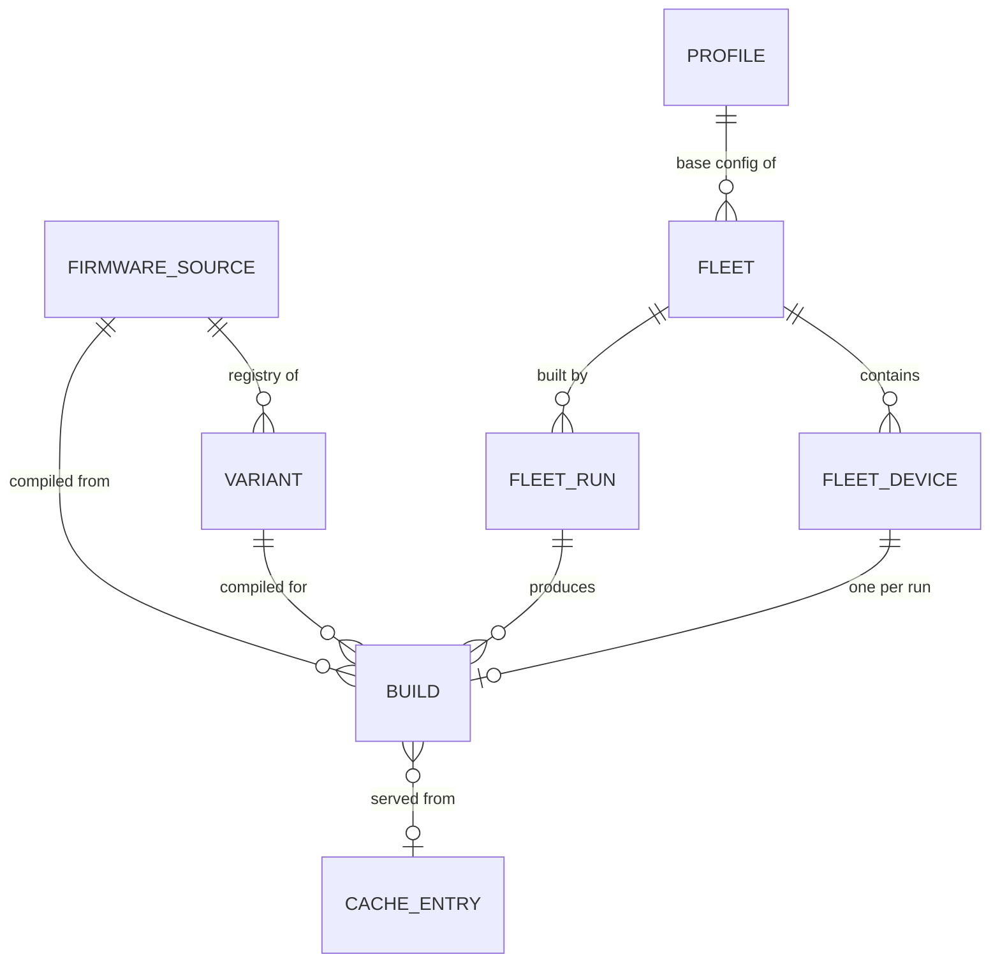
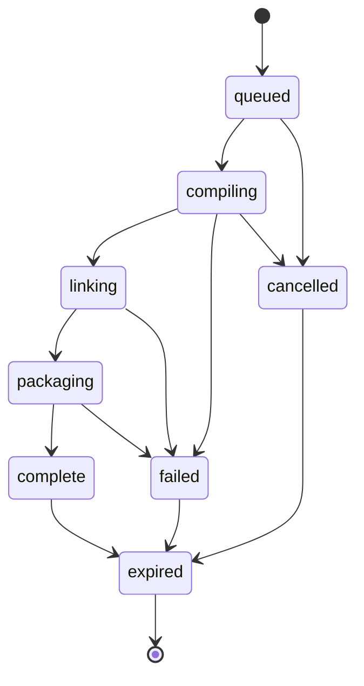

# MTFWBuilder

## Overview

MTFWBuilder is a self-hosted web application for Meshtastic radios. The operator fills
in a form. The project writes a `userPrefs.jsonc` file from the form. The project then
compiles Meshtastic firmware with PlatformIO, and the `userPrefs.jsonc` values are
compiled into the firmware. The operator downloads the firmware and flashes it to the
device.

The project serves three groups:
- the owner, who runs it in a homelab for personal devices;
- self-hosters in the Meshtastic community, who clone the repository and run it;
- event and fleet organizers, who give many devices the same channels and settings.

The official Meshtastic Web Flasher flashes prebuilt firmware only. The Meshtastic CLI
configures a device after it is flashed. No other public tool gives a web interface for
firmware that carries custom defaults. Research on 2026-11-21 found only small
command-line forks (see `pages/inherit-reconciliation.md`).

**Current state (2026-11-21).** The v2 rewrite (FastAPI, March 2026) changed the
backend. It did not change the frontend. Research found that the end-to-end flow does
not work today, for these reasons:
- The pages call v1 URLs that the v2 backend does not serve.
- 71 of the 150 registry ids are not PlatformIO environment names.
- Upstream firmware changed its output file names in December 2025.
- The generator writes many keys that the firmware does not read.

This spec documents the code as it is (`status: built` features 01–04). It then plans the
repair, the update to current upstream firmware, and new capabilities (`status:
planned` features 00 and 05–15). The full reconciliation of documents against code is
in `pages/inherit-reconciliation.md`.

**An important upstream fact.** A `userPrefs.jsonc` value is a factory default. The
firmware applies it on first boot and on factory reset only. After that, the saved
device config wins. To stop a user changing settings, the config must set an admin key
(`USERPREFS_USE_ADMIN_KEY_0`) and `USERPREFS_CONFIG_SECURITY_IS_MANAGED`. Source:
the header of `userPrefs.jsonc` in `meshtastic/firmware` `develop@fe89ac1`.

## Terms

| Term | Part of speech | Meaning in this project | Do not use |
|---|---|---|---|
| project | noun | MTFWBuilder, the whole application this spec describes. | app, tool, system |
| operator | noun | A person who uses the project's web pages to make a config or a build. | user, customer |
| admin | noun | An operator who has signed in with the admin password. Only an admin can change the firmware source or run cleanup. | administrator, superuser |
| device | noun | One physical Meshtastic radio. | node (except in Meshtastic field names), radio unit |
| variant | noun | One PlatformIO environment in the firmware source, for example `heltec-v4`. A variant is what the project compiles. | board, target, model, env |
| registry | noun | The list of variants the project offers, with name, manufacturer, architecture and support level. | device list, catalog |
| architecture | noun | The chip family of a variant: `esp32`, `esp32s3`, `esp32c3`, `esp32c6`, `esp32s2`, `nrf52840`, `nrf54l15`, `rp2040`, `rp2350`, `stm32`. | platform, chip |
| support level | noun | The upstream `board_level` of a variant: `release`, `pr` or `extra`. | tier, status |
| config | noun | The set of setting values that an operator enters for a device. | configuration, settings file, preferences |
| userPrefs file | noun | The `userPrefs.jsonc` file the project writes from a config. The firmware build reads it. | prefs, jsonc |
| userPrefs key | noun | One `USERPREFS_*` name in the userPrefs file. | define, flag, macro |
| admin key | noun | The public key of a device that may change this device's config remotely. The firmware holds three. | admin password |
| managed mode | noun | A device state in which the device rejects local config changes. Only an admin key holder changes the config. | locked mode |
| mesh beacon | noun | A broadcast that a device sends on a schedule, with a message and an offered channel, modem preset and region. | advert, announcement |
| frequency slot | noun | The 1-based number of one LoRa frequency in a region, the same number as `channel_num` in the LoRa config. | frequency index, slot number |
| factory default | noun | A value the firmware applies on first boot and on factory reset only. Every userPrefs key is a factory default. | baked setting, locked setting |
| firmware source | noun | One extracted copy of the `meshtastic/firmware` source tree at one firmware version. | firmware tree, repo copy |
| firmware version | noun | One upstream release tag, for example `v2.7.26.54e0d8d`. | release, tag (alone) |
| release channel | noun | The upstream release track of a firmware version: `stable` or `alpha`, or `pinned` for an exact tag. | channel (alone), track |
| install | verb | To download a firmware source and its packages onto the server. Never used for a device. | download, fetch |
| channel | noun | A Meshtastic channel: index 0–7, name, PSK, precision, uplink, downlink, muted. | room, group |
| PSK | noun | The pre-shared key that encrypts a channel. | password, key (alone) |
| secret | noun | Any config value that gives access: a PSK, a WiFi password, an MQTT password, an admin key. | credential, sensitive data |
| channel URL | noun | A `https://meshtastic.org/e/#…` URL that encodes a ChannelSet protobuf. | share link, QR link |
| build | noun | One compile of one variant with one userPrefs file. A build has a build id and a status. | job, compile run |
| build id | noun | The identifier of one build. | job id, token |
| build status | noun | One of: `queued`, `compiling`, `linking`, `packaging`, `complete`, `failed`, `cancelled`. | state, phase |
| artifact | noun | One file a build produces for the operator, for example `firmware-heltec-v4-2.7.26.54e0d8d.factory.bin`. | output, binary, image |
| build queue | noun | The ordered list of builds that wait for a free build worker. | job queue |
| build worker | noun | The process slot that runs one build at a time. | runner, executor |
| data directory | noun | The one directory that holds all state: firmware sources, artifacts, the database and `config.yaml`. `MTFW_DATA_DIR` sets it. | state dir, volume (alone) |
| build cache | noun | Stored artifacts, keyed by a hash of firmware version, variant and userPrefs file. | artifact store |
| progress stream | noun | The Server-Sent Events (SSE) stream that sends build status and log lines to the page. | event feed, socket |
| scrub | verb | To delete every file that holds a secret, after a build ends. | sanitize, wipe, clean |
| flash | verb | To write an artifact to a device. | burn, install, upload |
| profile | noun | A saved config with a name, stored by the project. | template, preset (alone) |
| fleet | noun | A named group of devices that share one profile and differ in per-device fields. | batch, group |
| fleet run | noun | One request that makes one build for each device in a fleet. | bulk build |
| push config | verb | To send a config to a connected device over Web Serial or Web Bluetooth, without a build. | provision, sync |
| modem preset | noun | A Meshtastic LoRa modem preset, for example `LONG_FAST`. | preset (alone), speed |
| region | noun | A Meshtastic LoRa region code, for example `US`. | country, band |
| role | noun | A Meshtastic device role, for example `CLIENT` or `ROUTER`. | mode, type |
| time zone | noun | An IANA tz database name, for example `America/New_York`. The form sends a time zone. | timezone, tz name |
| POSIX TZ string | noun | The `TZ` value that the firmware gives to `setenv`, for example `EST5EDT,M3.2.0,M11.1.0`. | tz string, timezone string |
| Web Serial | noun | The browser API that opens a USB serial port from a page. | WebUSB |
| SSE | noun | Server-Sent Events: a one-way HTTP stream from server to browser. | websocket |

## Goals

1. An operator makes a config, starts a build, and downloads a working artifact for any
   `release` or `pr` variant of the selected firmware version.
2. Every userPrefs key the project writes is a key the selected firmware version reads.
   A test checks this against the firmware source.
3. The registry comes from the firmware source. No person edits a variant list by hand.
4. The config form covers every userPrefs key that upstream lists, except the keys in
   `Non-goals`.
5. An operator flashes an ESP32-family artifact from the browser in one step.
6. An organizer makes builds for 20 devices in one fleet run.
7. No secret stays on disk after its build ends, on any path: success, failure, timeout
   or cancel.
8. A fresh clone installs, tests, lints and starts with the commands in `CLAUDE.md`, and
   CI runs the same commands on each pull request.

## Non-goals

- A public hosted instance. The project stays self-hosted.
- MeshCore or any mesh firmware other than Meshtastic.
- Native Linux variants (`meshtasticd`, architecture `native`). Their output is not
  flashable.
- Over-the-air (OTA) firmware update.
- Injection of a config into a prebuilt binary without a compile. No upstream mechanism
  exists for it.
- Accounts for operators. The admin password is the only sign-in.
- The userPrefs keys `USERPREFS_UI_TEST_LOG`, `USERPREFS_FIRMWARE_EDITION` and
  `USERPREFS_MESH_BEACON_LEGACY_SPLIT`. They are for upstream testing and vendor editions.

## Users & personas

| Persona | Needs | Allowed to |
|---|---|---|
| Homelab owner | Fast builds for a few personal devices. Correct defaults. | Everything, as admin. |
| Self-hoster | A Docker install that works on first start. Clear setup. | Everything on their own instance. |
| Fleet organizer | One config for many devices, with per-device names, roles and positions. Locked settings. | Create profiles and fleet runs. Download all artifacts. |
| Admin | Change the firmware source. Run cleanup. See build history. | All admin pages and admin API routes. |

An operator who is not signed in can make configs, builds and fleet runs. An admin
changes what firmware versions the instance holds. The project has no other roles.

## Feature map

| Feature set | Spec file | Status | Epic | Mockups |
|---|---|---|---|---|
| Foundation | [features/00-foundation.md](features/00-foundation.md) | planned | Epic 0: Foundation | — |
| Config generator | [features/01-config-generator.md](features/01-config-generator.md) | built | — | — |
| Firmware builder | [features/02-firmware-builder.md](features/02-firmware-builder.md) | built | — | — |
| Device registry | [features/03-device-registry.md](features/03-device-registry.md) | built | — | — |
| Admin | [features/04-admin.md](features/04-admin.md) | built | — | — |
| userPrefs correctness | [features/05-userprefs-correctness.md](features/05-userprefs-correctness.md) | planned | Epic 1: Correct userPrefs | — |
| Build pipeline repair | [features/06-build-pipeline-repair.md](features/06-build-pipeline-repair.md) | planned | Epic 2: Build pipeline repair | — |
| Frontend on htmx | [features/07-frontend-htmx.md](features/07-frontend-htmx.md) | planned | Epic 3: Frontend on htmx | [01-build-page](mockups/01-build-page.html) |
| Platform modernization | [features/08-platform-modernization.md](features/08-platform-modernization.md) | planned | Epic 4: Platform modernization | — |
| Firmware versions | [features/09-firmware-versions.md](features/09-firmware-versions.md) | planned | Epic 5: Firmware versions | [02-firmware-sources](mockups/02-firmware-sources.html) |
| Generated registry | [features/10-generated-registry.md](features/10-generated-registry.md) | planned | Epic 6: Generated registry | [03-device-picker](mockups/03-device-picker.html) |
| Config coverage | [features/11-config-coverage.md](features/11-config-coverage.md) | planned | Epic 7: Config coverage | [04-config-form](mockups/04-config-form.html) |
| Channel share | [features/12-channel-share.md](features/12-channel-share.md) | planned | Epic 8: Channel share | [05-channel-share](mockups/05-channel-share.html) |
| Browser flashing | [features/13-browser-flashing.md](features/13-browser-flashing.md) | planned | Epic 9: Browser flashing | [06-flash](mockups/06-flash.html) |
| Fleet builds | [features/14-fleet-builds.md](features/14-fleet-builds.md) | planned | Epic 10: Profiles and build cache, Epic 11: Fleet runs | [07-fleet](mockups/07-fleet.html) |
| Push config | [features/15-push-config.md](features/15-push-config.md) | planned | Epic 12: Push config | [08-push-config](mockups/08-push-config.html) |

## Architecture & stack

The diagram shows the target architecture after the planned epics. Today the build
worker runs only while a progress stream is open, the cleanup task does not exist, and
the database is not used (see `features/02-firmware-builder.md`).

| Component | Choice | Why |
|---|---|---|
| Web server | FastAPI + uvicorn, one process (`--workers 1`) | Built. Async builds and SSE. One process keeps the build queue in memory without a broker. |
| Pages | Jinja2 templates + htmx 2 + htmx SSE extension, Bootstrap 5.3 | Chosen in the interview: no JavaScript build step. htmx is loaded today but not used. ADR 0002. |
| Browser flashing | ESP Web Tools 10.x / esptool-js 0.7 (Apache-2.0), vendored | Apache-2.0 is compatible with GPL-3.0. The official Web Flasher uses esptool-js. |
| Push config | `@meshtastic/core` + `@meshtastic/transport-web-serial` (GPL-3.0, JSR), or `meshtastic-sdk` JS when it reaches 0.3.0 | The only maintained client libraries. Choice deferred to a spike in Epic 12. |
| Data store | SQLite through aiosqlite | Built (schema only). Zero setup for a self-hoster. ADR 0003. |
| Firmware build | PlatformIO Core 6.2 (`pioarduino` core for ESP32 on firmware 2.8) | Upstream build system. Source: `meshtastic/gh-action-firmware`. |
| Packaging | `pyproject.toml` + hatchling, uv + `uv.lock` (Epic 4) | Interview choice (stack modernization). |
| Runtime | Python 3.13 (Docker and CI; CI also tests 3.14) | `meshtastic` python requires `<3.15`. |
| Deploy | Docker Compose, self-hosted. No hosted instance. | Interview answer: not deployed. |
| Protobuf decode | `meshtastic` python package (GPL-3.0) | Decodes channel URLs and CLI YAML. Allowed by the GPL-3.0 relicense (ADR 0004). |

## Data model

**Built today** (`mtfwbuilder/database.py:8-30`). The project creates two tables at
startup. No code reads or writes them.

| Entity | Fields | Notes |
|---|---|---|
| `builds` | `id` TEXT PK, `variant`, `architecture`, `firmware_format` TEXT NOT NULL, `status` TEXT NOT NULL default `queued`, `firmware_path`, `build_log`, `error_message` TEXT, `created_at` default now, `completed_at` | Unused. Builds live in memory (`app.state.active_builds`). |
| `config_profiles` | `id` INTEGER PK, `name` TEXT NOT NULL, `config_json` TEXT NOT NULL, `created_at`, `updated_at` | Unused. `name` is not unique. |

The registry is a YAML file today (`devices/variants.yaml`, 150 entries, fields `id`,
`name`, `manufacturer`, `architecture`, `pio_platform`).

**Planned.** Each planned feature file states its own fields and migration.

| Entity | Owner feature | Key fields | Lifecycle |
|---|---|---|---|
| FIRMWARE_SOURCE | firmware-versions | `version` PK, `channel` (stable/alpha/pinned), `path`, `installed_at`, `status` | installing → ready → removed |
| VARIANT | generated-registry | `env` + `version` PK, `display_name`, `manufacturer`, `architecture`, `support_level`, `hw_model`, `image`, `requires_dfu` | regenerated when a firmware source becomes ready |
| BUILD | build-pipeline-repair | `id` (random, 128-bit), `version`, `variant`, `status`, `config_hash`, `created_at`, `completed_at`, `error_message`, `fleet_run_id` | queued → compiling → linking → packaging → complete / failed / cancelled → expired |
| CACHE_ENTRY | fleet-builds | `config_hash` PK, `artifact_paths`, `created_at`, `last_used_at` | created on complete, removed by TTL |
| PROFILE | fleet-builds | `id`, `name` UNIQUE, `config_json` without secrets, `created_at`, `updated_at` | created → updated → deleted |
| FLEET | fleet-builds | `id`, `name`, `profile_id` | created → deleted |
| FLEET_DEVICE | fleet-builds | `id`, `fleet_id`, `label`, `variant`, `long_name`, `short_name`, `role`, `fixed_lat`, `fixed_lon`, `fixed_alt`, `admin_key` | created → deleted |
| FLEET_RUN | fleet-builds | `id`, `fleet_id`, `version`, `status`, `created_at` | queued → running → complete / partial / failed |

A build log is not stored in the database. Upstream PlatformIO prints the `-D` build
flags, and those flags hold every secret (see `Risks`).

This is the planned build lifecycle. The `scrub` step runs on every transition into
`complete`, `failed` and `cancelled`.

## Cross-cutting concerns

**Authentication and authorization (built).** The admin password is a bcrypt hash in
`config.yaml`. `POST /admin/login` sets the cookie `mtfw_session`: an itsdangerous
signature of the string `admin`, HttpOnly, SameSite=Lax, max age 3600 s. The cookie sets
`Secure` only when the request scheme is `https`. These routes require the session:
`/api/v1/update-firmware`, `/api/v1/cleanup`, `GET /api/v1/firmware/available`,
`POST /api/v1/firmware/install` and `DELETE /api/v1/firmware/{version}`. The `/admin` page shows a sign-in form when no
session exists.

**CSRF (built, Epic 3).** Each admin form carries the hidden field `csrf_token`. The token
is the value of the cookie `mtfw_csrf`, signed with the same itsdangerous secret key. Sign-in
sets a new `mtfw_csrf` value, so the token belongs to one session. A JSON request and a DELETE
request send the token in the header `X-CSRF-Token`. Each admin POST or DELETE without a
valid token returns 403:
- `/admin/login`
- `/admin/logout`
- `/api/v1/update-firmware`
- `/api/v1/cleanup`
- `POST /api/v1/firmware/install`
- `DELETE /api/v1/firmware/{version}`

**Planned auth changes** (feature `build-pipeline-repair`):
- Build ids are random, so one operator cannot guess another operator's build.

**Validation.** Today the routes read raw JSON. The pydantic models in `models.py` are
not used. Planned: every route validates its body with a pydantic model, and every
enum (region, modem preset, role, GPS mode) comes from one module that matches the
upstream protobufs.

**Errors.** Today the config routes return HTTP 200 with `success: false` and the raw
exception text. Planned: a validation error returns 422 with field errors. An internal
error returns 500 with a generic message and logs the detail.

**Secrets.** A secret is never logged, never stored in the database, never kept in a
cache entry, and never kept in browser storage after the page closes. The project
scrubs the firmware source after every build. The build log sent to the page has every
secret value replaced with `***`.

**Logging.** Standard `logging`, optional JSON format (`MTFW_LOG_JSON`). No `print()`.

**Accessibility.** Every input has a label. The progress stream region has
`aria-live="polite"`. Every icon-only button has an `aria-label`. Colors meet WCAG AA
contrast in light and dark themes.

**i18n.** English only. Not planned.

**Performance.** One build worker by default (`MTFW_BUILD_WORKERS`, default 1). A
PlatformIO build of one ESP32 variant takes several minutes on first build and uses
several GB of disk for toolchains. The build cache returns a repeated build in under
one second.

**Security headers.** nginx sets them in production (`nginx/nginx.conf.example`). The
app sets none. Planned: the app sets `X-Content-Type-Options`, `Referrer-Policy` and a
Content-Security-Policy that allows only vendored scripts.

## Environments & config

| Environment | How it runs | Notes |
|---|---|---|
| local dev | `uvicorn mtfwbuilder.main:app --reload --port 5000` | Firmware source must be installed from `/admin`. |
| Docker | `docker compose up -d` | Port 5000. Volumes for firmware sources and PlatformIO toolchains. |
| Docker + nginx | `docker compose -f docker-compose.yml -f docker-compose.prod.yml up -d` | TLS on nginx. Needed for Web Serial on a LAN host. |

Settings come from `config.yaml` and from `MTFW_*` environment variables. Values in
`config.yaml` win over environment variables (`mtfwbuilder/config.py:58-116`). The full
list of names is in `docs/external.md`. Names only; no values are in this repository.

Seed data: none. The registry and the firmware source come from upstream at runtime.
Planned: a test fixture holds a small firmware source subset (a few variant
`platformio.ini` files and `userPrefs.jsonc`) so tests run without a download.

## Testing strategy

- **Unit:** pytest, `asyncio_mode = "auto"`. 106 tests at the inherit (2026-11-21, `bd15bb1`);
  the suite grows with each epic.
- **Contract tests (planned):** the userPrefs keys the generator writes are a subset of
  the keys the fixture firmware source reads. The registry fixture matches
  `pio project config --json-output` output.
- **Integration (planned):** route tests through httpx for every `/api/v1` route,
  including the progress stream. A fake `pio` executable stands in for PlatformIO.
- **E2E smoke (planned):** Playwright loads each page, fills the config form, starts a
  build against the fake `pio`, and downloads the artifact.
- **Real build (planned, manual or scheduled CI):** one real `pio run` of one ESP32 and
  one nRF52 variant.
- A change is done when `uv run pytest`, `uv run ruff check`, and `uv run ruff format
  --check` pass, and the E2E smoke passes for any change under `templates/` or `static/`.

## Epics

| # | Epic | Goal | Feature files | Depends on | Exit criteria |
|---|---|---|---|---|---|
| 0 | Foundation | CI, branch model, lint rules, test isolation, license, v1 removal | 00-foundation | — | CI runs on each PR to `dev`. Tests do not write to the repository. |
| 1 | Correct userPrefs | The generator writes only keys the firmware reads | 05-userprefs-correctness | 0 | A contract test passes against the fixture firmware source. |
| 2 | Build pipeline repair | A build runs to an artifact without a page attached, and scrubs on every path | 06-build-pipeline-repair | 0 | A fake-pio build completes, and its artifact downloads. No userPrefs file remains. |
| 3 | Frontend on htmx | The pages use the v2 API, the progress stream and admin sign-in | 07-frontend-htmx | 1, 2 | The E2E smoke passes. |
| 4 | Platform modernization | Python 3.13, uv, current dependencies, correct Docker volumes and nginx | 08-platform-modernization | 0 | `docker compose up` gives a working instance that keeps state across a restart. |
| 5 | Firmware versions | Hold several firmware versions, choose one per build | 09-firmware-versions | 2 | An admin installs stable and alpha. A build names its firmware version. |
| 6 | Generated registry | The registry comes from the firmware source metadata | 10-generated-registry | 5 | `devices/variants.yaml` is deleted. The picker shows every `release` and `pr` variant. |
| 7 | Config coverage | The form covers the upstream userPrefs keys | 11-config-coverage | 1, 3 | Every in-scope key has a form control and a test. |
| 8 | Channel share | Import and export channel URLs, QR codes and CLI YAML | 12-channel-share | 7 | A round trip of a channel URL gives the same channels. |
| 9 | Browser flashing | Flash ESP32-family artifacts from the page | 13-browser-flashing | 3 | A Chrome page flashes a factory artifact to a connected ESP32. |
| 10 | Profiles and build cache | Saved profiles and artifact reuse by config hash | 14-fleet-builds (FR 1–9) | 2, 7 | A repeated build returns from the build cache. |
| 11 | Fleet runs | One fleet run makes one build per device | 14-fleet-builds (FR 10–20) | 10 | A fleet run of 3 devices gives 3 artifacts and one zip. |
| 12 | Push config | Push a config to a device without a build | 15-push-config | 7, 9 | A Chrome page sets channels on a connected device over Web Serial. |

## Milestones

1. **M1 — Works again** (Epics 0–3). The documented flow works end to end on the
   firmware version that `releases/latest` returns. Shippable: tag `v2.1.0`.
2. **M2 — Current upstream** (Epics 4–7). Current stack, chosen firmware versions, a
   generated registry, and full config coverage. Shippable: tag `v3.0.0`.
3. **M3 — Fewer steps** (Epics 8–9). Channel share and browser flashing. Tag `v3.1.0`.
4. **M4 — Fleets** (Epics 10–11). Tag `v3.2.0`.
5. **M5 — No compile** (Epic 12). Tag `v3.3.0`.

## Assumptions

- The repair targets the firmware version that `releases/latest` returns
  (`v2.7.26.54e0d8d` on 2026-11-21). Firmware 2.8 support arrives with Epic 5.
- Python 3.13 is the target runtime. Python 3.14 is possible, but the `meshtastic`
  python package requires `<3.15`, and 3.13 gives more margin.
- One build worker is the default. A homelab machine cannot run two ESP32 compiles at
  once without heavy swap.
- Builds by operators who are not signed in stay allowed. The instance is self-hosted
  and trusted.
- The fixture firmware source for tests is a hand-picked subset copied from upstream
  under GPL-3.0, which the relicense allows.
- Web Serial works only on HTTPS or `localhost`. The docs tell a LAN self-hoster to use
  the nginx overlay with TLS.
- The `meshtastic.org/e/#` channel URL format is stable across 2.7 and 2.8 firmware.
- Reconstructed ADRs (0001–0003) record choices made in 2025–2026. Their context is
  reconstructed from the code and commit log, not from records of the time.

## Risks & open questions

**Contradictions between documents and code** (the code is the fact):
1. README says 62 variants. The registry holds 150. The README is stale since commit
   `e575ce7`.
2. README links a LICENSE file. No LICENSE file exists. `pyproject.toml` says MIT.
   Resolved in the interview: relicense to GPL-3.0 (ADR 0004).
3. README says the database stores build history and profiles. No code reads or writes
   the database.
4. README says the frontend uses htmx. No template uses an `hx-` attribute.
5. README describes real-time build progress. The build page never opens the progress
   stream, and it calls v1 URLs.
6. README says the admin panel needs the admin password. The page has no sign-in form.
7. README says builds clean up after 1 hour. No periodic task exists.
8. README says secrets are scrubbed from artifacts. Scrub runs on success only, and
   `.elf` and object files keep the values.
9. README says uploads are validated as JSON. Only size and UTF-8 are checked.
10. CONTRIBUTING says the `id` must match a PlatformIO environment. 71 ids do not.
11. `pyproject.toml` and CONTRIBUTING say Python 3.10+. The code needs 3.11
    (`asyncio.timeout`, `build_service.py:80`).
12. The README volume table names paths the app does not write to
    (`docker-compose.yml`; see `features/02-firmware-builder.md`).
13. `docker.env.example` and `docker-deploy.sh cleanup` use v1 names and routes.

**Risks:**
- **Router roles are not factory defaults.** Upstream replaces a userPrefs role of
  `ROUTER`, `ROUTER_LATE` or `LOST_AND_FOUND` with `CLIENT`
  (`src/mesh/NodeDB.cpp:1180-1188`). A fleet of routers needs push config (Epic 12)
  after the flash. Features 11 and 14 reject those roles with a clear message.
- **Secrets in build logs.** Upstream `bin/platformio-custom.py` prints every `-D`
  flag, and the flags hold PSKs and passwords. The progress stream sends the last 100
  log lines. Mitigation: mask in feature 06.
- **Upstream churn.** Upstream changes userPrefs keys, artifact names and toolchains
  without notice. Mitigation: contract tests against the fixture firmware source, and a
  scheduled CI job against upstream `develop`.
- **JS client library in flux.** `meshtastic/js` is archived. `meshtastic-sdk` JS is
  "snapshot only until 0.3.0". Epic 12 starts with a spike to choose.
- **Disk use.** Each firmware version plus its toolchains uses several GB. Mitigation: an
  admin removes firmware versions from the firmware sources page.
- **ESP32 2.8 toolchain.** Firmware 2.8 uses the pioarduino platform and fetches ESP-IDF
  components at build time. Network errors fail builds. Mitigation: retry, as upstream
  `bin/build-esp32.sh` does.

**Open questions:** none block approval.

## Issue map

Written by `/spec-to-issues` on 2026-11-21.

| Epic | Epic issue | Sub-issues |
|---|---|---|
| 0 Foundation | #4 | #5, #6, #7, #8, #9 |
| 1 Correct userPrefs | #10 | #11, #12, #13, #14, #15 |
| 2 Build pipeline repair | #16 | #17, #18, #19, #20, #21 |
| 3 Frontend on htmx | #22 | #23, #24, #25, #26, #27 |
| 4 Platform modernization | #28 | #29, #30, #31, #32 |
| 5 Firmware versions | #33 | #34, #35, #36, #37, #38 |
| 6 Generated registry | #39 | #40, #41, #42, #43 |
| 7 Config coverage | #44 | #45, #46, #47, #48, #49, #50 |
| 8 Channel share | #51 | #52, #53, #54, #55 |
| 9 Browser flashing | #56 | #57, #58, #59 |
| 10 Profiles and build cache | #60 | #61, #62, #63, #64 |
| 11 Fleet runs | #65 | #66, #67, #68, #69 |
| 12 Push config | #70 | #71, #72, #73, #74 |

| Requirement | Issues |
|---|---|
| FR-foundation-1 | #5 |
| FR-foundation-2 | #5 |
| FR-foundation-3 | #5 |
| FR-foundation-8 | #5 |
| FR-foundation-4 | #6 |
| FR-foundation-5 | #6 |
| FR-foundation-6 | #7 |
| FR-foundation-7 | #7 |
| FR-foundation-9 | #8 |
| FR-foundation-10 | #8 |
| FR-foundation-11 | #9 |
| FR-foundation-12 | #9 |
| FR-foundation-13 | #9 |
| FR-foundation-14 | #9 |
| FR-userprefs-correctness-16 | #11 |
| FR-userprefs-correctness-11 | #11 |
| FR-userprefs-correctness-12 | #11 |
| FR-userprefs-correctness-14 | #11 |
| FR-userprefs-correctness-1 | #12 |
| FR-userprefs-correctness-2 | #12 |
| FR-userprefs-correctness-4 | #12 |
| FR-userprefs-correctness-5 | #12 |
| FR-userprefs-correctness-6 | #12 |
| FR-userprefs-correctness-7 | #12 |
| FR-userprefs-correctness-8 | #12 |
| FR-userprefs-correctness-3 | #13 |
| FR-userprefs-correctness-9 | #13 |
| FR-userprefs-correctness-13 | #13 |
| FR-userprefs-correctness-10 | #14 |
| FR-userprefs-correctness-15 | #15 |
| FR-build-pipeline-repair-19 | #17 |
| FR-build-pipeline-repair-20 | #17 |
| FR-build-pipeline-repair-21 | #17 |
| FR-build-pipeline-repair-1 | #18 |
| FR-build-pipeline-repair-2 | #18 |
| FR-build-pipeline-repair-3 | #18 |
| FR-build-pipeline-repair-4 | #18 |
| FR-build-pipeline-repair-5 | #18 |
| FR-build-pipeline-repair-6 | #18 |
| FR-build-pipeline-repair-7 | #18 |
| FR-build-pipeline-repair-9 | #18 |
| FR-build-pipeline-repair-8 | #19 |
| FR-build-pipeline-repair-17 | #19 |
| FR-build-pipeline-repair-18 | #19 |
| FR-build-pipeline-repair-10 | #20 |
| FR-build-pipeline-repair-11 | #20 |
| FR-build-pipeline-repair-12 | #20 |
| FR-build-pipeline-repair-13 | #20 |
| FR-build-pipeline-repair-14 | #21 |
| FR-build-pipeline-repair-15 | #21 |
| FR-build-pipeline-repair-16 | #21 |
| FR-frontend-htmx-15 | #23 |
| FR-frontend-htmx-16 | #23 |
| FR-frontend-htmx-17 | #23 |
| FR-frontend-htmx-19 | #23 |
| FR-frontend-htmx-1 | #24 |
| FR-frontend-htmx-2 | #24 |
| FR-frontend-htmx-3 | #24 |
| FR-frontend-htmx-4 | #24 |
| FR-frontend-htmx-5 | #24 |
| FR-frontend-htmx-6 | #24 |
| FR-frontend-htmx-18 | #24 |
| FR-frontend-htmx-7 | #25 |
| FR-frontend-htmx-8 | #25 |
| FR-frontend-htmx-9 | #25 |
| FR-frontend-htmx-10 | #25 |
| FR-frontend-htmx-20 | #25 |
| FR-frontend-htmx-11 | #26 |
| FR-frontend-htmx-12 | #26 |
| FR-frontend-htmx-13 | #26 |
| FR-frontend-htmx-14 | #26 |
| FR-platform-modernization-1 | #29 |
| FR-platform-modernization-2 | #29 |
| FR-platform-modernization-3 | #29 |
| FR-platform-modernization-4 | #30 |
| FR-platform-modernization-5 | #30 |
| FR-platform-modernization-6 | #30 |
| FR-platform-modernization-7 | #30 |
| FR-platform-modernization-8 | #30 |
| FR-platform-modernization-9 | #31 |
| FR-platform-modernization-10 | #31 |
| FR-platform-modernization-11 | #31 |
| FR-platform-modernization-12 | #31 |
| FR-platform-modernization-13 | #31 |
| FR-platform-modernization-14 | #32 |
| FR-platform-modernization-15 | #32 |
| FR-firmware-versions-4 | #34 |
| FR-firmware-versions-9 | #34 |
| FR-firmware-versions-1 | #35 |
| FR-firmware-versions-2 | #35 |
| FR-firmware-versions-3 | #36 |
| FR-firmware-versions-5 | #36 |
| FR-firmware-versions-6 | #36 |
| FR-firmware-versions-7 | #36 |
| FR-firmware-versions-8 | #36 |
| FR-firmware-versions-10 | #37 |
| FR-firmware-versions-11 | #37 |
| FR-firmware-versions-12 | #37 |
| FR-firmware-versions-13 | #38 |
| FR-generated-registry-1 | #40 |
| FR-generated-registry-2 | #40 |
| FR-generated-registry-3 | #40 |
| FR-generated-registry-4 | #40 |
| FR-generated-registry-5 | #40 |
| FR-generated-registry-6 | #40 |
| FR-generated-registry-7 | #40 |
| FR-generated-registry-14 | #40 |
| FR-generated-registry-13 | #41 |
| FR-generated-registry-15 | #41 |
| FR-generated-registry-8 | #42 |
| FR-generated-registry-9 | #42 |
| FR-generated-registry-10 | #42 |
| FR-generated-registry-11 | #42 |
| FR-generated-registry-12 | #42 |
| FR-generated-registry-16 | #43 |
| FR-config-coverage-1 | #45 |
| FR-config-coverage-2 | #45 |
| FR-config-coverage-3 | #45 |
| FR-config-coverage-4 | #45 |
| FR-config-coverage-4a | #45 |
| FR-config-coverage-16 | #46 |
| FR-config-coverage-5 | #47 |
| FR-config-coverage-6 | #47 |
| FR-config-coverage-7 | #47 |
| FR-config-coverage-10 | #47 |
| FR-config-coverage-8 | #48 |
| FR-config-coverage-9 | #48 |
| FR-config-coverage-11 | #48 |
| FR-config-coverage-12 | #48 |
| FR-config-coverage-14 | #48 |
| FR-config-coverage-13 | #49 |
| FR-config-coverage-15 | #50 |
| FR-config-coverage-17 | #50 |
| FR-config-coverage-18 | #50 |
| FR-channel-share-1 | #52 |
| FR-channel-share-2 | #52 |
| FR-channel-share-3 | #52 |
| FR-channel-share-12 | #52 |
| FR-channel-share-4 | #53 |
| FR-channel-share-5 | #53 |
| FR-channel-share-6 | #53 |
| FR-channel-share-11 | #53 |
| FR-channel-share-9 | #54 |
| FR-channel-share-10 | #54 |
| FR-channel-share-7 | #55 |
| FR-channel-share-8 | #55 |
| FR-browser-flashing-1 | #57 |
| FR-browser-flashing-2 | #57 |
| FR-browser-flashing-11 | #57 |
| FR-browser-flashing-12 | #57 |
| FR-browser-flashing-13 | #57 |
| FR-browser-flashing-3 | #58 |
| FR-browser-flashing-4 | #58 |
| FR-browser-flashing-5 | #58 |
| FR-browser-flashing-6 | #58 |
| FR-browser-flashing-7 | #58 |
| FR-browser-flashing-8 | #58 |
| FR-browser-flashing-9 | #58 |
| FR-browser-flashing-10 | #59 |
| FR-fleet-builds-1 | #61, #63 |
| FR-fleet-builds-2 | #61 |
| FR-fleet-builds-4 | #61, #63 |
| FR-fleet-builds-3 | #62 |
| FR-fleet-builds-5 | #64 |
| FR-fleet-builds-6 | #64 |
| FR-fleet-builds-7 | #64 |
| FR-fleet-builds-8 | #64 |
| FR-fleet-builds-9 | #64 |
| FR-fleet-builds-10 | #66 |
| FR-fleet-builds-11 | #66 |
| FR-fleet-builds-14 | #66 |
| FR-fleet-builds-12 | #67 |
| FR-fleet-builds-13 | #67 |
| FR-fleet-builds-15 | #68 |
| FR-fleet-builds-17 | #68 |
| FR-fleet-builds-18 | #68 |
| FR-fleet-builds-16 | #69 |
| FR-fleet-builds-19 | #69 |
| FR-fleet-builds-20 | #69 |
| FR-push-config-1 | #71 |
| FR-push-config-2 | #72 |
| FR-push-config-3 | #72 |
| FR-push-config-11 | #72 |
| FR-push-config-4 | #73 |
| FR-push-config-5 | #73 |
| FR-push-config-6 | #73 |
| FR-push-config-7 | #74 |
| FR-push-config-8 | #74 |
| FR-push-config-9 | #74 |
| FR-push-config-10 | #74 |
| FR-push-config-12 | #74 |

## Changelog

- 2026-11-21 — Draft written by `/project-inherit` from a full repository survey, two
  upstream research spikes, and three interview rounds.
- 2026-11-21 — Review round 1: approved. Corrections before approval: the admin key
  key name (`USERPREFS_USE_ADMIN_KEY_<n>` holds the key), router roles rejected as
  factory defaults, an interim registry id fix in Epic 2, and the `.gitignore`
  `firmware/` pattern.
- 2026-11-21 — `/spec-to-issues`: 13 epics (#4–#70) and 58 sub-issues created. See `## Issue map`.
- 2026-11-21 — Epic 0 shipped (#82). Batch ruling: the generic ruff criterion on each Epic 0 sub-issue was checked at the batch gate, after #7. Out-of-plan fix accepted in #80: Starlette 1.10 needs `TemplateResponse(request, name, context)`; every page returned 500 before it. `dev` is now the repository default branch.
- 2026-11-21 — Epic 1 shipped (#92). PM decision, flagged for the owner: the event mode select defaults to Disabled (#13), so a form left at its defaults does not turn event mode on. The contract test found that firmware v2.7.26 reads no `USERPREFS_CHANNEL_3_*` key; the generator writes channel slots 0–2 only until #47. The build route still skips `ConfigRequest`: filed as #94 in epic #16.
- 2026-11-21 — Epic 2 shipped (#102). PM decision from the batch review, flagged for the owner: the project sets no shared PlatformIO build cache and the scrub deletes `.pio/build_cache`, because the cache keeps objects compiled with secrets (Goal 7). Each build then compiles from the start; toolchains stay cached. `config_hash` is an HMAC with `secret_key`. Follow-up #88 (more than one build worker) stays open.
- 2026-11-21 — Epic 4 shipped (#112). Batch review fixes: the data-directory move respects path overrides and scrubs an old firmware tree it keeps; production trusts only the nginx network for `X-Forwarded-For`; nginx repeats its security headers in each block. Terms: added `release channel` and `install` (the word `channel` alone means a Meshtastic channel).
- 2026-11-21 — Epic 3 shipped (#124). Milestone M1 (Works again) is complete. Additions accepted at the batch gate: `GET /api/v1/builds/{id}`, `config_source=form`, and `?log_from=` on the progress stream. CSRF covers sign-in and sign-out too. Not built from the Screens table: the build queue position and the elapsed time.
- 2026-11-21 — Epic 5 shipped (#132). PM decisions: the default firmware version falls back to the newest installed version of any release channel when no stable one is installed; `require_csrf` accepts the `X-CSRF-Token` header; `GET /api/v1/firmware/available` has no CSRF (read-only); the startup cleanup may remove a half-imported old firmware source after a crash (it is downloadable again).
